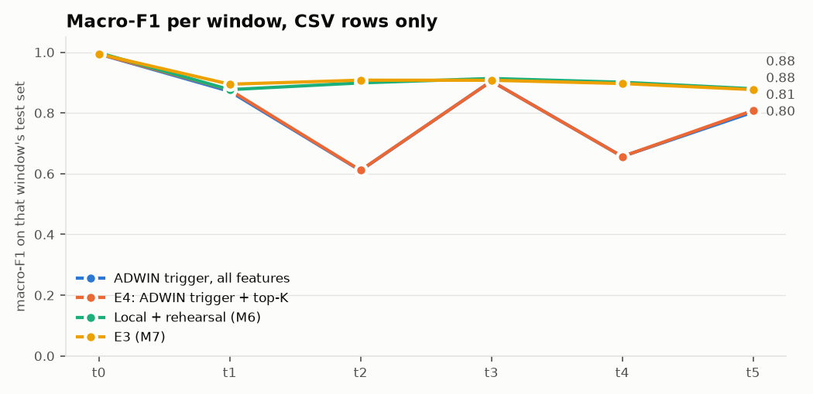

# M9: E4, drift-triggered updates, top-K features, adaptive gate (`dev` pool)

Run `20261107-123104_m9_e4_dev`. Generated by `scripts/m9_e4.py`. Seed 42. Scores use CSV-only rows (D7). Rows reach a client in 10 rounds per window, in random order, because the dataset has no timestamps. Between its update and the next g_t, a client uses its own calibrated output. Top-K limits new trees; older trees keep their splits, so inference still needs every feature.

## Results

| method | window avg | avg excl. t0 | final (t5) | SD over t1 to t5 | class forgetting |
|---|---:|---:|---:|---:|---:|
| Fixed schedule, all features (reproduces E3) | 0.9130 | 0.8968 | 0.8768 | 0.0127 | 0.0323 |
| Fixed schedule, all features (reproduces E3), client guard | 0.9158 | 0.8995 | 0.8822 | 0.0119 | 0.0286 |
| Fixed schedule, top-10 | 0.9014 | 0.8827 | 0.8617 | 0.0139 | 0.0339 |
| Fixed schedule, top-10, client guard | 0.9062 | 0.8879 | 0.8696 | 0.0148 | 0.0358 |
| Fixed schedule, top-20 | 0.9080 | 0.8907 | 0.8716 | 0.0136 | 0.0311 |
| Fixed schedule, top-20, client guard | 0.9117 | 0.8944 | 0.8780 | 0.0143 | 0.0313 |
| Fixed schedule, top-30 | 0.9127 | 0.8963 | 0.8772 | 0.0137 | 0.0323 |
| Fixed schedule, top-30, client guard | 0.9150 | 0.8984 | 0.8826 | 0.0126 | 0.0289 |
| ADWIN trigger, all features | 0.8066 | 0.7691 | 0.8025 | 0.1302 | -0.0808 |
| ADWIN trigger, all features, client guard | 0.8860 | 0.8637 | 0.8467 | 0.0314 | 0.0138 |
| Trigger on disagreement, all features | 0.6818 | 0.6194 | 0.6517 | 0.1693 | 0.0238 |
| Trigger on disagreement, all features, client guard | 0.7223 | 0.6673 | 0.7118 | 0.1462 | -0.0334 |
| E4: ADWIN trigger + top-K | 0.8085 | 0.7713 | 0.8081 | 0.1313 | -0.0885 |
| E4: ADWIN trigger + top-K, client guard | 0.8864 | 0.8641 | 0.8449 | 0.0322 | 0.0154 |
| ADWIN trigger added to the fixed schedule, top-K | 0.9079 | 0.8906 | 0.8731 | 0.0135 | 0.0323 |
| ADWIN trigger added to the fixed schedule, top-K, client guard | 0.9129 | 0.8959 | 0.8803 | 0.0131 | 0.0324 |
| Local + rehearsal (M6) | 0.9114 | 0.8940 | 0.8796 | 0.0155 | 0.0270 |
| E3 (M7) | 0.9130 | 0.8968 | 0.8768 | 0.0127 | 0.0323 |
| E3 (M7), client guard | 0.9158 | 0.8995 | 0.8822 | 0.0119 | 0.0286 |

Check against M7: `fixed` scores 0.91298 on window average and E3 in M7's report 0.91298 (difference +0.00000).

## Recovery inside each window

For E3, the old model and its g_t serve until the window ends. `mean over rounds` is macro-F1 averaged over the rounds of the window, with the window-end model as the last of them. `first trigger round` is the earliest over clients. Read the time to E3's earlier score: a method that already fell before the boundary reaches its own lower score sooner, which isn't a better recovery.

| method | window | own score before the boundary | old model on new rows | after window | mean over rounds | rounds to reach E3's earlier score (share of window) | rounds to reach its own (share of window) | first trigger round |
|---|---|---:|---:|---:|---:|---:|---:|---:|
| E3 (M7) | t1 | 0.994 | 0.451 | 0.895 | 0.491 | not in this window | not in this window | none |
| E3 (M7) | t2 | 0.895 | 0.593 | 0.908 | 0.622 | 1.0 | 1.0 | none |
| E3 (M7) | t3 | 0.908 | 0.488 | 0.908 | 0.526 | 1.0 | 1.0 | none |
| E3 (M7) | t4 | 0.908 | 0.652 | 0.897 | 0.675 | 1.0 | 1.0 | none |
| E3 (M7) | t5 | 0.897 | 0.814 | 0.877 | 0.820 | 1.0 | 1.0 | none |
| Fixed schedule, all features (reproduces E3) | t1 | 0.994 | 0.451 | 0.895 | 0.491 | not in this window | not in this window | none |
| Fixed schedule, all features (reproduces E3) | t2 | 0.895 | 0.593 | 0.908 | 0.622 | 1.0 | 1.0 | none |
| Fixed schedule, all features (reproduces E3) | t3 | 0.908 | 0.488 | 0.908 | 0.526 | 1.0 | 1.0 | none |
| Fixed schedule, all features (reproduces E3) | t4 | 0.908 | 0.652 | 0.897 | 0.675 | 1.0 | 1.0 | none |
| Fixed schedule, all features (reproduces E3) | t5 | 0.897 | 0.814 | 0.877 | 0.820 | 1.0 | 1.0 | none |
| ADWIN trigger, all features | t1 | 0.994 | 0.451 | 0.871 | 0.811 | not in this window | not in this window | 1 |
| ADWIN trigger, all features | t2 | 0.871 | 0.580 | 0.610 | 0.771 | not in this window | not in this window | 1 |
| ADWIN trigger, all features | t3 | 0.610 | 0.346 | 0.905 | 0.844 | 0.1 | 0.1 | 1 |
| ADWIN trigger, all features | t4 | 0.905 | 0.652 | 0.657 | 0.791 | not in this window | not in this window | 1 |
| ADWIN trigger, all features | t5 | 0.657 | 0.615 | 0.803 | 0.708 | not in this window | 0.1 | 1 |
| Trigger on disagreement, all features | t1 | 0.994 | 0.451 | 0.451 | 0.451 | not in this window | not in this window | none |
| Trigger on disagreement, all features | t2 | 0.451 | 0.259 | 0.479 | 0.545 | not in this window | 0.1 | 1 |
| Trigger on disagreement, all features | t3 | 0.479 | 0.245 | 0.874 | 0.735 | not in this window | 0.1 | 1 |
| Trigger on disagreement, all features | t4 | 0.874 | 0.641 | 0.642 | 0.641 | not in this window | not in this window | none |
| Trigger on disagreement, all features | t5 | 0.642 | 0.599 | 0.652 | 0.682 | not in this window | 0.1 | 1 |
| E4: ADWIN trigger + top-K | t1 | 0.994 | 0.451 | 0.876 | 0.811 | not in this window | not in this window | 1 |
| E4: ADWIN trigger + top-K | t2 | 0.876 | 0.592 | 0.611 | 0.776 | not in this window | not in this window | 1 |
| E4: ADWIN trigger + top-K | t3 | 0.611 | 0.349 | 0.905 | 0.845 | 0.1 | 0.1 | 1 |
| E4: ADWIN trigger + top-K | t4 | 0.905 | 0.652 | 0.657 | 0.789 | not in this window | not in this window | 1 |
| E4: ADWIN trigger + top-K | t5 | 0.657 | 0.609 | 0.808 | 0.707 | not in this window | 0.1 | 1 |
| ADWIN trigger added to the fixed schedule, top-K | t1 | 0.994 | 0.451 | 0.883 | 0.812 | not in this window | not in this window | 1 |
| ADWIN trigger added to the fixed schedule, top-K | t2 | 0.883 | 0.596 | 0.905 | 0.797 | 1.0 | 1.0 | 1 |
| ADWIN trigger added to the fixed schedule, top-K | t3 | 0.905 | 0.480 | 0.903 | 0.843 | 1.0 | 1.0 | 1 |
| ADWIN trigger added to the fixed schedule, top-K | t4 | 0.903 | 0.650 | 0.889 | 0.811 | 1.0 | 1.0 | 1 |
| ADWIN trigger added to the fixed schedule, top-K | t5 | 0.889 | 0.803 | 0.873 | 0.835 | not in this window | 1.0 | 1 |

## Cost

| method | local updates | clients updated, by window | uplink float32 (MB) | uplink 8-bit + zlib (MB) | downlink (kB) | local minutes |
|---|---:|---|---:|---:|---:|---:|
| Fixed schedule, all features (reproduces E3) | 90 | 15 15 15 15 15 15 | 22.6 | 1.6 | 35.6 | 2.2 |
| Fixed schedule, top-10 | 90 | 15 15 15 15 15 15 | 22.6 | 1.7 | 35.6 | 2.7 |
| Fixed schedule, top-20 | 90 | 15 15 15 15 15 15 | 22.6 | 1.6 | 35.6 | 2.7 |
| Fixed schedule, top-30 | 90 | 15 15 15 15 15 15 | 22.6 | 1.6 | 35.6 | 2.4 |
| ADWIN trigger, all features | 97 | 15 14 3 15 4 5 | 13.3 | 0.9 | 35.6 | 2.0 |
| Trigger on disagreement, all features | 58 | 15 0 6 12 0 4 | 10.4 | 0.5 | 35.6 | 1.3 |
| E4: ADWIN trigger + top-K | 97 | 15 14 3 15 4 5 | 13.3 | 0.9 | 35.6 | 2.5 |
| ADWIN trigger added to the fixed schedule, top-K | 127 | 15 15 15 15 15 15 | 22.6 | 1.6 | 35.6 | 3.5 |

## K sweep, fixed schedule

| K | mean validation macro-F1 | window avg (test) | final t5 (test) | picked |
|---:|---:|---:|---:|---|
| 10 | 0.9033 | 0.9014 | 0.8617 |  |
| 20 | 0.9119 | 0.9080 | 0.8716 |  |
| 30 | 0.9178 | 0.9127 | 0.8772 | yes |

## Adaptive gate: choosing the strength

| method | strength | mean errors caught, next window | fixed gate at the same cost | mean escalated, next window | picked on validation rows |
|---|---:|---:|---:|---:|---|
| Fixed schedule, all features (reproduces E3) | 0 | 0.233 | 0.233 | 0.106 | yes |
| Fixed schedule, all features (reproduces E3) | 1 | 0.249 | 0.247 | 0.111 |  |
| Fixed schedule, all features (reproduces E3) | 2 | 0.270 | 0.263 | 0.119 |  |
| Fixed schedule, all features (reproduces E3) | 4 | 0.316 | 0.317 | 0.143 |  |
| Fixed schedule, all features (reproduces E3) | 8 | 0.387 | 0.411 | 0.207 |  |
| Fixed schedule, all features (reproduces E3) | 16 | 0.445 | 0.502 | 0.324 |  |
| E4: ADWIN trigger + top-K | 0 | 0.215 | 0.215 | 0.097 | yes |
| E4: ADWIN trigger + top-K | 1 | 0.223 | 0.221 | 0.101 |  |
| E4: ADWIN trigger + top-K | 2 | 0.237 | 0.232 | 0.107 |  |
| E4: ADWIN trigger + top-K | 4 | 0.256 | 0.255 | 0.118 |  |
| E4: ADWIN trigger + top-K | 8 | 0.284 | 0.305 | 0.146 |  |
| E4: ADWIN trigger + top-K | 16 | 0.326 | 0.356 | 0.186 |  |

## Gate on test rows

`thresholds_only` is M7's gate. `fixed` adds the proposal's ADWIN flag and equals the adaptive gate at a score of 0. `psi_flag` is the D8 sensitivity run, not a headline. Target 10% (D10). Shown for E3's schedule and E4, at the picked strength; if that is 0, adaptive rows don't appear. All strengths and methods are in `gate_test.csv`. `fixed gate at the same cost` is the errors a fixed gate catches when loosened to the same escalation rate, on the same rows, so it shows whether the drift score adds anything over a looser threshold.

| method | model through | eval window | error rate | mode | strength | escalated | errors caught | fixed gate at the same cost | accuracy on the rest |
|---|---|---|---:|---|---:|---:|---:|---:|---:|
| Fixed schedule, all features (reproduces E3) | t0 | t0 | 0.003 | thresholds_only |  | 0.008 | 0.846 |  | 1.000 |
| Fixed schedule, all features (reproduces E3) | t0 | t0 | 0.003 | psi_flag |  | 0.008 | 0.846 |  | 1.000 |
| Fixed schedule, all features (reproduces E3) | t0 | t0 | 0.003 | fixed | 0 | 0.008 | 0.846 | 0.846 | 1.000 |
| Fixed schedule, all features (reproduces E3) | t0 | t1 | 0.730 | thresholds_only |  | 0.016 | 0.019 |  | 0.272 |
| Fixed schedule, all features (reproduces E3) | t0 | t1 | 0.730 | psi_flag |  | 0.938 | 0.979 |  | 0.750 |
| Fixed schedule, all features (reproduces E3) | t0 | t1 | 0.730 | fixed | 0 | 0.016 | 0.019 | 0.019 | 0.272 |
| Fixed schedule, all features (reproduces E3) | t1 | t1 | 0.110 | thresholds_only |  | 0.074 | 0.292 |  | 0.916 |
| Fixed schedule, all features (reproduces E3) | t1 | t1 | 0.110 | psi_flag |  | 0.074 | 0.292 |  | 0.916 |
| Fixed schedule, all features (reproduces E3) | t1 | t1 | 0.110 | fixed | 0 | 0.074 | 0.292 | 0.292 | 0.916 |
| Fixed schedule, all features (reproduces E3) | t1 | t2 | 0.165 | thresholds_only |  | 0.098 | 0.357 |  | 0.882 |
| Fixed schedule, all features (reproduces E3) | t1 | t2 | 0.165 | psi_flag |  | 0.098 | 0.357 |  | 0.882 |
| Fixed schedule, all features (reproduces E3) | t1 | t2 | 0.165 | fixed | 0 | 0.118 | 0.382 | 0.382 | 0.884 |
| Fixed schedule, all features (reproduces E3) | t2 | t2 | 0.109 | thresholds_only |  | 0.083 | 0.326 |  | 0.920 |
| Fixed schedule, all features (reproduces E3) | t2 | t2 | 0.109 | psi_flag |  | 0.083 | 0.326 |  | 0.920 |
| Fixed schedule, all features (reproduces E3) | t2 | t2 | 0.109 | fixed | 0 | 0.083 | 0.326 | 0.326 | 0.920 |
| Fixed schedule, all features (reproduces E3) | t2 | t3 | 0.323 | thresholds_only |  | 0.086 | 0.149 |  | 0.699 |
| Fixed schedule, all features (reproduces E3) | t2 | t3 | 0.323 | psi_flag |  | 0.460 | 0.632 |  | 0.780 |
| Fixed schedule, all features (reproduces E3) | t2 | t3 | 0.323 | fixed | 0 | 0.185 | 0.249 | 0.249 | 0.702 |
| Fixed schedule, all features (reproduces E3) | t3 | t3 | 0.095 | thresholds_only |  | 0.061 | 0.274 |  | 0.927 |
| Fixed schedule, all features (reproduces E3) | t3 | t3 | 0.095 | psi_flag |  | 0.151 | 0.315 |  | 0.923 |
| Fixed schedule, all features (reproduces E3) | t3 | t3 | 0.095 | fixed | 0 | 0.061 | 0.274 | 0.274 | 0.927 |
| Fixed schedule, all features (reproduces E3) | t3 | t4 | 0.167 | thresholds_only |  | 0.063 | 0.185 |  | 0.854 |
| Fixed schedule, all features (reproduces E3) | t3 | t4 | 0.167 | psi_flag |  | 0.332 | 0.514 |  | 0.878 |
| Fixed schedule, all features (reproduces E3) | t3 | t4 | 0.167 | fixed | 0 | 0.095 | 0.222 | 0.222 | 0.856 |
| Fixed schedule, all features (reproduces E3) | t4 | t4 | 0.093 | thresholds_only |  | 0.071 | 0.334 |  | 0.933 |
| Fixed schedule, all features (reproduces E3) | t4 | t4 | 0.093 | psi_flag |  | 0.071 | 0.334 |  | 0.933 |
| Fixed schedule, all features (reproduces E3) | t4 | t4 | 0.093 | fixed | 0 | 0.071 | 0.334 | 0.334 | 0.933 |
| Fixed schedule, all features (reproduces E3) | t4 | t5 | 0.140 | thresholds_only |  | 0.068 | 0.233 |  | 0.885 |
| Fixed schedule, all features (reproduces E3) | t4 | t5 | 0.140 | psi_flag |  | 0.629 | 0.781 |  | 0.917 |
| Fixed schedule, all features (reproduces E3) | t4 | t5 | 0.140 | fixed | 0 | 0.081 | 0.252 | 0.252 | 0.886 |
| Fixed schedule, all features (reproduces E3) | t5 | t5 | 0.089 | thresholds_only |  | 0.065 | 0.319 |  | 0.935 |
| Fixed schedule, all features (reproduces E3) | t5 | t5 | 0.089 | psi_flag |  | 0.249 | 0.461 |  | 0.936 |
| Fixed schedule, all features (reproduces E3) | t5 | t5 | 0.089 | fixed | 0 | 0.065 | 0.319 | 0.319 | 0.935 |
| E4: ADWIN trigger + top-K | t0 | t0 | 0.003 | thresholds_only |  | 0.008 | 0.833 |  | 1.000 |
| E4: ADWIN trigger + top-K | t0 | t0 | 0.003 | psi_flag |  | 0.008 | 0.833 |  | 1.000 |
| E4: ADWIN trigger + top-K | t0 | t0 | 0.003 | fixed | 0 | 0.008 | 0.833 | 0.833 | 1.000 |
| E4: ADWIN trigger + top-K | t0 | t1 | 0.730 | thresholds_only |  | 0.016 | 0.019 |  | 0.273 |
| E4: ADWIN trigger + top-K | t0 | t1 | 0.730 | psi_flag |  | 0.938 | 0.979 |  | 0.751 |
| E4: ADWIN trigger + top-K | t0 | t1 | 0.730 | fixed | 0 | 0.016 | 0.019 | 0.019 | 0.273 |
| E4: ADWIN trigger + top-K | t1 | t1 | 0.138 | thresholds_only |  | 0.098 | 0.282 |  | 0.890 |
| E4: ADWIN trigger + top-K | t1 | t1 | 0.138 | psi_flag |  | 0.098 | 0.282 |  | 0.890 |
| E4: ADWIN trigger + top-K | t1 | t1 | 0.138 | fixed | 0 | 0.098 | 0.282 | 0.282 | 0.890 |
| E4: ADWIN trigger + top-K | t1 | t2 | 0.188 | thresholds_only |  | 0.092 | 0.210 |  | 0.836 |
| E4: ADWIN trigger + top-K | t1 | t2 | 0.188 | psi_flag |  | 0.092 | 0.210 |  | 0.836 |
| E4: ADWIN trigger + top-K | t1 | t2 | 0.188 | fixed | 0 | 0.113 | 0.241 | 0.241 | 0.839 |
| E4: ADWIN trigger + top-K | t2 | t2 | 0.172 | thresholds_only |  | 0.106 | 0.381 |  | 0.881 |
| E4: ADWIN trigger + top-K | t2 | t2 | 0.172 | psi_flag |  | 0.106 | 0.381 |  | 0.881 |
| E4: ADWIN trigger + top-K | t2 | t2 | 0.172 | fixed | 0 | 0.106 | 0.381 | 0.381 | 0.881 |
| E4: ADWIN trigger + top-K | t2 | t3 | 0.370 | thresholds_only |  | 0.121 | 0.243 |  | 0.682 |
| E4: ADWIN trigger + top-K | t2 | t3 | 0.370 | psi_flag |  | 0.492 | 0.664 |  | 0.756 |
| E4: ADWIN trigger + top-K | t2 | t3 | 0.370 | fixed | 0 | 0.194 | 0.303 | 0.303 | 0.680 |
| E4: ADWIN trigger + top-K | t3 | t3 | 0.099 | thresholds_only |  | 0.068 | 0.295 |  | 0.925 |
| E4: ADWIN trigger + top-K | t3 | t3 | 0.099 | psi_flag |  | 0.157 | 0.334 |  | 0.922 |
| E4: ADWIN trigger + top-K | t3 | t3 | 0.099 | fixed | 0 | 0.068 | 0.295 | 0.295 | 0.925 |
| E4: ADWIN trigger + top-K | t3 | t4 | 0.169 | thresholds_only |  | 0.069 | 0.195 |  | 0.854 |
| E4: ADWIN trigger + top-K | t3 | t4 | 0.169 | psi_flag |  | 0.338 | 0.521 |  | 0.877 |
| E4: ADWIN trigger + top-K | t3 | t4 | 0.169 | fixed | 0 | 0.085 | 0.215 | 0.215 | 0.855 |
| E4: ADWIN trigger + top-K | t4 | t4 | 0.160 | thresholds_only |  | 0.074 | 0.311 |  | 0.881 |
| E4: ADWIN trigger + top-K | t4 | t4 | 0.160 | psi_flag |  | 0.074 | 0.311 |  | 0.881 |
| E4: ADWIN trigger + top-K | t4 | t4 | 0.160 | fixed | 0 | 0.074 | 0.311 | 0.311 | 0.881 |
| E4: ADWIN trigger + top-K | t4 | t5 | 0.208 | thresholds_only |  | 0.099 | 0.294 |  | 0.837 |
| E4: ADWIN trigger + top-K | t4 | t5 | 0.208 | psi_flag |  | 0.633 | 0.795 |  | 0.884 |
| E4: ADWIN trigger + top-K | t4 | t5 | 0.208 | fixed | 0 | 0.117 | 0.316 | 0.316 | 0.839 |
| E4: ADWIN trigger + top-K | t5 | t5 | 0.114 | thresholds_only |  | 0.068 | 0.292 |  | 0.913 |
| E4: ADWIN trigger + top-K | t5 | t5 | 0.114 | psi_flag |  | 0.254 | 0.417 |  | 0.911 |
| E4: ADWIN trigger + top-K | t5 | t5 | 0.114 | fixed | 0 | 0.068 | 0.292 | 0.292 | 0.913 |

