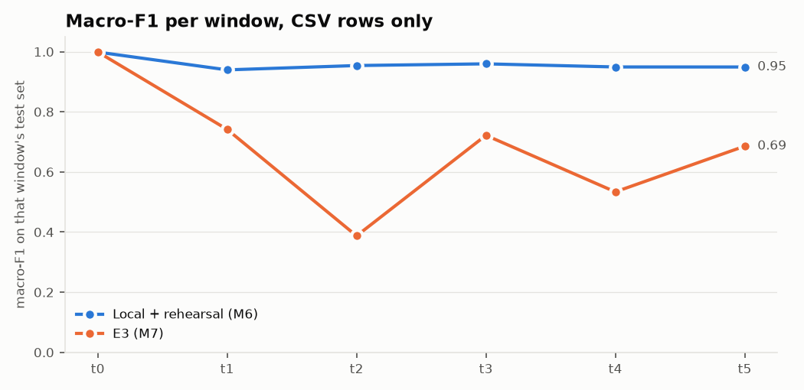

# M9: E4, drift-triggered updates, top-K features, adaptive gate (`dev` pool)

Run `20261116-154439_m9_e4_dev`. Generated by `scripts/m9_e4.py`. Seed 42. Scores use CSV-only rows (D7). Rows reach a client in 10 rounds per window, in random order, because the dataset has no timestamps. Between its update and the next g_t, a client uses its own calibrated output. Top-K limits new trees; older trees keep their splits, so inference still needs every feature.

**Passes missing from this report: ['e4', 'e4_label_free', 'e4_schedule', 'fixed']. They did not finish.**

## Results

| method | window avg | avg excl. t0 | final (t5) | SD over t1 to t5 | class forgetting |
|---|---:|---:|---:|---:|---:|
| Fixed schedule, top-10 | 0.7107 | 0.6536 | 0.6861 | 0.0815 | 0.1294 |
| Fixed schedule, top-10, client guard | 0.9484 | 0.9383 | 0.9330 | 0.0096 | 0.0176 |
| Fixed schedule, top-20 | 0.6980 | 0.6381 | 0.6969 | 0.1189 | 0.1125 |
| Fixed schedule, top-20, client guard | 0.9546 | 0.9459 | 0.9431 | 0.0078 | 0.0134 |
| Fixed schedule, top-30 | 0.7206 | 0.6652 | 0.6949 | 0.0914 | 0.1014 |
| Fixed schedule, top-30, client guard | 0.9582 | 0.9501 | 0.9478 | 0.0073 | 0.0125 |
| ADWIN trigger added to the fixed schedule, top-K | 0.7407 | 0.6893 | 0.7107 | 0.1037 | 0.1746 |
| ADWIN trigger added to the fixed schedule, top-K, client guard | 0.9563 | 0.9478 | 0.9463 | 0.0083 | 0.0098 |
| Local + rehearsal (M6) | 0.9583 | 0.9502 | 0.9490 | 0.0074 | 0.0120 |
| E3 (M7) | 0.6782 | 0.6140 | 0.6857 | 0.1507 | 0.1010 |
| E3 (M7), client guard | 0.9582 | 0.9501 | 0.9490 | 0.0077 | 0.0120 |

No `fixed` pass in this report, so nothing was checked against M7.

## Recovery inside each window

For E3, the old model and its g_t serve until the window ends. `mean over rounds` is macro-F1 averaged over the rounds of the window, with the window-end model as the last of them. `first trigger round` is the earliest over clients. Read the time to E3's earlier score: a method that already fell before the boundary reaches its own lower score sooner, which isn't a better recovery.

| method | window | own score before the boundary | old model on new rows | after window | mean over rounds | rounds to reach E3's earlier score (share of window) | rounds to reach its own (share of window) | first trigger round |
|---|---|---:|---:|---:|---:|---:|---:|---:|
| E3 (M7) | t1 | 0.999 | 0.244 | 0.741 | 0.290 | not in this window | not in this window | none |
| E3 (M7) | t2 | 0.741 | 0.499 | 0.387 | 0.489 | not in this window | not in this window | none |
| E3 (M7) | t3 | 0.387 | 0.258 | 0.722 | 0.300 | 1.0 | 1.0 | none |
| E3 (M7) | t4 | 0.722 | 0.555 | 0.534 | 0.553 | not in this window | not in this window | none |
| E3 (M7) | t5 | 0.534 | 0.524 | 0.686 | 0.539 | 0.0 | 0.0 | none |
| ADWIN trigger added to the fixed schedule, top-K | t1 | 0.998 | 0.378 | 0.815 | 0.842 | not in this window | not in this window | 1 |
| ADWIN trigger added to the fixed schedule, top-K | t2 | 0.815 | 0.552 | 0.526 | 0.739 | 0.1 | not in this window | 1 |
| ADWIN trigger added to the fixed schedule, top-K | t3 | 0.526 | 0.343 | 0.706 | 0.655 | 0.1 | 0.1 | 1 |
| ADWIN trigger added to the fixed schedule, top-K | t4 | 0.706 | 0.543 | 0.688 | 0.862 | 0.1 | 0.1 | 1 |
| ADWIN trigger added to the fixed schedule, top-K | t5 | 0.688 | 0.641 | 0.711 | 0.727 | 0.0 | 0.1 | 1 |

## Cost

| method | local updates | clients updated, by window | uplink float32 (MB) | uplink 8-bit + zlib (MB) | downlink (kB) | local minutes |
|---|---:|---|---:|---:|---:|---:|
| Fixed schedule, top-10 | 90 | 15 15 15 15 15 15 | 22.6 | 1.3 | 35.6 | 2.2 |
| Fixed schedule, top-20 | 90 | 15 15 15 15 15 15 | 22.6 | 1.2 | 35.6 | 2.2 |
| Fixed schedule, top-30 | 90 | 15 15 15 15 15 15 | 22.6 | 1.2 | 35.6 | 2.2 |
| ADWIN trigger added to the fixed schedule, top-K | 114 | 15 15 15 15 15 15 | 22.6 | 1.2 | 35.6 | 3.0 |

## K sweep, fixed schedule

| K | mean validation macro-F1 | window avg (test) | final t5 (test) | picked |
|---:|---:|---:|---:|---|
| 10 | 0.9287 | 0.7107 | 0.6861 |  |
| 20 | 0.9403 | 0.6980 | 0.6969 |  |
| 30 | 0.9408 | 0.7206 | 0.6949 |  |

## Adaptive gate: choosing the strength

| method | strength | mean errors caught, next window | fixed gate at the same cost | mean escalated, next window | picked on validation rows |
|---|---:|---:|---:|---:|---|

## Gate on test rows

`thresholds_only` is M7's gate. `fixed` adds the proposal's ADWIN flag and equals the adaptive gate at a score of 0. `psi_flag` is the D8 sensitivity run, not a headline. Target 10% (D10). Shown for E3's schedule and E4, at the picked strength; if that is 0, adaptive rows don't appear. All strengths and methods are in `gate_test.csv`. `fixed gate at the same cost` is the errors a fixed gate catches when loosened to the same escalation rate, on the same rows, so it shows whether the drift score adds anything over a looser threshold.

| method | model through | eval window | error rate | mode | strength | escalated | errors caught | fixed gate at the same cost | accuracy on the rest |
|---|---|---|---:|---|---:|---:|---:|---:|---:|

