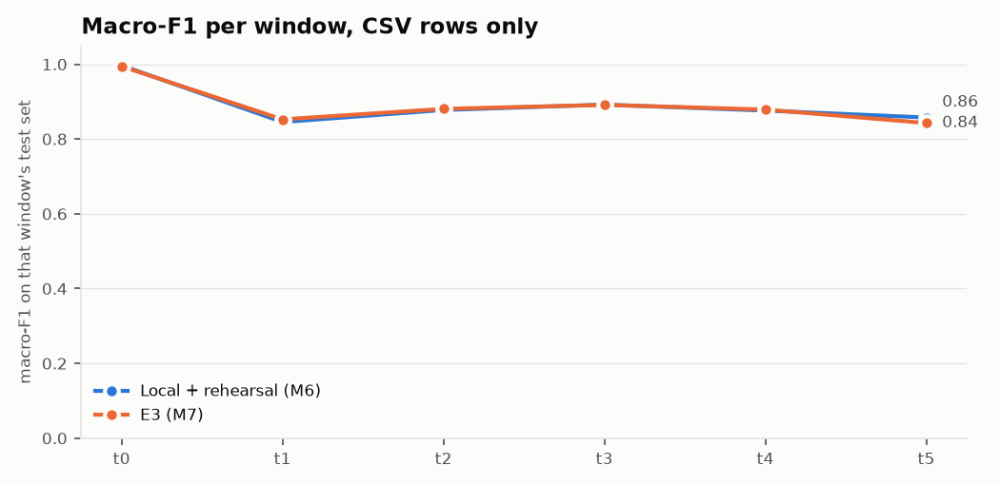

# M9: E4, drift-triggered updates, top-K features, adaptive gate (`dev` pool)

Run `20261116-161705_m9_e4_dev`. Generated by `scripts/m9_e4.py`. Seed 42. Scores use CSV-only rows (D7). Rows reach a client in 10 rounds per window, in random order, because the dataset has no timestamps. Between its update and the next g_t, a client uses its own calibrated output. Top-K limits new trees; older trees keep their splits, so inference still needs every feature.

**Passes missing from this report: ['e4', 'e4_label_free', 'e4_schedule', 'fixed']. They did not finish.**

## Results

| method | window avg | avg excl. t0 | final (t5) | SD over t1 to t5 | class forgetting |
|---|---:|---:|---:|---:|---:|
| Fixed schedule, top-10 | 0.8807 | 0.8577 | 0.8287 | 0.0217 | 0.0549 |
| Fixed schedule, top-10, client guard | 0.8823 | 0.8592 | 0.8377 | 0.0186 | 0.0525 |
| Fixed schedule, top-20 | 0.8867 | 0.8650 | 0.8419 | 0.0201 | 0.0480 |
| Fixed schedule, top-20, client guard | 0.8882 | 0.8664 | 0.8519 | 0.0174 | 0.0480 |
| Fixed schedule, top-30 | 0.8905 | 0.8697 | 0.8445 | 0.0198 | 0.0494 |
| Fixed schedule, top-30, client guard | 0.8929 | 0.8721 | 0.8565 | 0.0163 | 0.0475 |
| ADWIN trigger added to the fixed schedule, top-K | 0.8885 | 0.8673 | 0.8446 | 0.0193 | 0.0497 |
| ADWIN trigger added to the fixed schedule, top-K, client guard | 0.8890 | 0.8675 | 0.8515 | 0.0170 | 0.0473 |
| Local + rehearsal (M6) | 0.8909 | 0.8698 | 0.8575 | 0.0183 | 0.0458 |
| E3 (M7) | 0.8901 | 0.8693 | 0.8429 | 0.0205 | 0.0475 |
| E3 (M7), client guard | 0.8929 | 0.8721 | 0.8584 | 0.0167 | 0.0475 |

No `fixed` pass in this report, so nothing was checked against M7.

## Recovery inside each window

For E3, the old model and its g_t serve until the window ends. `mean over rounds` is macro-F1 averaged over the rounds of the window, with the window-end model as the last of them. `first trigger round` is the earliest over clients. Read the time to E3's earlier score: a method that already fell before the boundary reaches its own lower score sooner, which isn't a better recovery.

| method | window | own score before the boundary | old model on new rows | after window | mean over rounds | rounds to reach E3's earlier score (share of window) | rounds to reach its own (share of window) | first trigger round |
|---|---|---:|---:|---:|---:|---:|---:|---:|
| E3 (M7) | t1 | 0.994 | 0.454 | 0.853 | 0.490 | not in this window | not in this window | none |
| E3 (M7) | t2 | 0.853 | 0.575 | 0.881 | 0.603 | 1.0 | 1.0 | none |
| E3 (M7) | t3 | 0.881 | 0.468 | 0.891 | 0.507 | 1.0 | 1.0 | none |
| E3 (M7) | t4 | 0.891 | 0.645 | 0.879 | 0.666 | 1.0 | 1.0 | none |
| E3 (M7) | t5 | 0.879 | 0.802 | 0.843 | 0.806 | not in this window | not in this window | none |
| ADWIN trigger added to the fixed schedule, top-K | t1 | 0.994 | 0.454 | 0.849 | 0.776 | not in this window | not in this window | 1 |
| ADWIN trigger added to the fixed schedule, top-K | t2 | 0.849 | 0.572 | 0.877 | 0.689 | 1.0 | 1.0 | 1 |
| ADWIN trigger added to the fixed schedule, top-K | t3 | 0.877 | 0.465 | 0.889 | 0.829 | 0.3 | 0.3 | 1 |
| ADWIN trigger added to the fixed schedule, top-K | t4 | 0.889 | 0.637 | 0.876 | 0.753 | 1.0 | 1.0 | 1 |
| ADWIN trigger added to the fixed schedule, top-K | t5 | 0.876 | 0.795 | 0.845 | 0.804 | not in this window | not in this window | 1 |

## Cost

| method | local updates | clients updated, by window | uplink float32 (MB) | uplink 8-bit + zlib (MB) | downlink (kB) | local minutes |
|---|---:|---|---:|---:|---:|---:|
| Fixed schedule, top-10 | 90 | 15 15 15 15 15 15 | 22.6 | 1.7 | 35.6 | 2.7 |
| Fixed schedule, top-20 | 90 | 15 15 15 15 15 15 | 22.6 | 1.6 | 35.6 | 2.9 |
| Fixed schedule, top-30 | 90 | 15 15 15 15 15 15 | 22.6 | 1.6 | 35.6 | 2.8 |
| ADWIN trigger added to the fixed schedule, top-K | 126 | 15 15 15 15 15 15 | 22.6 | 1.6 | 35.6 | 4.4 |

## K sweep, fixed schedule

| K | mean validation macro-F1 | window avg (test) | final t5 (test) | picked |
|---:|---:|---:|---:|---|
| 10 | 0.8965 | 0.8807 | 0.8287 |  |
| 20 | 0.9034 | 0.8867 | 0.8419 |  |
| 30 | 0.9059 | 0.8905 | 0.8445 |  |

## Adaptive gate: choosing the strength

| method | strength | mean errors caught, next window | fixed gate at the same cost | mean escalated, next window | picked on validation rows |
|---|---:|---:|---:|---:|---|

## Gate on test rows

`thresholds_only` is M7's gate. `fixed` adds the proposal's ADWIN flag and equals the adaptive gate at a score of 0. `psi_flag` is the D8 sensitivity run, not a headline. Target 10% (D10). Shown for E3's schedule and E4, at the picked strength; if that is 0, adaptive rows don't appear. All strengths and methods are in `gate_test.csv`. `fixed gate at the same cost` is the errors a fixed gate catches when loosened to the same escalation rate, on the same rows, so it shows whether the drift score adds anything over a looser threshold.

| method | model through | eval window | error rate | mode | strength | escalated | errors caught | fixed gate at the same cost | accuracy on the rest |
|---|---|---|---:|---|---:|---:|---:|---:|---:|

