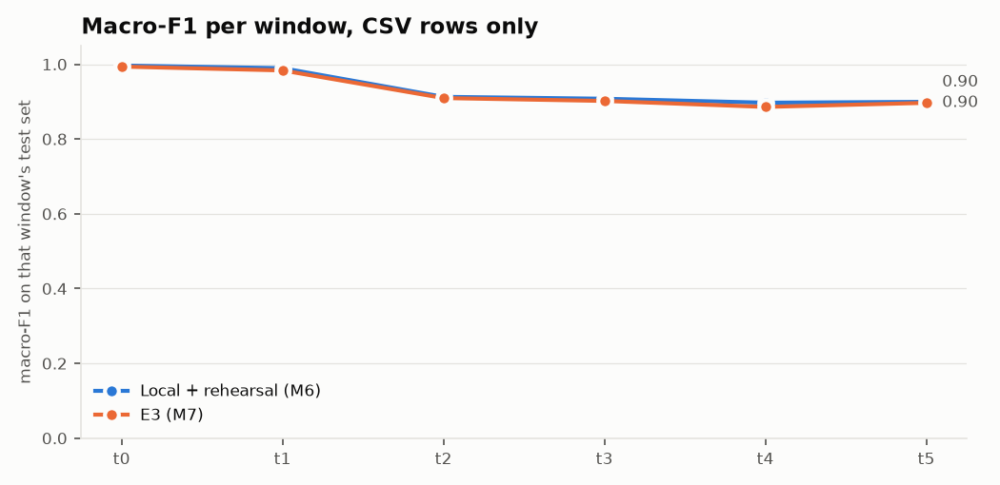

# M9: E4, drift-triggered updates, top-K features, adaptive gate (`dev` pool)

Run `20261116-125454_m9_e4_dev`. Generated by `scripts/m9_e4.py`. Seed 42. Scores use CSV-only rows (D7). Rows reach a client in 10 rounds per window, in random order, because the dataset has no timestamps. Between its update and the next g_t, a client uses its own calibrated output. Top-K limits new trees; older trees keep their splits, so inference still needs every feature.

**Passes missing from this report: ['e4', 'e4_label_free', 'e4_schedule', 'fixed']. They did not finish.**

## Results

| method | window avg | avg excl. t0 | final (t5) | SD over t1 to t5 | class forgetting |
|---|---:|---:|---:|---:|---:|
| Fixed schedule, top-10 | 0.9124 | 0.8959 | 0.8801 | 0.0470 | 0.0237 |
| Fixed schedule, top-10, client guard | 0.9246 | 0.9101 | 0.8884 | 0.0437 | 0.0276 |
| Fixed schedule, top-20 | 0.9246 | 0.9107 | 0.8874 | 0.0407 | 0.0222 |
| Fixed schedule, top-20, client guard | 0.9306 | 0.9175 | 0.8933 | 0.0411 | 0.0224 |
| Fixed schedule, top-30 | 0.9274 | 0.9143 | 0.8949 | 0.0397 | 0.0227 |
| Fixed schedule, top-30, client guard | 0.9334 | 0.9207 | 0.8997 | 0.0394 | 0.0250 |
| ADWIN trigger added to the fixed schedule, top-K | 0.9230 | 0.9090 | 0.8891 | 0.0417 | 0.0223 |
| ADWIN trigger added to the fixed schedule, top-K, client guard | 0.9329 | 0.9202 | 0.8982 | 0.0388 | 0.0246 |
| Local + rehearsal (M6) | 0.9339 | 0.9214 | 0.8995 | 0.0386 | 0.0259 |
| E3 (M7) | 0.9286 | 0.9155 | 0.8968 | 0.0390 | 0.0208 |
| E3 (M7), client guard | 0.9337 | 0.9212 | 0.9015 | 0.0375 | 0.0221 |

No `fixed` pass in this report, so nothing was checked against M7.

## Recovery inside each window

For E3, the old model and its g_t serve until the window ends. `mean over rounds` is macro-F1 averaged over the rounds of the window, with the window-end model as the last of them. `first trigger round` is the earliest over clients. Read the time to E3's earlier score: a method that already fell before the boundary reaches its own lower score sooner, which isn't a better recovery.

| method | window | own score before the boundary | old model on new rows | after window | mean over rounds | rounds to reach E3's earlier score (share of window) | rounds to reach its own (share of window) | first trigger round |
|---|---|---:|---:|---:|---:|---:|---:|---:|
| E3 (M7) | t1 | 0.994 | 0.430 | 0.984 | 0.480 | 1.0 | 1.0 | none |
| E3 (M7) | t2 | 0.984 | 0.678 | 0.910 | 0.699 | not in this window | not in this window | none |
| E3 (M7) | t3 | 0.910 | 0.640 | 0.902 | 0.664 | 1.0 | 1.0 | none |
| E3 (M7) | t4 | 0.902 | 0.652 | 0.886 | 0.674 | 1.0 | 1.0 | none |
| E3 (M7) | t5 | 0.886 | 0.858 | 0.897 | 0.862 | 1.0 | 1.0 | none |
| ADWIN trigger added to the fixed schedule, top-K | t1 | 0.993 | 0.431 | 0.982 | 0.877 | 1.0 | 1.0 | 1 |
| ADWIN trigger added to the fixed schedule, top-K | t2 | 0.982 | 0.677 | 0.904 | 0.875 | not in this window | not in this window | 1 |
| ADWIN trigger added to the fixed schedule, top-K | t3 | 0.904 | 0.639 | 0.889 | 0.786 | not in this window | 1.0 | 1 |
| ADWIN trigger added to the fixed schedule, top-K | t4 | 0.889 | 0.644 | 0.881 | 0.835 | not in this window | 1.0 | 1 |
| ADWIN trigger added to the fixed schedule, top-K | t5 | 0.881 | 0.856 | 0.889 | 0.873 | 0.1 | 0.1 | 1 |

## Cost

| method | local updates | clients updated, by window | uplink float32 (MB) | uplink 8-bit + zlib (MB) | downlink (kB) | local minutes |
|---|---:|---|---:|---:|---:|---:|
| Fixed schedule, top-10 | 90 | 15 15 15 15 15 15 | 24.2 | 1.5 | 35.6 | 2.5 |
| Fixed schedule, top-20 | 90 | 15 15 15 15 15 15 | 24.2 | 1.5 | 35.6 | 2.6 |
| Fixed schedule, top-30 | 90 | 15 15 15 15 15 15 | 24.2 | 1.5 | 35.6 | 2.6 |
| ADWIN trigger added to the fixed schedule, top-K | 133 | 15 15 15 15 15 15 | 24.2 | 1.4 | 35.6 | 4.2 |

## K sweep, fixed schedule

| K | mean validation macro-F1 | window avg (test) | final t5 (test) | picked |
|---:|---:|---:|---:|---|
| 10 | 0.9220 | 0.9124 | 0.8801 |  |
| 20 | 0.9312 | 0.9246 | 0.8874 |  |
| 30 | 0.9350 | 0.9274 | 0.8949 |  |

## Adaptive gate: choosing the strength

| method | strength | mean errors caught, next window | fixed gate at the same cost | mean escalated, next window | picked on validation rows |
|---|---:|---:|---:|---:|---|

## Gate on test rows

`thresholds_only` is M7's gate. `fixed` adds the proposal's ADWIN flag and equals the adaptive gate at a score of 0. `psi_flag` is the D8 sensitivity run, not a headline. Target 10% (D10). Shown for E3's schedule and E4, at the picked strength; if that is 0, adaptive rows don't appear. All strengths and methods are in `gate_test.csv`. `fixed gate at the same cost` is the errors a fixed gate catches when loosened to the same escalation rate, on the same rows, so it shows whether the drift score adds anything over a looser threshold.

| method | model through | eval window | error rate | mode | strength | escalated | errors caught | fixed gate at the same cost | accuracy on the rest |
|---|---|---|---:|---|---:|---:|---:|---:|---:|

