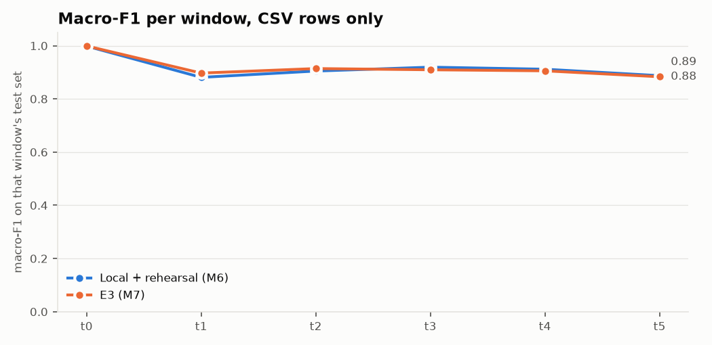

# M9: E4, drift-triggered updates, top-K features, adaptive gate (`dev` pool)

Run `20261116-131949_m9_e4_dev`. Generated by `scripts/m9_e4.py`. Seed 42. Scores use CSV-only rows (D7). Rows reach a client in 10 rounds per window, in random order, because the dataset has no timestamps. Between its update and the next g_t, a client uses its own calibrated output. Top-K limits new trees; older trees keep their splits, so inference still needs every feature.

**Passes missing from this report: ['e4', 'e4_label_free', 'e4_schedule', 'fixed']. They did not finish.**

## Results

| method | window avg | avg excl. t0 | final (t5) | SD over t1 to t5 | class forgetting |
|---|---:|---:|---:|---:|---:|
| Fixed schedule, top-10 | 0.9100 | 0.8924 | 0.8680 | 0.0146 | 0.0419 |
| Fixed schedule, top-10, client guard | 0.9155 | 0.8988 | 0.8755 | 0.0146 | 0.0388 |
| Fixed schedule, top-20 | 0.9146 | 0.8978 | 0.8784 | 0.0135 | 0.0368 |
| Fixed schedule, top-20, client guard | 0.9194 | 0.9037 | 0.8886 | 0.0125 | 0.0298 |
| Fixed schedule, top-30 | 0.9175 | 0.9012 | 0.8825 | 0.0125 | 0.0337 |
| Fixed schedule, top-30, client guard | 0.9233 | 0.9083 | 0.8939 | 0.0112 | 0.0298 |
| ADWIN trigger added to the fixed schedule, top-K | 0.9141 | 0.8972 | 0.8822 | 0.0140 | 0.0394 |
| ADWIN trigger added to the fixed schedule, top-K, client guard | 0.9199 | 0.9043 | 0.8899 | 0.0133 | 0.0319 |
| Local + rehearsal (M6) | 0.9171 | 0.9008 | 0.8874 | 0.0162 | 0.0295 |
| E3 (M7) | 0.9181 | 0.9019 | 0.8833 | 0.0121 | 0.0346 |
| E3 (M7), client guard | 0.9227 | 0.9075 | 0.8905 | 0.0126 | 0.0305 |

No `fixed` pass in this report, so nothing was checked against M7.

## Recovery inside each window

For E3, the old model and its g_t serve until the window ends. `mean over rounds` is macro-F1 averaged over the rounds of the window, with the window-end model as the last of them. `first trigger round` is the earliest over clients. Read the time to E3's earlier score: a method that already fell before the boundary reaches its own lower score sooner, which isn't a better recovery.

| method | window | own score before the boundary | old model on new rows | after window | mean over rounds | rounds to reach E3's earlier score (share of window) | rounds to reach its own (share of window) | first trigger round |
|---|---|---:|---:|---:|---:|---:|---:|---:|
| E3 (M7) | t1 | 0.999 | 0.460 | 0.897 | 0.500 | not in this window | not in this window | none |
| E3 (M7) | t2 | 0.897 | 0.576 | 0.914 | 0.607 | 1.0 | 1.0 | none |
| E3 (M7) | t3 | 0.914 | 0.505 | 0.910 | 0.542 | 1.0 | 1.0 | none |
| E3 (M7) | t4 | 0.910 | 0.663 | 0.906 | 0.685 | 1.0 | 1.0 | none |
| E3 (M7) | t5 | 0.906 | 0.809 | 0.883 | 0.816 | not in this window | not in this window | none |
| ADWIN trigger added to the fixed schedule, top-K | t1 | 0.999 | 0.461 | 0.888 | 0.818 | not in this window | not in this window | 1 |
| ADWIN trigger added to the fixed schedule, top-K | t2 | 0.888 | 0.574 | 0.917 | 0.811 | 1.0 | 1.0 | 1 |
| ADWIN trigger added to the fixed schedule, top-K | t3 | 0.917 | 0.497 | 0.906 | 0.868 | 0.1 | 0.1 | 1 |
| ADWIN trigger added to the fixed schedule, top-K | t4 | 0.906 | 0.663 | 0.893 | 0.858 | 1.0 | 1.0 | 1 |
| ADWIN trigger added to the fixed schedule, top-K | t5 | 0.893 | 0.806 | 0.882 | 0.840 | not in this window | 1.0 | 1 |

## Cost

| method | local updates | clients updated, by window | uplink float32 (MB) | uplink 8-bit + zlib (MB) | downlink (kB) | local minutes |
|---|---:|---|---:|---:|---:|---:|
| Fixed schedule, top-10 | 60 | 10 10 10 10 10 10 | 15.0 | 1.1 | 23.8 | 2.0 |
| Fixed schedule, top-20 | 60 | 10 10 10 10 10 10 | 15.0 | 1.1 | 23.8 | 2.0 |
| Fixed schedule, top-30 | 60 | 10 10 10 10 10 10 | 15.0 | 1.1 | 23.8 | 2.1 |
| ADWIN trigger added to the fixed schedule, top-K | 90 | 10 10 10 10 10 10 | 15.0 | 1.0 | 23.8 | 3.0 |

## K sweep, fixed schedule

| K | mean validation macro-F1 | window avg (test) | final t5 (test) | picked |
|---:|---:|---:|---:|---|
| 10 | 0.9070 | 0.9100 | 0.8680 |  |
| 20 | 0.9138 | 0.9146 | 0.8784 |  |
| 30 | 0.9159 | 0.9175 | 0.8825 |  |

## Adaptive gate: choosing the strength

| method | strength | mean errors caught, next window | fixed gate at the same cost | mean escalated, next window | picked on validation rows |
|---|---:|---:|---:|---:|---|

## Gate on test rows

`thresholds_only` is M7's gate. `fixed` adds the proposal's ADWIN flag and equals the adaptive gate at a score of 0. `psi_flag` is the D8 sensitivity run, not a headline. Target 10% (D10). Shown for E3's schedule and E4, at the picked strength; if that is 0, adaptive rows don't appear. All strengths and methods are in `gate_test.csv`. `fixed gate at the same cost` is the errors a fixed gate catches when loosened to the same escalation rate, on the same rows, so it shows whether the drift score adds anything over a looser threshold.

| method | model through | eval window | error rate | mode | strength | escalated | errors caught | fixed gate at the same cost | accuracy on the rest |
|---|---|---|---:|---|---:|---:|---:|---:|---:|

