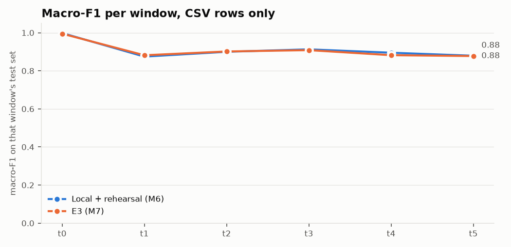

# M9: E4, drift-triggered updates, top-K features, adaptive gate (`dev` pool)

Run `20261116-135942_m9_e4_dev`. Generated by `scripts/m9_e4.py`. Seed 42. Scores use CSV-only rows (D7). Rows reach a client in 10 rounds per window, in random order, because the dataset has no timestamps. Between its update and the next g_t, a client uses its own calibrated output. Top-K limits new trees; older trees keep their splits, so inference still needs every feature.

**Passes missing from this report: ['e4', 'e4_label_free', 'e4_schedule', 'fixed']. They did not finish.**

## Results

| method | window avg | avg excl. t0 | final (t5) | SD over t1 to t5 | class forgetting |
|---|---:|---:|---:|---:|---:|
| Fixed schedule, top-10 | 0.8921 | 0.8717 | 0.8528 | 0.0164 | 0.0357 |
| Fixed schedule, top-10, client guard | 0.8985 | 0.8786 | 0.8586 | 0.0171 | 0.0386 |
| Fixed schedule, top-20 | 0.9037 | 0.8853 | 0.8663 | 0.0158 | 0.0315 |
| Fixed schedule, top-20, client guard | 0.9107 | 0.8931 | 0.8773 | 0.0153 | 0.0373 |
| Fixed schedule, top-30 | 0.9051 | 0.8871 | 0.8739 | 0.0147 | 0.0314 |
| Fixed schedule, top-30, client guard | 0.9118 | 0.8945 | 0.8777 | 0.0152 | 0.0343 |
| ADWIN trigger added to the fixed schedule, top-K | 0.9044 | 0.8862 | 0.8798 | 0.0170 | 0.0334 |
| ADWIN trigger added to the fixed schedule, top-K, client guard | 0.9097 | 0.8920 | 0.8828 | 0.0149 | 0.0337 |
| Local + rehearsal (M6) | 0.9099 | 0.8923 | 0.8792 | 0.0156 | 0.0359 |
| E3 (M7) | 0.9077 | 0.8903 | 0.8775 | 0.0138 | 0.0330 |
| E3 (M7), client guard | 0.9116 | 0.8942 | 0.8805 | 0.0139 | 0.0353 |

No `fixed` pass in this report, so nothing was checked against M7.

## Recovery inside each window

For E3, the old model and its g_t serve until the window ends. `mean over rounds` is macro-F1 averaged over the rounds of the window, with the window-end model as the last of them. `first trigger round` is the earliest over clients. Read the time to E3's earlier score: a method that already fell before the boundary reaches its own lower score sooner, which isn't a better recovery.

| method | window | own score before the boundary | old model on new rows | after window | mean over rounds | rounds to reach E3's earlier score (share of window) | rounds to reach its own (share of window) | first trigger round |
|---|---|---:|---:|---:|---:|---:|---:|---:|
| E3 (M7) | t1 | 0.995 | 0.450 | 0.882 | 0.490 | not in this window | not in this window | none |
| E3 (M7) | t2 | 0.882 | 0.574 | 0.902 | 0.604 | 1.0 | 1.0 | none |
| E3 (M7) | t3 | 0.902 | 0.491 | 0.909 | 0.529 | 1.0 | 1.0 | none |
| E3 (M7) | t4 | 0.909 | 0.655 | 0.882 | 0.676 | not in this window | not in this window | none |
| E3 (M7) | t5 | 0.882 | 0.790 | 0.878 | 0.798 | 1.0 | 1.0 | none |
| ADWIN trigger added to the fixed schedule, top-K | t1 | 0.995 | 0.448 | 0.866 | 0.808 | not in this window | not in this window | 1 |
| ADWIN trigger added to the fixed schedule, top-K | t2 | 0.866 | 0.575 | 0.902 | 0.745 | 1.0 | 1.0 | 1 |
| ADWIN trigger added to the fixed schedule, top-K | t3 | 0.902 | 0.498 | 0.906 | 0.808 | 1.0 | 1.0 | 1 |
| ADWIN trigger added to the fixed schedule, top-K | t4 | 0.906 | 0.653 | 0.877 | 0.807 | not in this window | not in this window | 1 |
| ADWIN trigger added to the fixed schedule, top-K | t5 | 0.877 | 0.780 | 0.880 | 0.815 | 1.0 | 1.0 | 1 |

## Cost

| method | local updates | clients updated, by window | uplink float32 (MB) | uplink 8-bit + zlib (MB) | downlink (kB) | local minutes |
|---|---:|---|---:|---:|---:|---:|
| Fixed schedule, top-10 | 120 | 20 20 20 20 20 20 | 30.1 | 2.2 | 47.5 | 3.2 |
| Fixed schedule, top-20 | 120 | 20 20 20 20 20 20 | 30.1 | 2.1 | 47.5 | 3.9 |
| Fixed schedule, top-30 | 120 | 20 20 20 20 20 20 | 30.1 | 2.1 | 47.5 | 3.8 |
| ADWIN trigger added to the fixed schedule, top-K | 169 | 20 20 20 20 20 20 | 30.1 | 2.1 | 47.5 | 4.8 |

## K sweep, fixed schedule

| K | mean validation macro-F1 | window avg (test) | final t5 (test) | picked |
|---:|---:|---:|---:|---|
| 10 | 0.9095 | 0.8921 | 0.8528 |  |
| 20 | 0.9175 | 0.9037 | 0.8663 |  |
| 30 | 0.9198 | 0.9051 | 0.8739 |  |

## Adaptive gate: choosing the strength

| method | strength | mean errors caught, next window | fixed gate at the same cost | mean escalated, next window | picked on validation rows |
|---|---:|---:|---:|---:|---|

## Gate on test rows

`thresholds_only` is M7's gate. `fixed` adds the proposal's ADWIN flag and equals the adaptive gate at a score of 0. `psi_flag` is the D8 sensitivity run, not a headline. Target 10% (D10). Shown for E3's schedule and E4, at the picked strength; if that is 0, adaptive rows don't appear. All strengths and methods are in `gate_test.csv`. `fixed gate at the same cost` is the errors a fixed gate catches when loosened to the same escalation rate, on the same rows, so it shows whether the drift score adds anything over a looser threshold.

| method | model through | eval window | error rate | mode | strength | escalated | errors caught | fixed gate at the same cost | accuracy on the rest |
|---|---|---|---:|---|---:|---:|---:|---:|---:|

