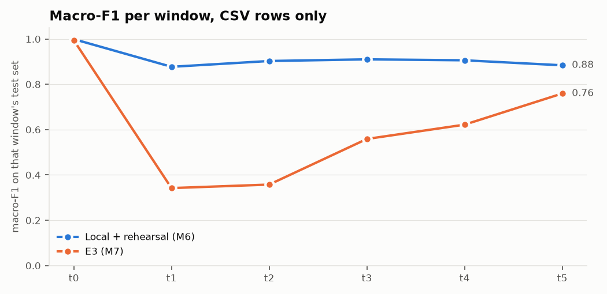

# M9: E4, drift-triggered updates, top-K features, adaptive gate (`dev` pool)

Run `20261116-002259_m9_e4_dev`. Generated by `scripts/m9_e4.py`. Seed 42. Scores use CSV-only rows (D7). Rows reach a client in 10 rounds per window, in random order, because the dataset has no timestamps. Between its update and the next g_t, a client uses its own calibrated output. Top-K limits new trees; older trees keep their splits, so inference still needs every feature.

**Passes missing from this report: ['e4', 'e4_label_free', 'e4_schedule', 'fixed']. They did not finish.**

## Results

| method | window avg | avg excl. t0 | final (t5) | SD over t1 to t5 | class forgetting |
|---|---:|---:|---:|---:|---:|
| Fixed schedule, top-10 | 0.6625 | 0.5970 | 0.7245 | 0.2322 | 0.1540 |
| Fixed schedule, top-10, client guard | 0.9042 | 0.8856 | 0.8718 | 0.0152 | 0.0334 |
| Fixed schedule, top-20 | 0.6754 | 0.6183 | 0.7291 | 0.1922 | 0.1665 |
| Fixed schedule, top-20, client guard | 0.9096 | 0.8920 | 0.8773 | 0.0154 | 0.0294 |
| Fixed schedule, top-30 | 0.6181 | 0.5438 | 0.6562 | 0.1976 | 0.0860 |
| Fixed schedule, top-30, client guard | 0.9121 | 0.8956 | 0.8844 | 0.0139 | 0.0282 |
| ADWIN trigger added to the fixed schedule, top-K | 0.8094 | 0.7733 | 0.7947 | 0.0661 | 0.1060 |
| ADWIN trigger added to the fixed schedule, top-K, client guard | 0.9105 | 0.8937 | 0.8808 | 0.0146 | 0.0281 |
| Local + rehearsal (M6) | 0.9131 | 0.8959 | 0.8838 | 0.0145 | 0.0277 |
| E3 (M7) | 0.6056 | 0.5279 | 0.7593 | 0.1781 | 0.0613 |
| E3 (M7), client guard | 0.9127 | 0.8959 | 0.8838 | 0.0145 | 0.0276 |

No `fixed` pass in this report, so nothing was checked against M7.

## Recovery inside each window

For E3, the old model and its g_t serve until the window ends. `mean over rounds` is macro-F1 averaged over the rounds of the window, with the window-end model as the last of them. `first trigger round` is the earliest over clients. Read the time to E3's earlier score: a method that already fell before the boundary reaches its own lower score sooner, which isn't a better recovery.

| method | window | own score before the boundary | old model on new rows | after window | mean over rounds | rounds to reach E3's earlier score (share of window) | rounds to reach its own (share of window) | first trigger round |
|---|---|---:|---:|---:|---:|---:|---:|---:|
| E3 (M7) | t1 | 0.994 | 0.455 | 0.342 | 0.445 | not in this window | not in this window | none |
| E3 (M7) | t2 | 0.342 | 0.237 | 0.357 | 0.248 | 1.0 | 1.0 | none |
| E3 (M7) | t3 | 0.357 | 0.186 | 0.559 | 0.220 | 1.0 | 1.0 | none |
| E3 (M7) | t4 | 0.559 | 0.404 | 0.622 | 0.424 | 1.0 | 1.0 | none |
| E3 (M7) | t5 | 0.622 | 0.535 | 0.759 | 0.556 | 1.0 | 1.0 | none |
| ADWIN trigger added to the fixed schedule, top-K | t1 | 0.990 | 0.451 | 0.694 | 0.797 | not in this window | not in this window | 1 |
| ADWIN trigger added to the fixed schedule, top-K | t2 | 0.694 | 0.479 | 0.713 | 0.671 | 0.0 | 0.1 | 1 |
| ADWIN trigger added to the fixed schedule, top-K | t3 | 0.713 | 0.416 | 0.841 | 0.817 | 0.0 | 0.1 | 1 |
| ADWIN trigger added to the fixed schedule, top-K | t4 | 0.841 | 0.626 | 0.823 | 0.796 | 0.0 | 0.6 | 1 |
| ADWIN trigger added to the fixed schedule, top-K | t5 | 0.823 | 0.713 | 0.795 | 0.793 | 0.0 | 0.4 | 1 |

## Cost

| method | local updates | clients updated, by window | uplink float32 (MB) | uplink 8-bit + zlib (MB) | downlink (kB) | local minutes |
|---|---:|---|---:|---:|---:|---:|
| Fixed schedule, top-10 | 90 | 15 15 15 15 15 15 | 4.3 | 0.4 | 35.6 | 3.0 |
| Fixed schedule, top-20 | 90 | 15 15 15 15 15 15 | 4.3 | 0.3 | 35.6 | 2.8 |
| Fixed schedule, top-30 | 90 | 15 15 15 15 15 15 | 4.3 | 0.3 | 35.6 | 3.8 |
| ADWIN trigger added to the fixed schedule, top-K | 130 | 15 15 15 15 15 15 | 4.3 | 0.3 | 35.6 | 4.8 |

## K sweep, fixed schedule

| K | mean validation macro-F1 | window avg (test) | final t5 (test) | picked |
|---:|---:|---:|---:|---|
| 10 | 0.9094 | 0.6625 | 0.7245 |  |
| 20 | 0.9181 | 0.6754 | 0.7291 |  |
| 30 | 0.9188 | 0.6181 | 0.6562 |  |

## Adaptive gate: choosing the strength

| method | strength | mean errors caught, next window | fixed gate at the same cost | mean escalated, next window | picked on validation rows |
|---|---:|---:|---:|---:|---|

## Gate on test rows

`thresholds_only` is M7's gate. `fixed` adds the proposal's ADWIN flag and equals the adaptive gate at a score of 0. `psi_flag` is the D8 sensitivity run, not a headline. Target 10% (D10). Shown for E3's schedule and E4, at the picked strength; if that is 0, adaptive rows don't appear. All strengths and methods are in `gate_test.csv`. `fixed gate at the same cost` is the errors a fixed gate catches when loosened to the same escalation rate, on the same rows, so it shows whether the drift score adds anything over a looser threshold.

| method | model through | eval window | error rate | mode | strength | escalated | errors caught | fixed gate at the same cost | accuracy on the rest |
|---|---|---|---:|---|---:|---:|---:|---:|---:|

