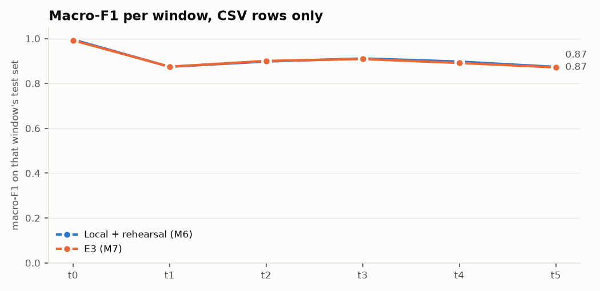

# M9: E4, drift-triggered updates, top-K features, adaptive gate (`dev` pool)

Run `20261116-175528_m9_e4_dev`. Generated by `scripts/m9_e4.py`. Seed 42. Scores use CSV-only rows (D7). Rows reach a client in 10 rounds per window, in random order, because the dataset has no timestamps. Between its update and the next g_t, a client uses its own calibrated output. Top-K limits new trees; older trees keep their splits, so inference still needs every feature.

**Passes missing from this report: ['e4', 'e4_label_free', 'e4_schedule', 'fixed']. They did not finish.**

## Results

| method | window avg | avg excl. t0 | final (t5) | SD over t1 to t5 | class forgetting |
|---|---:|---:|---:|---:|---:|
| Fixed schedule, top-10 | 0.8903 | 0.8700 | 0.8579 | 0.0181 | 0.0244 |
| Fixed schedule, top-10, client guard | 0.8997 | 0.8807 | 0.8637 | 0.0149 | 0.0278 |
| Fixed schedule, top-20 | 0.9023 | 0.8845 | 0.8648 | 0.0155 | 0.0266 |
| Fixed schedule, top-20, client guard | 0.9059 | 0.8882 | 0.8685 | 0.0176 | 0.0245 |
| Fixed schedule, top-30 | 0.9044 | 0.8872 | 0.8727 | 0.0174 | 0.0267 |
| Fixed schedule, top-30, client guard | 0.9095 | 0.8923 | 0.8764 | 0.0184 | 0.0264 |
| ADWIN trigger added to the fixed schedule, top-K | 0.9022 | 0.8847 | 0.8669 | 0.0188 | 0.0238 |
| ADWIN trigger added to the fixed schedule, top-K, client guard | 0.9079 | 0.8905 | 0.8691 | 0.0192 | 0.0226 |
| Local + rehearsal (M6) | 0.9084 | 0.8909 | 0.8737 | 0.0165 | 0.0230 |
| E3 (M7) | 0.9064 | 0.8892 | 0.8714 | 0.0161 | 0.0295 |
| E3 (M7), client guard | 0.9093 | 0.8921 | 0.8758 | 0.0153 | 0.0264 |

No `fixed` pass in this report, so nothing was checked against M7.

## Recovery inside each window

For E3, the old model and its g_t serve until the window ends. `mean over rounds` is macro-F1 averaged over the rounds of the window, with the window-end model as the last of them. `first trigger round` is the earliest over clients. Read the time to E3's earlier score: a method that already fell before the boundary reaches its own lower score sooner, which isn't a better recovery.

| method | window | own score before the boundary | old model on new rows | after window | mean over rounds | rounds to reach E3's earlier score (share of window) | rounds to reach its own (share of window) | first trigger round |
|---|---|---:|---:|---:|---:|---:|---:|---:|
| E3 (M7) | t1 | 0.992 | 0.453 | 0.875 | 0.491 | not in this window | not in this window | none |
| E3 (M7) | t2 | 0.875 | 0.588 | 0.900 | 0.617 | 1.0 | 1.0 | none |
| E3 (M7) | t3 | 0.900 | 0.486 | 0.909 | 0.524 | 1.0 | 1.0 | none |
| E3 (M7) | t4 | 0.909 | 0.660 | 0.891 | 0.681 | 1.0 | 1.0 | none |
| E3 (M7) | t5 | 0.891 | 0.772 | 0.871 | 0.781 | 1.0 | 1.0 | none |
| ADWIN trigger added to the fixed schedule, top-K | t1 | 0.990 | 0.451 | 0.871 | 0.809 | not in this window | not in this window | 1 |
| ADWIN trigger added to the fixed schedule, top-K | t2 | 0.871 | 0.580 | 0.903 | 0.745 | 1.0 | 1.0 | 1 |
| ADWIN trigger added to the fixed schedule, top-K | t3 | 0.903 | 0.483 | 0.907 | 0.827 | 1.0 | 1.0 | 1 |
| ADWIN trigger added to the fixed schedule, top-K | t4 | 0.907 | 0.657 | 0.876 | 0.800 | not in this window | not in this window | 1 |
| ADWIN trigger added to the fixed schedule, top-K | t5 | 0.876 | 0.762 | 0.867 | 0.815 | not in this window | 1.0 | 1 |

## Cost

| method | local updates | clients updated, by window | uplink float32 (MB) | uplink 8-bit + zlib (MB) | downlink (kB) | local minutes |
|---|---:|---|---:|---:|---:|---:|
| Fixed schedule, top-10 | 90 | 15 15 15 15 15 15 | 22.6 | 1.5 | 35.6 | 2.5 |
| Fixed schedule, top-20 | 90 | 15 15 15 15 15 15 | 22.6 | 1.6 | 35.6 | 2.5 |
| Fixed schedule, top-30 | 90 | 15 15 15 15 15 15 | 22.6 | 1.6 | 35.6 | 2.7 |
| ADWIN trigger added to the fixed schedule, top-K | 125 | 15 15 15 15 15 15 | 22.6 | 1.5 | 35.6 | 3.7 |

## K sweep, fixed schedule

| K | mean validation macro-F1 | window avg (test) | final t5 (test) | picked |
|---:|---:|---:|---:|---|
| 10 | 0.8791 | 0.8903 | 0.8579 |  |
| 20 | 0.8916 | 0.9023 | 0.8648 |  |
| 30 | 0.8959 | 0.9044 | 0.8727 |  |

## Adaptive gate: choosing the strength

| method | strength | mean errors caught, next window | fixed gate at the same cost | mean escalated, next window | picked on validation rows |
|---|---:|---:|---:|---:|---|

## Gate on test rows

`thresholds_only` is M7's gate. `fixed` adds the proposal's ADWIN flag and equals the adaptive gate at a score of 0. `psi_flag` is the D8 sensitivity run, not a headline. Target 10% (D10). Shown for E3's schedule and E4, at the picked strength; if that is 0, adaptive rows don't appear. All strengths and methods are in `gate_test.csv`. `fixed gate at the same cost` is the errors a fixed gate catches when loosened to the same escalation rate, on the same rows, so it shows whether the drift score adds anything over a looser threshold.

| method | model through | eval window | error rate | mode | strength | escalated | errors caught | fixed gate at the same cost | accuracy on the rest |
|---|---|---|---:|---|---:|---:|---:|---:|---:|

