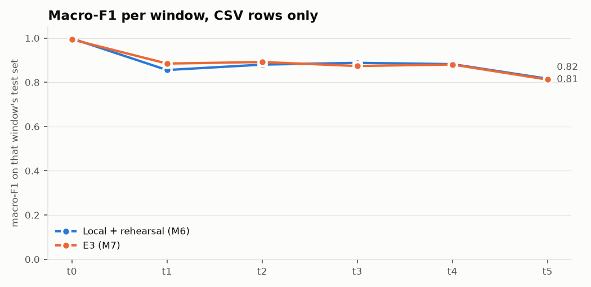

# M9: E4, drift-triggered updates, top-K features, adaptive gate (`dev` pool)

Run `20261116-172423_m9_e4_dev`. Generated by `scripts/m9_e4.py`. Seed 42. Scores use CSV-only rows (D7). Rows reach a client in 10 rounds per window, in random order, because the dataset has no timestamps. Between its update and the next g_t, a client uses its own calibrated output. Top-K limits new trees; older trees keep their splits, so inference still needs every feature.

**Passes missing from this report: ['e4', 'e4_label_free', 'e4_schedule', 'fixed']. They did not finish.**

## Results

| method | window avg | avg excl. t0 | final (t5) | SD over t1 to t5 | class forgetting |
|---|---:|---:|---:|---:|---:|
| Fixed schedule, top-10 | 0.8782 | 0.8548 | 0.8036 | 0.0294 | 0.0464 |
| Fixed schedule, top-10, client guard | 0.8821 | 0.8588 | 0.8087 | 0.0283 | 0.0471 |
| Fixed schedule, top-20 | 0.8860 | 0.8645 | 0.8108 | 0.0309 | 0.0416 |
| Fixed schedule, top-20, client guard | 0.8907 | 0.8694 | 0.8178 | 0.0295 | 0.0416 |
| Fixed schedule, top-30 | 0.8899 | 0.8692 | 0.8137 | 0.0318 | 0.0434 |
| Fixed schedule, top-30, client guard | 0.8920 | 0.8709 | 0.8228 | 0.0282 | 0.0412 |
| ADWIN trigger added to the fixed schedule, top-K | 0.8864 | 0.8649 | 0.8198 | 0.0259 | 0.0396 |
| ADWIN trigger added to the fixed schedule, top-K, client guard | 0.8891 | 0.8674 | 0.8265 | 0.0247 | 0.0370 |
| Local + rehearsal (M6) | 0.8865 | 0.8643 | 0.8162 | 0.0296 | 0.0418 |
| E3 (M7) | 0.8893 | 0.8684 | 0.8122 | 0.0321 | 0.0463 |
| E3 (M7), client guard | 0.8935 | 0.8726 | 0.8223 | 0.0288 | 0.0441 |

No `fixed` pass in this report, so nothing was checked against M7.

## Recovery inside each window

For E3, the old model and its g_t serve until the window ends. `mean over rounds` is macro-F1 averaged over the rounds of the window, with the window-end model as the last of them. `first trigger round` is the earliest over clients. Read the time to E3's earlier score: a method that already fell before the boundary reaches its own lower score sooner, which isn't a better recovery.

| method | window | own score before the boundary | old model on new rows | after window | mean over rounds | rounds to reach E3's earlier score (share of window) | rounds to reach its own (share of window) | first trigger round |
|---|---|---:|---:|---:|---:|---:|---:|---:|
| E3 (M7) | t1 | 0.994 | 0.457 | 0.885 | 0.496 | not in this window | not in this window | none |
| E3 (M7) | t2 | 0.885 | 0.567 | 0.892 | 0.596 | 1.0 | 1.0 | none |
| E3 (M7) | t3 | 0.892 | 0.470 | 0.874 | 0.507 | 1.0 | 1.0 | none |
| E3 (M7) | t4 | 0.874 | 0.668 | 0.880 | 0.687 | 1.0 | 1.0 | none |
| E3 (M7) | t5 | 0.880 | 0.757 | 0.812 | 0.762 | not in this window | not in this window | none |
| ADWIN trigger added to the fixed schedule, top-K | t1 | 0.994 | 0.455 | 0.871 | 0.803 | not in this window | not in this window | 1 |
| ADWIN trigger added to the fixed schedule, top-K | t2 | 0.871 | 0.555 | 0.885 | 0.772 | 1.0 | 1.0 | 1 |
| ADWIN trigger added to the fixed schedule, top-K | t3 | 0.885 | 0.464 | 0.871 | 0.796 | not in this window | 1.0 | 1 |
| ADWIN trigger added to the fixed schedule, top-K | t4 | 0.871 | 0.666 | 0.877 | 0.825 | 1.0 | 1.0 | 1 |
| ADWIN trigger added to the fixed schedule, top-K | t5 | 0.877 | 0.749 | 0.820 | 0.787 | not in this window | not in this window | 1 |

## Cost

| method | local updates | clients updated, by window | uplink float32 (MB) | uplink 8-bit + zlib (MB) | downlink (kB) | local minutes |
|---|---:|---|---:|---:|---:|---:|
| Fixed schedule, top-10 | 90 | 15 15 15 15 15 15 | 22.6 | 1.7 | 35.6 | 2.6 |
| Fixed schedule, top-20 | 90 | 15 15 15 15 15 15 | 22.6 | 1.6 | 35.6 | 2.7 |
| Fixed schedule, top-30 | 90 | 15 15 15 15 15 15 | 22.6 | 1.6 | 35.6 | 3.0 |
| ADWIN trigger added to the fixed schedule, top-K | 127 | 15 15 15 15 15 15 | 22.6 | 1.6 | 35.6 | 3.8 |

## K sweep, fixed schedule

| K | mean validation macro-F1 | window avg (test) | final t5 (test) | picked |
|---:|---:|---:|---:|---|
| 10 | 0.9068 | 0.8782 | 0.8036 |  |
| 20 | 0.9144 | 0.8860 | 0.8108 |  |
| 30 | 0.9161 | 0.8899 | 0.8137 |  |

## Adaptive gate: choosing the strength

| method | strength | mean errors caught, next window | fixed gate at the same cost | mean escalated, next window | picked on validation rows |
|---|---:|---:|---:|---:|---|

## Gate on test rows

`thresholds_only` is M7's gate. `fixed` adds the proposal's ADWIN flag and equals the adaptive gate at a score of 0. `psi_flag` is the D8 sensitivity run, not a headline. Target 10% (D10). Shown for E3's schedule and E4, at the picked strength; if that is 0, adaptive rows don't appear. All strengths and methods are in `gate_test.csv`. `fixed gate at the same cost` is the errors a fixed gate catches when loosened to the same escalation rate, on the same rows, so it shows whether the drift score adds anything over a looser threshold.

| method | model through | eval window | error rate | mode | strength | escalated | errors caught | fixed gate at the same cost | accuracy on the rest |
|---|---|---|---:|---|---:|---:|---:|---:|---:|

