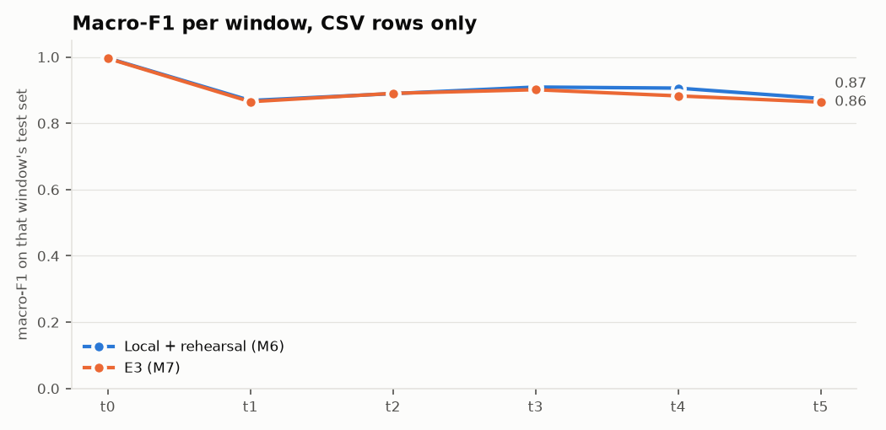

# M9: E4, drift-triggered updates, top-K features, adaptive gate (`dev` pool)

Run `20261116-164716_m9_e4_dev`. Generated by `scripts/m9_e4.py`. Seed 42. Scores use CSV-only rows (D7). Rows reach a client in 10 rounds per window, in random order, because the dataset has no timestamps. Between its update and the next g_t, a client uses its own calibrated output. Top-K limits new trees; older trees keep their splits, so inference still needs every feature.

**Passes missing from this report: ['e4', 'e4_label_free', 'e4_schedule', 'fixed']. They did not finish.**

## Results

| method | window avg | avg excl. t0 | final (t5) | SD over t1 to t5 | class forgetting |
|---|---:|---:|---:|---:|---:|
| Fixed schedule, top-10 | 0.8773 | 0.8535 | 0.8494 | 0.0130 | 0.0445 |
| Fixed schedule, top-10, client guard | 0.8883 | 0.8664 | 0.8579 | 0.0185 | 0.0504 |
| Fixed schedule, top-20 | 0.8947 | 0.8745 | 0.8624 | 0.0139 | 0.0289 |
| Fixed schedule, top-20, client guard | 0.9056 | 0.8874 | 0.8706 | 0.0158 | 0.0383 |
| Fixed schedule, top-30 | 0.8997 | 0.8805 | 0.8662 | 0.0155 | 0.0354 |
| Fixed schedule, top-30, client guard | 0.9080 | 0.8902 | 0.8733 | 0.0175 | 0.0375 |
| ADWIN trigger added to the fixed schedule, top-K | 0.8970 | 0.8773 | 0.8644 | 0.0154 | 0.0344 |
| ADWIN trigger added to the fixed schedule, top-K, client guard | 0.9046 | 0.8862 | 0.8691 | 0.0164 | 0.0386 |
| Local + rehearsal (M6) | 0.9075 | 0.8897 | 0.8749 | 0.0181 | 0.0357 |
| E3 (M7) | 0.8999 | 0.8807 | 0.8639 | 0.0161 | 0.0340 |
| E3 (M7), client guard | 0.9100 | 0.8927 | 0.8752 | 0.0169 | 0.0383 |

No `fixed` pass in this report, so nothing was checked against M7.

## Recovery inside each window

For E3, the old model and its g_t serve until the window ends. `mean over rounds` is macro-F1 averaged over the rounds of the window, with the window-end model as the last of them. `first trigger round` is the earliest over clients. Read the time to E3's earlier score: a method that already fell before the boundary reaches its own lower score sooner, which isn't a better recovery.

| method | window | own score before the boundary | old model on new rows | after window | mean over rounds | rounds to reach E3's earlier score (share of window) | rounds to reach its own (share of window) | first trigger round |
|---|---|---:|---:|---:|---:|---:|---:|---:|
| E3 (M7) | t1 | 0.996 | 0.455 | 0.865 | 0.493 | not in this window | not in this window | none |
| E3 (M7) | t2 | 0.865 | 0.567 | 0.890 | 0.596 | 1.0 | 1.0 | none |
| E3 (M7) | t3 | 0.890 | 0.488 | 0.901 | 0.526 | 1.0 | 1.0 | none |
| E3 (M7) | t4 | 0.901 | 0.650 | 0.883 | 0.671 | 1.0 | 1.0 | none |
| E3 (M7) | t5 | 0.883 | 0.758 | 0.864 | 0.768 | 1.0 | 1.0 | none |
| ADWIN trigger added to the fixed schedule, top-K | t1 | 0.995 | 0.453 | 0.859 | 0.802 | not in this window | not in this window | 1 |
| ADWIN trigger added to the fixed schedule, top-K | t2 | 0.859 | 0.558 | 0.885 | 0.770 | 1.0 | 1.0 | 1 |
| ADWIN trigger added to the fixed schedule, top-K | t3 | 0.885 | 0.482 | 0.897 | 0.827 | 1.0 | 1.0 | 1 |
| ADWIN trigger added to the fixed schedule, top-K | t4 | 0.897 | 0.649 | 0.881 | 0.820 | not in this window | 1.0 | 1 |
| ADWIN trigger added to the fixed schedule, top-K | t5 | 0.881 | 0.771 | 0.864 | 0.805 | 1.0 | 1.0 | 1 |

## Cost

| method | local updates | clients updated, by window | uplink float32 (MB) | uplink 8-bit + zlib (MB) | downlink (kB) | local minutes |
|---|---:|---|---:|---:|---:|---:|
| Fixed schedule, top-10 | 90 | 15 15 15 15 15 15 | 22.6 | 1.7 | 35.6 | 2.6 |
| Fixed schedule, top-20 | 90 | 15 15 15 15 15 15 | 22.6 | 1.6 | 35.6 | 2.5 |
| Fixed schedule, top-30 | 90 | 15 15 15 15 15 15 | 22.6 | 1.6 | 35.6 | 2.6 |
| ADWIN trigger added to the fixed schedule, top-K | 127 | 15 15 15 15 15 15 | 22.6 | 1.6 | 35.6 | 3.8 |

## K sweep, fixed schedule

| K | mean validation macro-F1 | window avg (test) | final t5 (test) | picked |
|---:|---:|---:|---:|---|
| 10 | 0.8758 | 0.8773 | 0.8494 |  |
| 20 | 0.8964 | 0.8947 | 0.8624 |  |
| 30 | 0.8966 | 0.8997 | 0.8662 |  |

## Adaptive gate: choosing the strength

| method | strength | mean errors caught, next window | fixed gate at the same cost | mean escalated, next window | picked on validation rows |
|---|---:|---:|---:|---:|---|

## Gate on test rows

`thresholds_only` is M7's gate. `fixed` adds the proposal's ADWIN flag and equals the adaptive gate at a score of 0. `psi_flag` is the D8 sensitivity run, not a headline. Target 10% (D10). Shown for E3's schedule and E4, at the picked strength; if that is 0, adaptive rows don't appear. All strengths and methods are in `gate_test.csv`. `fixed gate at the same cost` is the errors a fixed gate catches when loosened to the same escalation rate, on the same rows, so it shows whether the drift score adds anything over a looser threshold.

| method | model through | eval window | error rate | mode | strength | escalated | errors caught | fixed gate at the same cost | accuracy on the rest |
|---|---|---|---:|---|---:|---:|---:|---:|---:|

