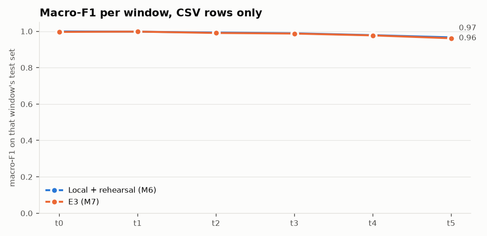

# M9: E4, drift-triggered updates, top-K features, adaptive gate (`dev` pool)

Run `20261116-114942_m9_e4_dev`. Generated by `scripts/m9_e4.py`. Seed 42. Scores use CSV-only rows (D7). Rows reach a client in 10 rounds per window, in random order, because the dataset has no timestamps. Between its update and the next g_t, a client uses its own calibrated output. Top-K limits new trees; older trees keep their splits, so inference still needs every feature.

**Passes missing from this report: ['e4', 'e4_label_free', 'e4_schedule', 'fixed']. They did not finish.**

## Results

| method | window avg | avg excl. t0 | final (t5) | SD over t1 to t5 | class forgetting |
|---|---:|---:|---:|---:|---:|
| Fixed schedule, top-10 | 0.9827 | 0.9801 | 0.9592 | 0.0157 | 0.0022 |
| Fixed schedule, top-10, client guard | 0.9850 | 0.9822 | 0.9647 | 0.0140 | 0.0054 |
| Fixed schedule, top-20 | 0.9847 | 0.9823 | 0.9605 | 0.0144 | 0.0046 |
| Fixed schedule, top-20, client guard | 0.9870 | 0.9846 | 0.9670 | 0.0123 | 0.0061 |
| Fixed schedule, top-30 | 0.9849 | 0.9826 | 0.9613 | 0.0144 | 0.0052 |
| Fixed schedule, top-30, client guard | 0.9874 | 0.9850 | 0.9673 | 0.0124 | 0.0061 |
| ADWIN trigger added to the fixed schedule, top-K | 0.9836 | 0.9810 | 0.9596 | 0.0147 | 0.0047 |
| ADWIN trigger added to the fixed schedule, top-K, client guard | 0.9862 | 0.9836 | 0.9652 | 0.0137 | 0.0067 |
| Local + rehearsal (M6) | 0.9874 | 0.9850 | 0.9665 | 0.0125 | 0.0057 |
| E3 (M7) | 0.9852 | 0.9830 | 0.9616 | 0.0141 | 0.0049 |
| E3 (M7), client guard | 0.9871 | 0.9847 | 0.9656 | 0.0130 | 0.0054 |

No `fixed` pass in this report, so nothing was checked against M7.

## Recovery inside each window

For E3, the old model and its g_t serve until the window ends. `mean over rounds` is macro-F1 averaged over the rounds of the window, with the window-end model as the last of them. `first trigger round` is the earliest over clients. Read the time to E3's earlier score: a method that already fell before the boundary reaches its own lower score sooner, which isn't a better recovery.

| method | window | own score before the boundary | old model on new rows | after window | mean over rounds | rounds to reach E3's earlier score (share of window) | rounds to reach its own (share of window) | first trigger round |
|---|---|---:|---:|---:|---:|---:|---:|---:|
| E3 (M7) | t1 | 0.996 | 0.457 | 0.998 | 0.506 | 1.0 | 1.0 | none |
| E3 (M7) | t2 | 0.998 | 0.655 | 0.991 | 0.686 | 1.0 | 1.0 | none |
| E3 (M7) | t3 | 0.991 | 0.570 | 0.987 | 0.608 | 1.0 | 1.0 | none |
| E3 (M7) | t4 | 0.987 | 0.719 | 0.977 | 0.743 | 1.0 | 1.0 | none |
| E3 (M7) | t5 | 0.977 | 0.914 | 0.962 | 0.918 | 1.0 | 1.0 | none |
| ADWIN trigger added to the fixed schedule, top-K | t1 | 0.997 | 0.457 | 0.998 | 0.945 | 0.1 | 0.1 | 1 |
| ADWIN trigger added to the fixed schedule, top-K | t2 | 0.998 | 0.655 | 0.988 | 0.888 | 1.0 | 1.0 | 1 |
| ADWIN trigger added to the fixed schedule, top-K | t3 | 0.988 | 0.552 | 0.985 | 0.938 | 0.1 | 0.1 | 1 |
| ADWIN trigger added to the fixed schedule, top-K | t4 | 0.985 | 0.718 | 0.974 | 0.920 | 1.0 | 1.0 | 1 |
| ADWIN trigger added to the fixed schedule, top-K | t5 | 0.974 | 0.913 | 0.960 | 0.931 | 1.0 | 1.0 | 1 |

## Cost

| method | local updates | clients updated, by window | uplink float32 (MB) | uplink 8-bit + zlib (MB) | downlink (kB) | local minutes |
|---|---:|---|---:|---:|---:|---:|
| Fixed schedule, top-10 | 90 | 15 15 15 15 15 15 | 22.6 | 0.5 | 35.6 | 3.2 |
| Fixed schedule, top-20 | 90 | 15 15 15 15 15 15 | 22.6 | 0.5 | 35.6 | 3.8 |
| Fixed schedule, top-30 | 90 | 15 15 15 15 15 15 | 22.6 | 0.5 | 35.6 | 3.2 |
| ADWIN trigger added to the fixed schedule, top-K | 131 | 15 15 15 15 15 15 | 22.6 | 0.5 | 35.6 | 5.3 |

## K sweep, fixed schedule

| K | mean validation macro-F1 | window avg (test) | final t5 (test) | picked |
|---:|---:|---:|---:|---|
| 10 | 0.9876 | 0.9827 | 0.9592 |  |
| 20 | 0.9884 | 0.9847 | 0.9605 |  |
| 30 | 0.9886 | 0.9849 | 0.9613 |  |

## Adaptive gate: choosing the strength

| method | strength | mean errors caught, next window | fixed gate at the same cost | mean escalated, next window | picked on validation rows |
|---|---:|---:|---:|---:|---|

## Gate on test rows

`thresholds_only` is M7's gate. `fixed` adds the proposal's ADWIN flag and equals the adaptive gate at a score of 0. `psi_flag` is the D8 sensitivity run, not a headline. Target 10% (D10). Shown for E3's schedule and E4, at the picked strength; if that is 0, adaptive rows don't appear. All strengths and methods are in `gate_test.csv`. `fixed gate at the same cost` is the errors a fixed gate catches when loosened to the same escalation rate, on the same rows, so it shows whether the drift score adds anything over a looser threshold.

| method | model through | eval window | error rate | mode | strength | escalated | errors caught | fixed gate at the same cost | accuracy on the rest |
|---|---|---|---:|---|---:|---:|---:|---:|---:|

