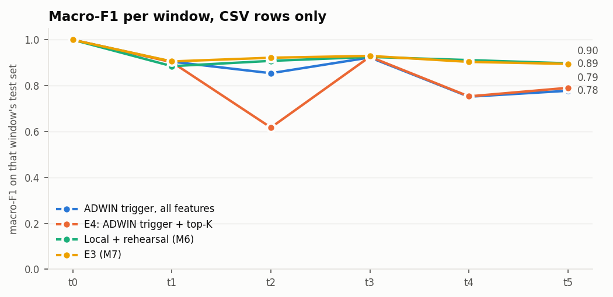

# M9: E4, drift-triggered updates, top-K features, adaptive gate (`full` pool)

Run `20261107-142108_m9_e4_full`. Generated by `scripts/m9_e4.py`. Seed 42. Scores use CSV-only rows (D7). Rows reach a client in 10 rounds per window, in random order, because the dataset has no timestamps. Between its update and the next g_t, a client uses its own calibrated output. Top-K limits new trees; older trees keep their splits, so inference still needs every feature.

## Results

| method | window avg | avg excl. t0 | final (t5) | SD over t1 to t5 | class forgetting |
|---|---:|---:|---:|---:|---:|
| Fixed schedule, all features (reproduces E3) | 0.9258 | 0.9111 | 0.8943 | 0.0142 | 0.0259 |
| Fixed schedule, all features (reproduces E3), client guard | 0.9289 | 0.9147 | 0.9005 | 0.0134 | 0.0236 |
| Fixed schedule, top-10 | 0.9157 | 0.8990 | 0.8812 | 0.0154 | 0.0285 |
| Fixed schedule, top-10, client guard | 0.9184 | 0.9022 | 0.8859 | 0.0138 | 0.0286 |
| Fixed schedule, top-20 | 0.9215 | 0.9060 | 0.8896 | 0.0149 | 0.0237 |
| Fixed schedule, top-20, client guard | 0.9235 | 0.9084 | 0.8934 | 0.0144 | 0.0243 |
| Fixed schedule, top-30 | 0.9262 | 0.9116 | 0.8960 | 0.0137 | 0.0260 |
| Fixed schedule, top-30, client guard | 0.9286 | 0.9144 | 0.9005 | 0.0126 | 0.0208 |
| ADWIN trigger, all features | 0.8683 | 0.8421 | 0.7776 | 0.0756 | 0.0081 |
| ADWIN trigger, all features, client guard | 0.8985 | 0.8783 | 0.8475 | 0.0494 | -0.0210 |
| Trigger on disagreement, all features | 0.7636 | 0.7165 | 0.7536 | 0.1688 | 0.0248 |
| Trigger on disagreement, all features, client guard | 0.8118 | 0.7742 | 0.8610 | 0.1828 | -0.0132 |
| E4: ADWIN trigger + top-K | 0.8315 | 0.7979 | 0.7904 | 0.1244 | -0.0080 |
| E4: ADWIN trigger + top-K, client guard | 0.8969 | 0.8763 | 0.8470 | 0.0397 | 0.0000 |
| ADWIN trigger added to the fixed schedule, top-K | 0.9244 | 0.9094 | 0.8925 | 0.0155 | 0.0288 |
| ADWIN trigger added to the fixed schedule, top-K, client guard | 0.9271 | 0.9126 | 0.8967 | 0.0139 | 0.0243 |
| Local + rehearsal (M6) | 0.9210 | 0.9053 | 0.8972 | 0.0151 | 0.0218 |
| E3 (M7) | 0.9257 | 0.9109 | 0.8947 | 0.0142 | 0.0245 |
| E3 (M7), client guard | 0.9288 | 0.9146 | 0.8986 | 0.0138 | 0.0249 |

Check against M7: `fixed` scores 0.92577 on window average and E3 in M7's report 0.92568 (difference +0.00009).

## Recovery inside each window

For E3, the old model and its g_t serve until the window ends. `mean over rounds` is macro-F1 averaged over the rounds of the window, with the window-end model as the last of them. `first trigger round` is the earliest over clients. Read the time to E3's earlier score: a method that already fell before the boundary reaches its own lower score sooner, which isn't a better recovery.

| method | window | own score before the boundary | old model on new rows | after window | mean over rounds | rounds to reach E3's earlier score (share of window) | rounds to reach its own (share of window) | first trigger round |
|---|---|---:|---:|---:|---:|---:|---:|---:|
| E3 (M7) | t1 | 0.999 | 0.462 | 0.905 | 0.502 | not in this window | not in this window | none |
| E3 (M7) | t2 | 0.905 | 0.636 | 0.922 | 0.662 | 1.0 | 1.0 | none |
| E3 (M7) | t3 | 0.922 | 0.615 | 0.929 | 0.644 | 1.0 | 1.0 | none |
| E3 (M7) | t4 | 0.929 | 0.755 | 0.904 | 0.769 | not in this window | not in this window | none |
| E3 (M7) | t5 | 0.904 | 0.850 | 0.895 | 0.854 | 1.0 | 1.0 | none |
| Fixed schedule, all features (reproduces E3) | t1 | 0.999 | 0.462 | 0.905 | 0.502 | not in this window | not in this window | none |
| Fixed schedule, all features (reproduces E3) | t2 | 0.905 | 0.636 | 0.922 | 0.662 | 1.0 | 1.0 | none |
| Fixed schedule, all features (reproduces E3) | t3 | 0.922 | 0.615 | 0.930 | 0.644 | 1.0 | 1.0 | none |
| Fixed schedule, all features (reproduces E3) | t4 | 0.930 | 0.755 | 0.904 | 0.769 | not in this window | not in this window | none |
| Fixed schedule, all features (reproduces E3) | t5 | 0.904 | 0.852 | 0.894 | 0.856 | 1.0 | 1.0 | none |
| ADWIN trigger, all features | t1 | 0.999 | 0.462 | 0.904 | 0.845 | not in this window | not in this window | 1 |
| ADWIN trigger, all features | t2 | 0.904 | 0.632 | 0.854 | 0.851 | not in this window | not in this window | 1 |
| ADWIN trigger, all features | t3 | 0.854 | 0.596 | 0.923 | 0.867 | 1.0 | 0.1 | 1 |
| ADWIN trigger, all features | t4 | 0.923 | 0.751 | 0.752 | 0.789 | not in this window | not in this window | 1 |
| ADWIN trigger, all features | t5 | 0.752 | 0.722 | 0.778 | 0.789 | not in this window | 0.1 | 1 |
| Trigger on disagreement, all features | t1 | 0.999 | 0.462 | 0.462 | 0.462 | not in this window | not in this window | none |
| Trigger on disagreement, all features | t2 | 0.462 | 0.318 | 0.683 | 0.721 | not in this window | 0.1 | 1 |
| Trigger on disagreement, all features | t3 | 0.683 | 0.480 | 0.929 | 0.875 | 0.2 | 0.1 | 1 |
| Trigger on disagreement, all features | t4 | 0.929 | 0.754 | 0.755 | 0.811 | not in this window | not in this window | 1 |
| Trigger on disagreement, all features | t5 | 0.755 | 0.726 | 0.754 | 0.783 | not in this window | 0.1 | 1 |
| E4: ADWIN trigger + top-K | t1 | 0.999 | 0.462 | 0.902 | 0.845 | not in this window | not in this window | 1 |
| E4: ADWIN trigger + top-K | t2 | 0.902 | 0.627 | 0.617 | 0.815 | not in this window | not in this window | 1 |
| E4: ADWIN trigger + top-K | t3 | 0.617 | 0.443 | 0.926 | 0.799 | 1.0 | 0.1 | 1 |
| E4: ADWIN trigger + top-K | t4 | 0.926 | 0.753 | 0.753 | 0.804 | not in this window | not in this window | 1 |
| E4: ADWIN trigger + top-K | t5 | 0.753 | 0.726 | 0.790 | 0.793 | not in this window | 0.1 | 1 |
| ADWIN trigger added to the fixed schedule, top-K | t1 | 0.999 | 0.462 | 0.902 | 0.845 | not in this window | not in this window | 1 |
| ADWIN trigger added to the fixed schedule, top-K | t2 | 0.902 | 0.627 | 0.921 | 0.842 | 1.0 | 1.0 | 1 |
| ADWIN trigger added to the fixed schedule, top-K | t3 | 0.921 | 0.627 | 0.930 | 0.884 | 0.2 | 0.2 | 1 |
| ADWIN trigger added to the fixed schedule, top-K | t4 | 0.930 | 0.756 | 0.901 | 0.822 | not in this window | not in this window | 1 |
| ADWIN trigger added to the fixed schedule, top-K | t5 | 0.901 | 0.849 | 0.893 | 0.875 | 1.0 | 1.0 | 1 |

## Cost

| method | local updates | clients updated, by window | uplink float32 (MB) | uplink 8-bit + zlib (MB) | downlink (kB) | local minutes |
|---|---:|---|---:|---:|---:|---:|
| Fixed schedule, all features (reproduces E3) | 90 | 15 15 15 15 15 15 | 338.6 | 16.6 | 35.6 | 18.7 |
| Fixed schedule, top-10 | 90 | 15 15 15 15 15 15 | 338.6 | 17.3 | 35.6 | 16.3 |
| Fixed schedule, top-20 | 90 | 15 15 15 15 15 15 | 338.6 | 16.8 | 35.6 | 16.9 |
| Fixed schedule, top-30 | 90 | 15 15 15 15 15 15 | 338.6 | 16.6 | 35.6 | 17.4 |
| ADWIN trigger, all features | 95 | 15 15 5 13 1 6 | 189.7 | 8.8 | 35.6 | 24.7 |
| Trigger on disagreement, all features | 75 | 15 0 10 15 1 4 | 190.3 | 6.1 | 35.6 | 19.0 |
| E4: ADWIN trigger + top-K | 95 | 15 15 3 14 2 6 | 189.9 | 8.8 | 35.6 | 25.2 |
| ADWIN trigger added to the fixed schedule, top-K | 128 | 15 15 15 15 15 15 | 338.6 | 16.6 | 35.6 | 34.7 |

## K sweep, fixed schedule

| K | mean validation macro-F1 | window avg (test) | final t5 (test) | picked |
|---:|---:|---:|---:|---|
| 10 | 0.8996 | 0.9157 | 0.8812 |  |
| 20 | 0.9070 | 0.9215 | 0.8896 |  |
| 30 | 0.9115 | 0.9262 | 0.8960 | yes |

## Adaptive gate: choosing the strength

| method | strength | mean errors caught, next window | fixed gate at the same cost | mean escalated, next window | picked on validation rows |
|---|---:|---:|---:|---:|---|
| Fixed schedule, all features (reproduces E3) | 0 | 0.248 | 0.248 | 0.067 |  |
| Fixed schedule, all features (reproduces E3) | 1 | 0.255 | 0.253 | 0.069 |  |
| Fixed schedule, all features (reproduces E3) | 2 | 0.261 | 0.259 | 0.071 |  |
| Fixed schedule, all features (reproduces E3) | 4 | 0.274 | 0.271 | 0.075 |  |
| Fixed schedule, all features (reproduces E3) | 8 | 0.301 | 0.296 | 0.084 | yes |
| Fixed schedule, all features (reproduces E3) | 16 | 0.344 | 0.361 | 0.110 |  |
| E4: ADWIN trigger + top-K | 0 | 0.208 | 0.208 | 0.061 |  |
| E4: ADWIN trigger + top-K | 1 | 0.214 | 0.214 | 0.063 |  |
| E4: ADWIN trigger + top-K | 2 | 0.221 | 0.220 | 0.066 |  |
| E4: ADWIN trigger + top-K | 4 | 0.240 | 0.236 | 0.072 |  |
| E4: ADWIN trigger + top-K | 8 | 0.271 | 0.281 | 0.089 | yes |
| E4: ADWIN trigger + top-K | 16 | 0.314 | 0.328 | 0.111 |  |

## Gate on test rows

`thresholds_only` is M7's gate. `fixed` adds the proposal's ADWIN flag and equals the adaptive gate at a score of 0. `psi_flag` is the D8 sensitivity run, not a headline. Target 10% (D10). Shown for E3's schedule and E4, at the picked strength; if that is 0, adaptive rows don't appear. All strengths and methods are in `gate_test.csv`. `fixed gate at the same cost` is the errors a fixed gate catches when loosened to the same escalation rate, on the same rows, so it shows whether the drift score adds anything over a looser threshold.

| method | model through | eval window | error rate | mode | strength | escalated | errors caught | fixed gate at the same cost | accuracy on the rest |
|---|---|---|---:|---|---:|---:|---:|---:|---:|
| Fixed schedule, all features (reproduces E3) | t0 | t0 | 0.000 | thresholds_only |  | 0.002 | 0.778 |  | 1.000 |
| Fixed schedule, all features (reproduces E3) | t0 | t0 | 0.000 | psi_flag |  | 0.002 | 0.778 |  | 1.000 |
| Fixed schedule, all features (reproduces E3) | t0 | t0 | 0.000 | fixed | 0 | 0.002 | 0.778 | 0.778 | 1.000 |
| Fixed schedule, all features (reproduces E3) | t0 | t0 | 0.000 | adaptive | 8 | 0.002 | 0.778 | 0.778 | 1.000 |
| Fixed schedule, all features (reproduces E3) | t0 | t1 | 0.741 | thresholds_only |  | 0.002 | 0.002 |  | 0.259 |
| Fixed schedule, all features (reproduces E3) | t0 | t1 | 0.741 | psi_flag |  | 0.871 | 0.912 |  | 0.498 |
| Fixed schedule, all features (reproduces E3) | t0 | t1 | 0.741 | fixed | 0 | 0.002 | 0.002 | 0.002 | 0.259 |
| Fixed schedule, all features (reproduces E3) | t0 | t1 | 0.741 | adaptive | 8 | 0.002 | 0.002 | 0.002 | 0.259 |
| Fixed schedule, all features (reproduces E3) | t1 | t1 | 0.102 | thresholds_only |  | 0.071 | 0.296 |  | 0.923 |
| Fixed schedule, all features (reproduces E3) | t1 | t1 | 0.102 | psi_flag |  | 0.341 | 0.476 |  | 0.919 |
| Fixed schedule, all features (reproduces E3) | t1 | t1 | 0.102 | fixed | 0 | 0.071 | 0.296 | 0.296 | 0.923 |
| Fixed schedule, all features (reproduces E3) | t1 | t1 | 0.102 | adaptive | 8 | 0.071 | 0.296 | 0.296 | 0.923 |
| Fixed schedule, all features (reproduces E3) | t1 | t2 | 0.115 | thresholds_only |  | 0.080 | 0.350 |  | 0.919 |
| Fixed schedule, all features (reproduces E3) | t1 | t2 | 0.115 | psi_flag |  | 0.348 | 0.508 |  | 0.913 |
| Fixed schedule, all features (reproduces E3) | t1 | t2 | 0.115 | fixed | 0 | 0.083 | 0.353 | 0.353 | 0.919 |
| Fixed schedule, all features (reproduces E3) | t1 | t2 | 0.115 | adaptive | 8 | 0.089 | 0.372 | 0.371 | 0.921 |
| Fixed schedule, all features (reproduces E3) | t2 | t2 | 0.100 | thresholds_only |  | 0.073 | 0.315 |  | 0.926 |
| Fixed schedule, all features (reproduces E3) | t2 | t2 | 0.100 | psi_flag |  | 0.073 | 0.315 |  | 0.926 |
| Fixed schedule, all features (reproduces E3) | t2 | t2 | 0.100 | fixed | 0 | 0.073 | 0.315 | 0.315 | 0.926 |
| Fixed schedule, all features (reproduces E3) | t2 | t2 | 0.100 | adaptive | 8 | 0.080 | 0.341 | 0.343 | 0.929 |
| Fixed schedule, all features (reproduces E3) | t2 | t3 | 0.157 | thresholds_only |  | 0.097 | 0.369 |  | 0.891 |
| Fixed schedule, all features (reproduces E3) | t2 | t3 | 0.157 | psi_flag |  | 0.121 | 0.425 |  | 0.897 |
| Fixed schedule, all features (reproduces E3) | t2 | t3 | 0.157 | fixed | 0 | 0.105 | 0.376 | 0.376 | 0.891 |
| Fixed schedule, all features (reproduces E3) | t2 | t3 | 0.157 | adaptive | 8 | 0.142 | 0.491 | 0.468 | 0.907 |
| Fixed schedule, all features (reproduces E3) | t3 | t3 | 0.107 | thresholds_only |  | 0.067 | 0.277 |  | 0.917 |
| Fixed schedule, all features (reproduces E3) | t3 | t3 | 0.107 | psi_flag |  | 0.097 | 0.297 |  | 0.917 |
| Fixed schedule, all features (reproduces E3) | t3 | t3 | 0.107 | fixed | 0 | 0.067 | 0.277 | 0.277 | 0.917 |
| Fixed schedule, all features (reproduces E3) | t3 | t3 | 0.107 | adaptive | 8 | 0.094 | 0.365 | 0.366 | 0.925 |
| Fixed schedule, all features (reproduces E3) | t3 | t4 | 0.111 | thresholds_only |  | 0.068 | 0.274 |  | 0.914 |
| Fixed schedule, all features (reproduces E3) | t3 | t4 | 0.111 | psi_flag |  | 0.098 | 0.292 |  | 0.913 |
| Fixed schedule, all features (reproduces E3) | t3 | t4 | 0.111 | fixed | 0 | 0.069 | 0.275 | 0.275 | 0.914 |
| Fixed schedule, all features (reproduces E3) | t3 | t4 | 0.111 | adaptive | 8 | 0.096 | 0.360 | 0.361 | 0.921 |
| Fixed schedule, all features (reproduces E3) | t4 | t4 | 0.106 | thresholds_only |  | 0.069 | 0.283 |  | 0.918 |
| Fixed schedule, all features (reproduces E3) | t4 | t4 | 0.106 | psi_flag |  | 0.069 | 0.283 |  | 0.918 |
| Fixed schedule, all features (reproduces E3) | t4 | t4 | 0.106 | fixed | 0 | 0.069 | 0.283 | 0.283 | 0.918 |
| Fixed schedule, all features (reproduces E3) | t4 | t4 | 0.106 | adaptive | 8 | 0.070 | 0.286 | 0.286 | 0.918 |
| Fixed schedule, all features (reproduces E3) | t4 | t5 | 0.138 | thresholds_only |  | 0.068 | 0.206 |  | 0.882 |
| Fixed schedule, all features (reproduces E3) | t4 | t5 | 0.138 | psi_flag |  | 0.175 | 0.311 |  | 0.885 |
| Fixed schedule, all features (reproduces E3) | t4 | t5 | 0.138 | fixed | 0 | 0.071 | 0.210 | 0.210 | 0.882 |
| Fixed schedule, all features (reproduces E3) | t4 | t5 | 0.138 | adaptive | 8 | 0.080 | 0.233 | 0.238 | 0.885 |
| Fixed schedule, all features (reproduces E3) | t5 | t5 | 0.103 | thresholds_only |  | 0.062 | 0.279 |  | 0.921 |
| Fixed schedule, all features (reproduces E3) | t5 | t5 | 0.103 | psi_flag |  | 0.169 | 0.357 |  | 0.921 |
| Fixed schedule, all features (reproduces E3) | t5 | t5 | 0.103 | fixed | 0 | 0.062 | 0.279 | 0.279 | 0.921 |
| Fixed schedule, all features (reproduces E3) | t5 | t5 | 0.103 | adaptive | 8 | 0.078 | 0.326 | 0.333 | 0.925 |
| E4: ADWIN trigger + top-K | t0 | t0 | 0.000 | thresholds_only |  | 0.002 | 0.750 |  | 1.000 |
| E4: ADWIN trigger + top-K | t0 | t0 | 0.000 | psi_flag |  | 0.002 | 0.750 |  | 1.000 |
| E4: ADWIN trigger + top-K | t0 | t0 | 0.000 | fixed | 0 | 0.002 | 0.750 | 0.750 | 1.000 |
| E4: ADWIN trigger + top-K | t0 | t0 | 0.000 | adaptive | 8 | 0.002 | 0.750 | 0.750 | 1.000 |
| E4: ADWIN trigger + top-K | t0 | t1 | 0.741 | thresholds_only |  | 0.002 | 0.002 |  | 0.259 |
| E4: ADWIN trigger + top-K | t0 | t1 | 0.741 | psi_flag |  | 0.871 | 0.912 |  | 0.498 |
| E4: ADWIN trigger + top-K | t0 | t1 | 0.741 | fixed | 0 | 0.002 | 0.002 | 0.002 | 0.259 |
| E4: ADWIN trigger + top-K | t0 | t1 | 0.741 | adaptive | 8 | 0.002 | 0.002 | 0.002 | 0.259 |
| E4: ADWIN trigger + top-K | t1 | t1 | 0.106 | thresholds_only |  | 0.067 | 0.271 |  | 0.917 |
| E4: ADWIN trigger + top-K | t1 | t1 | 0.106 | psi_flag |  | 0.339 | 0.436 |  | 0.910 |
| E4: ADWIN trigger + top-K | t1 | t1 | 0.106 | fixed | 0 | 0.067 | 0.271 | 0.271 | 0.917 |
| E4: ADWIN trigger + top-K | t1 | t1 | 0.106 | adaptive | 8 | 0.067 | 0.271 | 0.271 | 0.917 |
| E4: ADWIN trigger + top-K | t1 | t2 | 0.119 | thresholds_only |  | 0.076 | 0.320 |  | 0.912 |
| E4: ADWIN trigger + top-K | t1 | t2 | 0.119 | psi_flag |  | 0.344 | 0.466 |  | 0.903 |
| E4: ADWIN trigger + top-K | t1 | t2 | 0.119 | fixed | 0 | 0.079 | 0.323 | 0.323 | 0.912 |
| E4: ADWIN trigger + top-K | t1 | t2 | 0.119 | adaptive | 8 | 0.086 | 0.347 | 0.349 | 0.915 |
| E4: ADWIN trigger + top-K | t2 | t2 | 0.120 | thresholds_only |  | 0.072 | 0.262 |  | 0.904 |
| E4: ADWIN trigger + top-K | t2 | t2 | 0.120 | psi_flag |  | 0.072 | 0.262 |  | 0.904 |
| E4: ADWIN trigger + top-K | t2 | t2 | 0.120 | fixed | 0 | 0.072 | 0.262 | 0.262 | 0.904 |
| E4: ADWIN trigger + top-K | t2 | t2 | 0.120 | adaptive | 8 | 0.099 | 0.323 | 0.338 | 0.910 |
| E4: ADWIN trigger + top-K | t2 | t3 | 0.176 | thresholds_only |  | 0.075 | 0.207 |  | 0.849 |
| E4: ADWIN trigger + top-K | t2 | t3 | 0.176 | psi_flag |  | 0.105 | 0.288 |  | 0.860 |
| E4: ADWIN trigger + top-K | t2 | t3 | 0.176 | fixed | 0 | 0.082 | 0.215 | 0.215 | 0.849 |
| E4: ADWIN trigger + top-K | t2 | t3 | 0.176 | adaptive | 8 | 0.145 | 0.367 | 0.342 | 0.870 |
| E4: ADWIN trigger + top-K | t3 | t3 | 0.107 | thresholds_only |  | 0.069 | 0.289 |  | 0.918 |
| E4: ADWIN trigger + top-K | t3 | t3 | 0.107 | psi_flag |  | 0.099 | 0.310 |  | 0.918 |
| E4: ADWIN trigger + top-K | t3 | t3 | 0.107 | fixed | 0 | 0.069 | 0.289 | 0.289 | 0.918 |
| E4: ADWIN trigger + top-K | t3 | t3 | 0.107 | adaptive | 8 | 0.097 | 0.385 | 0.383 | 0.927 |
| E4: ADWIN trigger + top-K | t3 | t4 | 0.111 | thresholds_only |  | 0.069 | 0.282 |  | 0.914 |
| E4: ADWIN trigger + top-K | t3 | t4 | 0.111 | psi_flag |  | 0.100 | 0.300 |  | 0.914 |
| E4: ADWIN trigger + top-K | t3 | t4 | 0.111 | fixed | 0 | 0.071 | 0.283 | 0.283 | 0.914 |
| E4: ADWIN trigger + top-K | t3 | t4 | 0.111 | adaptive | 8 | 0.099 | 0.375 | 0.377 | 0.923 |
| E4: ADWIN trigger + top-K | t4 | t4 | 0.109 | thresholds_only |  | 0.067 | 0.266 |  | 0.914 |
| E4: ADWIN trigger + top-K | t4 | t4 | 0.109 | psi_flag |  | 0.067 | 0.266 |  | 0.914 |
| E4: ADWIN trigger + top-K | t4 | t4 | 0.109 | fixed | 0 | 0.067 | 0.266 | 0.266 | 0.914 |
| E4: ADWIN trigger + top-K | t4 | t4 | 0.109 | adaptive | 8 | 0.069 | 0.271 | 0.272 | 0.915 |
| E4: ADWIN trigger + top-K | t4 | t5 | 0.141 | thresholds_only |  | 0.063 | 0.196 |  | 0.879 |
| E4: ADWIN trigger + top-K | t4 | t5 | 0.141 | psi_flag |  | 0.172 | 0.309 |  | 0.882 |
| E4: ADWIN trigger + top-K | t4 | t5 | 0.141 | fixed | 0 | 0.066 | 0.200 | 0.200 | 0.879 |
| E4: ADWIN trigger + top-K | t4 | t5 | 0.141 | adaptive | 8 | 0.084 | 0.238 | 0.246 | 0.883 |
| E4: ADWIN trigger + top-K | t5 | t5 | 0.106 | thresholds_only |  | 0.062 | 0.263 |  | 0.916 |
| E4: ADWIN trigger + top-K | t5 | t5 | 0.106 | psi_flag |  | 0.170 | 0.338 |  | 0.915 |
| E4: ADWIN trigger + top-K | t5 | t5 | 0.106 | fixed | 0 | 0.062 | 0.263 | 0.263 | 0.916 |
| E4: ADWIN trigger + top-K | t5 | t5 | 0.106 | adaptive | 8 | 0.077 | 0.307 | 0.318 | 0.920 |

