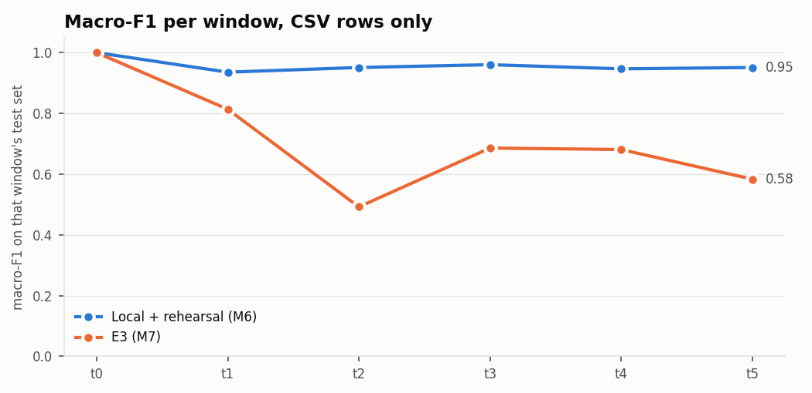

# M9: E4, drift-triggered updates, top-K features, adaptive gate (`full` pool)

Run `20261116-210624_m9_e4_full`. Generated by `scripts/m9_e4.py`. Seed 42. Scores use CSV-only rows (D7). Rows reach a client in 10 rounds per window, in random order, because the dataset has no timestamps. Between its update and the next g_t, a client uses its own calibrated output. Top-K limits new trees; older trees keep their splits, so inference still needs every feature.

**Passes missing from this report: ['e4', 'e4_label_free', 'e4_schedule', 'fixed']. They did not finish.**

## Results

| method | window avg | avg excl. t0 | final (t5) | SD over t1 to t5 | class forgetting |
|---|---:|---:|---:|---:|---:|
| Fixed schedule, top-10 | 0.7332 | 0.6799 | 0.6592 | 0.0918 | 0.1116 |
| Fixed schedule, top-10, client guard | 0.9502 | 0.9402 | 0.9362 | 0.0072 | 0.0178 |
| Fixed schedule, top-20 | 0.7053 | 0.6464 | 0.5899 | 0.1038 | 0.1727 |
| Fixed schedule, top-20, client guard | 0.9532 | 0.9438 | 0.9419 | 0.0096 | 0.0132 |
| Fixed schedule, top-30 | 0.7133 | 0.6560 | 0.5918 | 0.0903 | 0.1790 |
| Fixed schedule, top-30, client guard | 0.9580 | 0.9496 | 0.9501 | 0.0074 | 0.0112 |
| ADWIN trigger added to the fixed schedule, top-K | 0.7211 | 0.6654 | 0.5633 | 0.1456 | 0.1906 |
| ADWIN trigger added to the fixed schedule, top-K, client guard | 0.9566 | 0.9479 | 0.9481 | 0.0091 | 0.0101 |
| Local + rehearsal (M6) | 0.9573 | 0.9487 | 0.9508 | 0.0090 | 0.0113 |
| E3 (M7) | 0.7091 | 0.6510 | 0.5832 | 0.1208 | 0.2028 |
| E3 (M7), client guard | 0.9586 | 0.9504 | 0.9508 | 0.0063 | 0.0128 |

No `fixed` pass in this report, so nothing was checked against M7.

## Recovery inside each window

For E3, the old model and its g_t serve until the window ends. `mean over rounds` is macro-F1 averaged over the rounds of the window, with the window-end model as the last of them. `first trigger round` is the earliest over clients. Read the time to E3's earlier score: a method that already fell before the boundary reaches its own lower score sooner, which isn't a better recovery.

| method | window | own score before the boundary | old model on new rows | after window | mean over rounds | rounds to reach E3's earlier score (share of window) | rounds to reach its own (share of window) | first trigger round |
|---|---|---:|---:|---:|---:|---:|---:|---:|
| E3 (M7) | t1 | 1.000 | 0.334 | 0.813 | 0.378 | not in this window | not in this window | none |
| E3 (M7) | t2 | 0.813 | 0.572 | 0.492 | 0.565 | not in this window | not in this window | none |
| E3 (M7) | t3 | 0.492 | 0.380 | 0.686 | 0.408 | 1.0 | 1.0 | none |
| E3 (M7) | t4 | 0.686 | 0.563 | 0.681 | 0.574 | 1.0 | 1.0 | none |
| E3 (M7) | t5 | 0.681 | 0.687 | 0.583 | 0.678 | 0.0 | 0.0 | none |
| ADWIN trigger added to the fixed schedule, top-K | t1 | 1.000 | 0.399 | 0.912 | 0.884 | not in this window | not in this window | 1 |
| ADWIN trigger added to the fixed schedule, top-K | t2 | 0.912 | 0.653 | 0.594 | 0.875 | 0.1 | 0.1 | 1 |
| ADWIN trigger added to the fixed schedule, top-K | t3 | 0.594 | 0.454 | 0.681 | 0.657 | 0.1 | 0.1 | 1 |
| ADWIN trigger added to the fixed schedule, top-K | t4 | 0.681 | 0.559 | 0.576 | 0.869 | 0.1 | 0.1 | 1 |
| ADWIN trigger added to the fixed schedule, top-K | t5 | 0.576 | 0.576 | 0.563 | 0.597 | not in this window | 0.0 | 1 |

## Cost

| method | local updates | clients updated, by window | uplink float32 (MB) | uplink 8-bit + zlib (MB) | downlink (kB) | local minutes |
|---|---:|---|---:|---:|---:|---:|
| Fixed schedule, top-10 | 90 | 15 15 15 15 15 15 | 338.6 | 12.1 | 35.6 | 16.3 |
| Fixed schedule, top-20 | 90 | 15 15 15 15 15 15 | 338.6 | 11.5 | 35.6 | 16.7 |
| Fixed schedule, top-30 | 90 | 15 15 15 15 15 15 | 338.6 | 11.5 | 35.6 | 16.8 |
| ADWIN trigger added to the fixed schedule, top-K | 127 | 15 15 15 15 15 15 | 338.6 | 11.6 | 35.6 | 32.8 |

## K sweep, fixed schedule

| K | mean validation macro-F1 | window avg (test) | final t5 (test) | picked |
|---:|---:|---:|---:|---|
| 10 | 0.9110 | 0.7332 | 0.6592 |  |
| 20 | 0.9256 | 0.7053 | 0.5899 |  |
| 30 | 0.9300 | 0.7133 | 0.5918 |  |

## Adaptive gate: choosing the strength

| method | strength | mean errors caught, next window | fixed gate at the same cost | mean escalated, next window | picked on validation rows |
|---|---:|---:|---:|---:|---|

## Gate on test rows

`thresholds_only` is M7's gate. `fixed` adds the proposal's ADWIN flag and equals the adaptive gate at a score of 0. `psi_flag` is the D8 sensitivity run, not a headline. Target 10% (D10). Shown for E3's schedule and E4, at the picked strength; if that is 0, adaptive rows don't appear. All strengths and methods are in `gate_test.csv`. `fixed gate at the same cost` is the errors a fixed gate catches when loosened to the same escalation rate, on the same rows, so it shows whether the drift score adds anything over a looser threshold.

| method | model through | eval window | error rate | mode | strength | escalated | errors caught | fixed gate at the same cost | accuracy on the rest |
|---|---|---|---:|---|---:|---:|---:|---:|---:|

