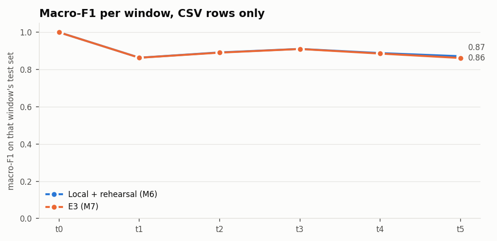

# M9: E4, drift-triggered updates, top-K features, adaptive gate (`full` pool)

Run `20261116-210943_m9_e4_full`. Generated by `scripts/m9_e4.py`. Seed 42. Scores use CSV-only rows (D7). Rows reach a client in 10 rounds per window, in random order, because the dataset has no timestamps. Between its update and the next g_t, a client uses its own calibrated output. Top-K limits new trees; older trees keep their splits, so inference still needs every feature.

**Passes missing from this report: ['e4', 'e4_label_free', 'e4_schedule', 'fixed']. They did not finish.**

## Results

| method | window avg | avg excl. t0 | final (t5) | SD over t1 to t5 | class forgetting |
|---|---:|---:|---:|---:|---:|
| Fixed schedule, top-10 | 0.8942 | 0.8732 | 0.8489 | 0.0215 | 0.0511 |
| Fixed schedule, top-10, client guard | 0.8960 | 0.8753 | 0.8547 | 0.0201 | 0.0518 |
| Fixed schedule, top-20 | 0.8994 | 0.8795 | 0.8565 | 0.0218 | 0.0496 |
| Fixed schedule, top-20, client guard | 0.9011 | 0.8815 | 0.8648 | 0.0197 | 0.0486 |
| Fixed schedule, top-30 | 0.9015 | 0.8820 | 0.8625 | 0.0205 | 0.0482 |
| Fixed schedule, top-30, client guard | 0.9046 | 0.8857 | 0.8711 | 0.0184 | 0.0469 |
| ADWIN trigger added to the fixed schedule, top-K | 0.9007 | 0.8810 | 0.8593 | 0.0205 | 0.0467 |
| ADWIN trigger added to the fixed schedule, top-K, client guard | 0.9030 | 0.8838 | 0.8670 | 0.0187 | 0.0454 |
| Local + rehearsal (M6) | 0.9041 | 0.8850 | 0.8712 | 0.0184 | 0.0455 |
| E3 (M7) | 0.9017 | 0.8821 | 0.8618 | 0.0202 | 0.0464 |
| E3 (M7), client guard | 0.9048 | 0.8859 | 0.8708 | 0.0181 | 0.0469 |

No `fixed` pass in this report, so nothing was checked against M7.

## Recovery inside each window

For E3, the old model and its g_t serve until the window ends. `mean over rounds` is macro-F1 averaged over the rounds of the window, with the window-end model as the last of them. `first trigger round` is the earliest over clients. Read the time to E3's earlier score: a method that already fell before the boundary reaches its own lower score sooner, which isn't a better recovery.

| method | window | own score before the boundary | old model on new rows | after window | mean over rounds | rounds to reach E3's earlier score (share of window) | rounds to reach its own (share of window) | first trigger round |
|---|---|---:|---:|---:|---:|---:|---:|---:|
| E3 (M7) | t1 | 0.999 | 0.461 | 0.863 | 0.498 | not in this window | not in this window | none |
| E3 (M7) | t2 | 0.863 | 0.611 | 0.891 | 0.636 | 1.0 | 1.0 | none |
| E3 (M7) | t3 | 0.891 | 0.613 | 0.910 | 0.640 | 1.0 | 1.0 | none |
| E3 (M7) | t4 | 0.910 | 0.740 | 0.885 | 0.753 | not in this window | not in this window | none |
| E3 (M7) | t5 | 0.885 | 0.830 | 0.862 | 0.833 | not in this window | not in this window | none |
| ADWIN trigger added to the fixed schedule, top-K | t1 | 0.999 | 0.461 | 0.862 | 0.820 | not in this window | not in this window | 1 |
| ADWIN trigger added to the fixed schedule, top-K | t2 | 0.862 | 0.609 | 0.891 | 0.772 | 1.0 | 1.0 | 1 |
| ADWIN trigger added to the fixed schedule, top-K | t3 | 0.891 | 0.626 | 0.909 | 0.869 | 0.1 | 0.1 | 1 |
| ADWIN trigger added to the fixed schedule, top-K | t4 | 0.909 | 0.738 | 0.883 | 0.751 | not in this window | not in this window | none |
| ADWIN trigger added to the fixed schedule, top-K | t5 | 0.883 | 0.830 | 0.859 | 0.854 | not in this window | not in this window | 1 |

## Cost

| method | local updates | clients updated, by window | uplink float32 (MB) | uplink 8-bit + zlib (MB) | downlink (kB) | local minutes |
|---|---:|---|---:|---:|---:|---:|
| Fixed schedule, top-10 | 90 | 15 15 15 15 15 15 | 338.6 | 18.2 | 35.6 | 16.6 |
| Fixed schedule, top-20 | 90 | 15 15 15 15 15 15 | 338.6 | 17.7 | 35.6 | 17.3 |
| Fixed schedule, top-30 | 90 | 15 15 15 15 15 15 | 338.6 | 17.5 | 35.6 | 18.2 |
| ADWIN trigger added to the fixed schedule, top-K | 129 | 15 15 15 15 15 15 | 338.6 | 17.6 | 35.6 | 35.3 |

## K sweep, fixed schedule

| K | mean validation macro-F1 | window avg (test) | final t5 (test) | picked |
|---:|---:|---:|---:|---|
| 10 | 0.8906 | 0.8942 | 0.8489 |  |
| 20 | 0.8974 | 0.8994 | 0.8565 |  |
| 30 | 0.9011 | 0.9015 | 0.8625 |  |

## Adaptive gate: choosing the strength

| method | strength | mean errors caught, next window | fixed gate at the same cost | mean escalated, next window | picked on validation rows |
|---|---:|---:|---:|---:|---|

## Gate on test rows

`thresholds_only` is M7's gate. `fixed` adds the proposal's ADWIN flag and equals the adaptive gate at a score of 0. `psi_flag` is the D8 sensitivity run, not a headline. Target 10% (D10). Shown for E3's schedule and E4, at the picked strength; if that is 0, adaptive rows don't appear. All strengths and methods are in `gate_test.csv`. `fixed gate at the same cost` is the errors a fixed gate catches when loosened to the same escalation rate, on the same rows, so it shows whether the drift score adds anything over a looser threshold.

| method | model through | eval window | error rate | mode | strength | escalated | errors caught | fixed gate at the same cost | accuracy on the rest |
|---|---|---|---:|---|---:|---:|---:|---:|---:|

