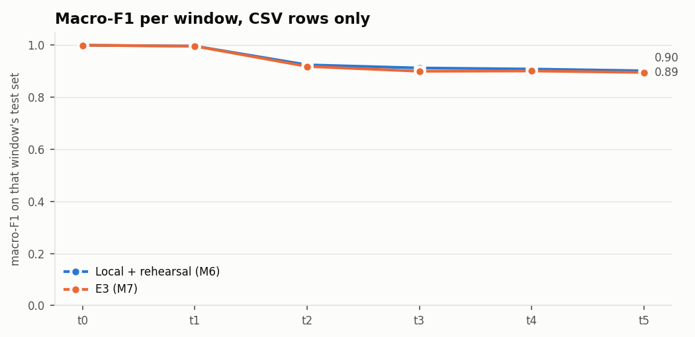

# M9: E4, drift-triggered updates, top-K features, adaptive gate (`full` pool)

Run `20261116-205620_m9_e4_full`. Generated by `scripts/m9_e4.py`. Seed 42. Scores use CSV-only rows (D7). Rows reach a client in 10 rounds per window, in random order, because the dataset has no timestamps. Between its update and the next g_t, a client uses its own calibrated output. Top-K limits new trees; older trees keep their splits, so inference still needs every feature.

**Passes missing from this report: ['e4', 'e4_label_free', 'e4_schedule', 'fixed']. They did not finish.**

## Results

| method | window avg | avg excl. t0 | final (t5) | SD over t1 to t5 | class forgetting |
|---|---:|---:|---:|---:|---:|
| Fixed schedule, top-10 | 0.9258 | 0.9111 | 0.8830 | 0.0469 | 0.0172 |
| Fixed schedule, top-10, client guard | 0.9312 | 0.9175 | 0.8892 | 0.0434 | 0.0216 |
| Fixed schedule, top-20 | 0.9334 | 0.9203 | 0.8912 | 0.0432 | 0.0180 |
| Fixed schedule, top-20, client guard | 0.9388 | 0.9267 | 0.9012 | 0.0396 | 0.0188 |
| Fixed schedule, top-30 | 0.9337 | 0.9207 | 0.8972 | 0.0426 | 0.0172 |
| Fixed schedule, top-30, client guard | 0.9402 | 0.9283 | 0.9040 | 0.0388 | 0.0200 |
| ADWIN trigger added to the fixed schedule, top-K | 0.9340 | 0.9210 | 0.8954 | 0.0436 | 0.0171 |
| ADWIN trigger added to the fixed schedule, top-K, client guard | 0.9411 | 0.9295 | 0.9047 | 0.0384 | 0.0194 |
| Local + rehearsal (M6) | 0.9402 | 0.9284 | 0.9014 | 0.0387 | 0.0222 |
| E3 (M7) | 0.9347 | 0.9218 | 0.8949 | 0.0424 | 0.0186 |
| E3 (M7), client guard | 0.9412 | 0.9296 | 0.9030 | 0.0381 | 0.0211 |

No `fixed` pass in this report, so nothing was checked against M7.

## Recovery inside each window

For E3, the old model and its g_t serve until the window ends. `mean over rounds` is macro-F1 averaged over the rounds of the window, with the window-end model as the last of them. `first trigger round` is the earliest over clients. Read the time to E3's earlier score: a method that already fell before the boundary reaches its own lower score sooner, which isn't a better recovery.

| method | window | own score before the boundary | old model on new rows | after window | mean over rounds | rounds to reach E3's earlier score (share of window) | rounds to reach its own (share of window) | first trigger round |
|---|---|---:|---:|---:|---:|---:|---:|---:|
| E3 (M7) | t1 | 0.999 | 0.579 | 0.996 | 0.617 | 1.0 | 1.0 | none |
| E3 (M7) | t2 | 0.996 | 0.689 | 0.918 | 0.710 | not in this window | not in this window | none |
| E3 (M7) | t3 | 0.918 | 0.721 | 0.900 | 0.737 | 1.0 | 1.0 | none |
| E3 (M7) | t4 | 0.900 | 0.681 | 0.901 | 0.701 | 1.0 | 1.0 | none |
| E3 (M7) | t5 | 0.901 | 0.863 | 0.895 | 0.866 | 1.0 | 1.0 | none |
| ADWIN trigger added to the fixed schedule, top-K | t1 | 0.999 | 0.563 | 0.995 | 0.953 | 0.1 | 0.1 | 1 |
| ADWIN trigger added to the fixed schedule, top-K | t2 | 0.995 | 0.689 | 0.926 | 0.902 | not in this window | not in this window | 1 |
| ADWIN trigger added to the fixed schedule, top-K | t3 | 0.926 | 0.728 | 0.896 | 0.743 | not in this window | not in this window | none |
| ADWIN trigger added to the fixed schedule, top-K | t4 | 0.896 | 0.673 | 0.892 | 0.850 | 1.0 | 1.0 | 1 |
| ADWIN trigger added to the fixed schedule, top-K | t5 | 0.892 | 0.854 | 0.895 | 0.883 | 0.1 | 0.1 | 1 |

## Cost

| method | local updates | clients updated, by window | uplink float32 (MB) | uplink 8-bit + zlib (MB) | downlink (kB) | local minutes |
|---|---:|---|---:|---:|---:|---:|
| Fixed schedule, top-10 | 90 | 15 15 15 15 15 15 | 352.2 | 14.4 | 35.6 | 15.6 |
| Fixed schedule, top-20 | 90 | 15 15 15 15 15 15 | 352.2 | 14.0 | 35.6 | 16.8 |
| Fixed schedule, top-30 | 90 | 15 15 15 15 15 15 | 352.2 | 13.8 | 35.6 | 16.7 |
| ADWIN trigger added to the fixed schedule, top-K | 134 | 15 15 15 15 15 15 | 352.2 | 13.8 | 35.6 | 34.3 |

## K sweep, fixed schedule

| K | mean validation macro-F1 | window avg (test) | final t5 (test) | picked |
|---:|---:|---:|---:|---|
| 10 | 0.9178 | 0.9258 | 0.8830 |  |
| 20 | 0.9278 | 0.9334 | 0.8912 |  |
| 30 | 0.9322 | 0.9337 | 0.8972 |  |

## Adaptive gate: choosing the strength

| method | strength | mean errors caught, next window | fixed gate at the same cost | mean escalated, next window | picked on validation rows |
|---|---:|---:|---:|---:|---|

## Gate on test rows

`thresholds_only` is M7's gate. `fixed` adds the proposal's ADWIN flag and equals the adaptive gate at a score of 0. `psi_flag` is the D8 sensitivity run, not a headline. Target 10% (D10). Shown for E3's schedule and E4, at the picked strength; if that is 0, adaptive rows don't appear. All strengths and methods are in `gate_test.csv`. `fixed gate at the same cost` is the errors a fixed gate catches when loosened to the same escalation rate, on the same rows, so it shows whether the drift score adds anything over a looser threshold.

| method | model through | eval window | error rate | mode | strength | escalated | errors caught | fixed gate at the same cost | accuracy on the rest |
|---|---|---|---:|---|---:|---:|---:|---:|---:|

