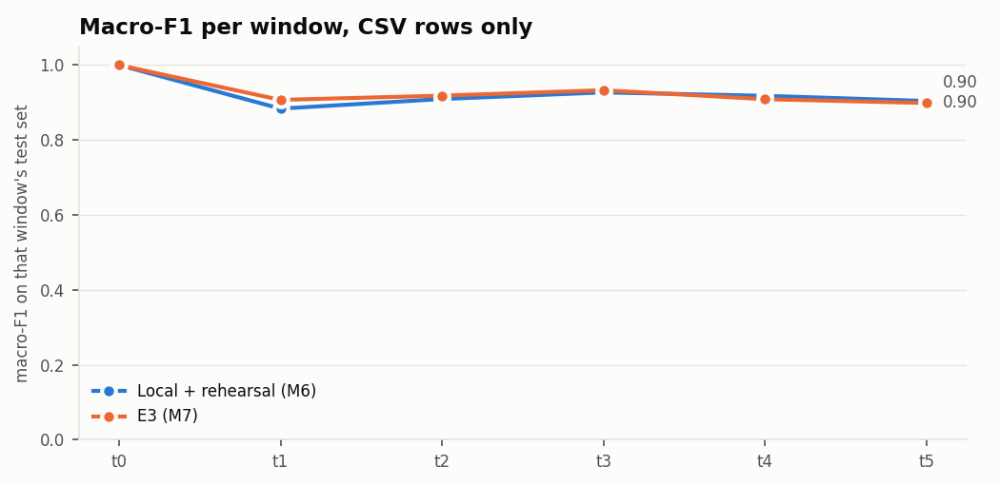

# M9: E4, drift-triggered updates, top-K features, adaptive gate (`full` pool)

Run `20261116-202953_m9_e4_full`. Generated by `scripts/m9_e4.py`. Seed 42. Scores use CSV-only rows (D7). Rows reach a client in 10 rounds per window, in random order, because the dataset has no timestamps. Between its update and the next g_t, a client uses its own calibrated output. Top-K limits new trees; older trees keep their splits, so inference still needs every feature.

**Passes missing from this report: ['e4', 'e4_label_free', 'e4_schedule', 'fixed']. They did not finish.**

## Results

| method | window avg | avg excl. t0 | final (t5) | SD over t1 to t5 | class forgetting |
|---|---:|---:|---:|---:|---:|
| Fixed schedule, top-10 | 0.9193 | 0.9032 | 0.8843 | 0.0155 | 0.0448 |
| Fixed schedule, top-10, client guard | 0.9231 | 0.9078 | 0.8915 | 0.0143 | 0.0385 |
| Fixed schedule, top-20 | 0.9245 | 0.9095 | 0.8926 | 0.0149 | 0.0374 |
| Fixed schedule, top-20, client guard | 0.9287 | 0.9145 | 0.9034 | 0.0125 | 0.0317 |
| Fixed schedule, top-30 | 0.9265 | 0.9119 | 0.8987 | 0.0127 | 0.0356 |
| Fixed schedule, top-30, client guard | 0.9307 | 0.9170 | 0.9098 | 0.0107 | 0.0317 |
| ADWIN trigger added to the fixed schedule, top-K | 0.9264 | 0.9119 | 0.8964 | 0.0132 | 0.0346 |
| ADWIN trigger added to the fixed schedule, top-K, client guard | 0.9307 | 0.9170 | 0.9069 | 0.0108 | 0.0316 |
| Local + rehearsal (M6) | 0.9232 | 0.9080 | 0.9037 | 0.0163 | 0.0292 |
| E3 (M7) | 0.9272 | 0.9127 | 0.8983 | 0.0130 | 0.0369 |
| E3 (M7), client guard | 0.9314 | 0.9177 | 0.9099 | 0.0107 | 0.0314 |

No `fixed` pass in this report, so nothing was checked against M7.

## Recovery inside each window

For E3, the old model and its g_t serve until the window ends. `mean over rounds` is macro-F1 averaged over the rounds of the window, with the window-end model as the last of them. `first trigger round` is the earliest over clients. Read the time to E3's earlier score: a method that already fell before the boundary reaches its own lower score sooner, which isn't a better recovery.

| method | window | own score before the boundary | old model on new rows | after window | mean over rounds | rounds to reach E3's earlier score (share of window) | rounds to reach its own (share of window) | first trigger round |
|---|---|---:|---:|---:|---:|---:|---:|---:|
| E3 (M7) | t1 | 0.999 | 0.462 | 0.907 | 0.502 | not in this window | not in this window | none |
| E3 (M7) | t2 | 0.907 | 0.633 | 0.918 | 0.659 | 1.0 | 1.0 | none |
| E3 (M7) | t3 | 0.918 | 0.632 | 0.932 | 0.659 | 1.0 | 1.0 | none |
| E3 (M7) | t4 | 0.932 | 0.757 | 0.908 | 0.771 | not in this window | not in this window | none |
| E3 (M7) | t5 | 0.908 | 0.848 | 0.898 | 0.853 | 1.0 | 1.0 | none |
| ADWIN trigger added to the fixed schedule, top-K | t1 | 0.999 | 0.462 | 0.908 | 0.846 | not in this window | not in this window | 1 |
| ADWIN trigger added to the fixed schedule, top-K | t2 | 0.908 | 0.636 | 0.920 | 0.849 | 1.0 | 1.0 | 1 |
| ADWIN trigger added to the fixed schedule, top-K | t3 | 0.920 | 0.643 | 0.930 | 0.895 | 0.1 | 0.1 | 1 |
| ADWIN trigger added to the fixed schedule, top-K | t4 | 0.930 | 0.756 | 0.905 | 0.833 | not in this window | not in this window | 1 |
| ADWIN trigger added to the fixed schedule, top-K | t5 | 0.905 | 0.847 | 0.896 | 0.877 | 1.0 | 1.0 | 1 |

## Cost

| method | local updates | clients updated, by window | uplink float32 (MB) | uplink 8-bit + zlib (MB) | downlink (kB) | local minutes |
|---|---:|---|---:|---:|---:|---:|
| Fixed schedule, top-10 | 60 | 10 10 10 10 10 10 | 225.7 | 11.3 | 23.8 | 14.9 |
| Fixed schedule, top-20 | 60 | 10 10 10 10 10 10 | 225.7 | 11.0 | 23.8 | 15.7 |
| Fixed schedule, top-30 | 60 | 10 10 10 10 10 10 | 225.7 | 10.9 | 23.8 | 15.7 |
| ADWIN trigger added to the fixed schedule, top-K | 86 | 10 10 10 10 10 10 | 225.7 | 10.9 | 23.8 | 32.1 |

## K sweep, fixed schedule

| K | mean validation macro-F1 | window avg (test) | final t5 (test) | picked |
|---:|---:|---:|---:|---|
| 10 | 0.9008 | 0.9193 | 0.8843 |  |
| 20 | 0.9073 | 0.9245 | 0.8926 |  |
| 30 | 0.9104 | 0.9265 | 0.8987 |  |

## Adaptive gate: choosing the strength

| method | strength | mean errors caught, next window | fixed gate at the same cost | mean escalated, next window | picked on validation rows |
|---|---:|---:|---:|---:|---|

## Gate on test rows

`thresholds_only` is M7's gate. `fixed` adds the proposal's ADWIN flag and equals the adaptive gate at a score of 0. `psi_flag` is the D8 sensitivity run, not a headline. Target 10% (D10). Shown for E3's schedule and E4, at the picked strength; if that is 0, adaptive rows don't appear. All strengths and methods are in `gate_test.csv`. `fixed gate at the same cost` is the errors a fixed gate catches when loosened to the same escalation rate, on the same rows, so it shows whether the drift score adds anything over a looser threshold.

| method | model through | eval window | error rate | mode | strength | escalated | errors caught | fixed gate at the same cost | accuracy on the rest |
|---|---|---|---:|---|---:|---:|---:|---:|---:|

