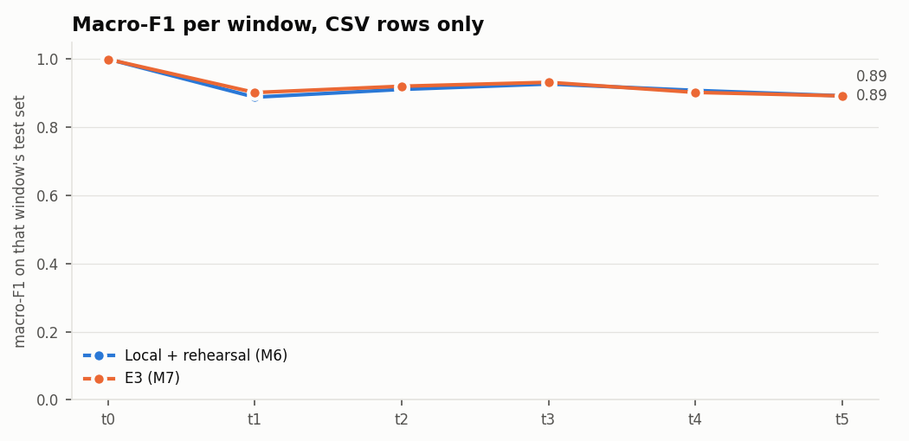

# M9: E4, drift-triggered updates, top-K features, adaptive gate (`full` pool)

Run `20261116-214034_m9_e4_full`. Generated by `scripts/m9_e4.py`. Seed 42. Scores use CSV-only rows (D7). Rows reach a client in 10 rounds per window, in random order, because the dataset has no timestamps. Between its update and the next g_t, a client uses its own calibrated output. Top-K limits new trees; older trees keep their splits, so inference still needs every feature.

**Passes missing from this report: ['e4', 'e4_label_free', 'e4_schedule', 'fixed']. They did not finish.**

## Results

| method | window avg | avg excl. t0 | final (t5) | SD over t1 to t5 | class forgetting |
|---|---:|---:|---:|---:|---:|
| Fixed schedule, top-10 | 0.9121 | 0.8946 | 0.8785 | 0.0176 | 0.0321 |
| Fixed schedule, top-10, client guard | 0.9157 | 0.8989 | 0.8805 | 0.0164 | 0.0398 |
| Fixed schedule, top-20 | 0.9213 | 0.9058 | 0.8860 | 0.0169 | 0.0322 |
| Fixed schedule, top-20, client guard | 0.9237 | 0.9086 | 0.8922 | 0.0149 | 0.0352 |
| Fixed schedule, top-30 | 0.9246 | 0.9097 | 0.8921 | 0.0152 | 0.0351 |
| Fixed schedule, top-30, client guard | 0.9265 | 0.9119 | 0.8953 | 0.0141 | 0.0335 |
| ADWIN trigger added to the fixed schedule, top-K | 0.9209 | 0.9052 | 0.8893 | 0.0183 | 0.0301 |
| ADWIN trigger added to the fixed schedule, top-K, client guard | 0.9246 | 0.9096 | 0.8917 | 0.0159 | 0.0324 |
| Local + rehearsal (M6) | 0.9208 | 0.9050 | 0.8919 | 0.0156 | 0.0353 |
| E3 (M7) | 0.9243 | 0.9094 | 0.8918 | 0.0161 | 0.0347 |
| E3 (M7), client guard | 0.9267 | 0.9121 | 0.8934 | 0.0148 | 0.0354 |

No `fixed` pass in this report, so nothing was checked against M7.

## Recovery inside each window

For E3, the old model and its g_t serve until the window ends. `mean over rounds` is macro-F1 averaged over the rounds of the window, with the window-end model as the last of them. `first trigger round` is the earliest over clients. Read the time to E3's earlier score: a method that already fell before the boundary reaches its own lower score sooner, which isn't a better recovery.

| method | window | own score before the boundary | old model on new rows | after window | mean over rounds | rounds to reach E3's earlier score (share of window) | rounds to reach its own (share of window) | first trigger round |
|---|---|---:|---:|---:|---:|---:|---:|---:|
| E3 (M7) | t1 | 0.999 | 0.461 | 0.902 | 0.501 | not in this window | not in this window | none |
| E3 (M7) | t2 | 0.902 | 0.646 | 0.920 | 0.670 | 1.0 | 1.0 | none |
| E3 (M7) | t3 | 0.920 | 0.622 | 0.932 | 0.650 | 1.0 | 1.0 | none |
| E3 (M7) | t4 | 0.932 | 0.757 | 0.902 | 0.771 | not in this window | not in this window | none |
| E3 (M7) | t5 | 0.902 | 0.841 | 0.892 | 0.845 | 1.0 | 1.0 | none |
| ADWIN trigger added to the fixed schedule, top-K | t1 | 0.999 | 0.461 | 0.888 | 0.845 | not in this window | not in this window | 1 |
| ADWIN trigger added to the fixed schedule, top-K | t2 | 0.888 | 0.630 | 0.918 | 0.838 | 1.0 | 1.0 | 1 |
| ADWIN trigger added to the fixed schedule, top-K | t3 | 0.918 | 0.632 | 0.930 | 0.887 | 0.1 | 0.1 | 1 |
| ADWIN trigger added to the fixed schedule, top-K | t4 | 0.930 | 0.756 | 0.902 | 0.802 | not in this window | not in this window | 3 |
| ADWIN trigger added to the fixed schedule, top-K | t5 | 0.902 | 0.839 | 0.889 | 0.866 | 1.0 | 1.0 | 1 |

## Cost

| method | local updates | clients updated, by window | uplink float32 (MB) | uplink 8-bit + zlib (MB) | downlink (kB) | local minutes |
|---|---:|---|---:|---:|---:|---:|
| Fixed schedule, top-10 | 120 | 20 20 20 20 20 20 | 451.4 | 22.9 | 47.5 | 18.4 |
| Fixed schedule, top-20 | 120 | 20 20 20 20 20 20 | 451.4 | 22.2 | 47.5 | 19.7 |
| Fixed schedule, top-30 | 120 | 20 20 20 20 20 20 | 451.4 | 21.9 | 47.5 | 19.5 |
| ADWIN trigger added to the fixed schedule, top-K | 170 | 20 20 20 20 20 20 | 451.4 | 22.0 | 47.5 | 36.4 |

## K sweep, fixed schedule

| K | mean validation macro-F1 | window avg (test) | final t5 (test) | picked |
|---:|---:|---:|---:|---|
| 10 | 0.9032 | 0.9121 | 0.8785 |  |
| 20 | 0.9131 | 0.9213 | 0.8860 |  |
| 30 | 0.9164 | 0.9246 | 0.8921 |  |

## Adaptive gate: choosing the strength

| method | strength | mean errors caught, next window | fixed gate at the same cost | mean escalated, next window | picked on validation rows |
|---|---:|---:|---:|---:|---|

## Gate on test rows

`thresholds_only` is M7's gate. `fixed` adds the proposal's ADWIN flag and equals the adaptive gate at a score of 0. `psi_flag` is the D8 sensitivity run, not a headline. Target 10% (D10). Shown for E3's schedule and E4, at the picked strength; if that is 0, adaptive rows don't appear. All strengths and methods are in `gate_test.csv`. `fixed gate at the same cost` is the errors a fixed gate catches when loosened to the same escalation rate, on the same rows, so it shows whether the drift score adds anything over a looser threshold.

| method | model through | eval window | error rate | mode | strength | escalated | errors caught | fixed gate at the same cost | accuracy on the rest |
|---|---|---|---:|---|---:|---:|---:|---:|---:|

