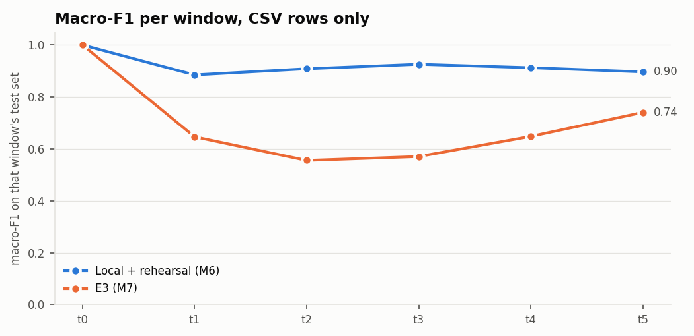

# M9: E4, drift-triggered updates, top-K features, adaptive gate (`full` pool)

Run `20261115-222537_m9_e4_full`. Generated by `scripts/m9_e4.py`. Seed 42. Scores use CSV-only rows (D7). Rows reach a client in 10 rounds per window, in random order, because the dataset has no timestamps. Between its update and the next g_t, a client uses its own calibrated output. Top-K limits new trees; older trees keep their splits, so inference still needs every feature.

**Passes missing from this report: ['e4', 'e4_label_free', 'e4_schedule', 'fixed']. They did not finish.**

## Results

| method | window avg | avg excl. t0 | final (t5) | SD over t1 to t5 | class forgetting |
|---|---:|---:|---:|---:|---:|
| Fixed schedule, top-10 | 0.5334 | 0.6230 | 0.8671 | 0.3698 | -0.0236 |
| Fixed schedule, top-10, client guard | 0.9117 | 0.8941 | 0.8828 | 0.0176 | 0.0239 |
| Fixed schedule, top-20 | 0.5550 | 0.6491 | 0.7227 | 0.1425 | 0.0785 |
| Fixed schedule, top-20, client guard | 0.9183 | 0.9021 | 0.8913 | 0.0166 | 0.0226 |
| Fixed schedule, top-30 | 0.6110 | 0.7160 | 0.8435 | 0.1295 | -0.0108 |
| Fixed schedule, top-30, client guard | 0.9250 | 0.9100 | 0.8964 | 0.0106 | 0.0308 |
| ADWIN trigger added to the fixed schedule, top-K | 0.4632 | 0.5387 | 0.7447 | 0.1658 | 0.0397 |
| ADWIN trigger added to the fixed schedule, top-K, client guard | 0.9203 | 0.9044 | 0.8946 | 0.0156 | 0.0216 |
| Local + rehearsal (M6) | 0.9211 | 0.9054 | 0.8962 | 0.0157 | 0.0216 |
| E3 (M7) | 0.6933 | 0.6320 | 0.7401 | 0.0739 | 0.0671 |
| E3 (M7), client guard | 0.9211 | 0.9054 | 0.8962 | 0.0157 | 0.0216 |

No `fixed` pass in this report, so nothing was checked against M7.

## Recovery inside each window

For E3, the old model and its g_t serve until the window ends. `mean over rounds` is macro-F1 averaged over the rounds of the window, with the window-end model as the last of them. `first trigger round` is the earliest over clients. Read the time to E3's earlier score: a method that already fell before the boundary reaches its own lower score sooner, which isn't a better recovery.

| method | window | own score before the boundary | old model on new rows | after window | mean over rounds | rounds to reach E3's earlier score (share of window) | rounds to reach its own (share of window) | first trigger round |
|---|---|---:|---:|---:|---:|---:|---:|---:|
| E3 (M7) | t1 | 1.000 | 0.462 | 0.646 | 0.478 | not in this window | not in this window | none |
| E3 (M7) | t2 | 0.646 | 0.476 | 0.555 | 0.483 | not in this window | not in this window | none |
| E3 (M7) | t3 | 0.555 | 0.340 | 0.570 | 0.361 | 1.0 | 1.0 | none |
| E3 (M7) | t4 | 0.570 | 0.466 | 0.648 | 0.483 | 1.0 | 1.0 | none |
| E3 (M7) | t5 | 0.648 | 0.614 | 0.740 | 0.626 | 1.0 | 1.0 | none |
| ADWIN trigger added to the fixed schedule, top-K | t1 | 0.086 | 0.016 | 0.305 | 0.750 | not in this window | 0.1 | 1 |
| ADWIN trigger added to the fixed schedule, top-K | t2 | 0.305 | 0.228 | 0.455 | 0.477 | not in this window | 0.1 | 1 |
| ADWIN trigger added to the fixed schedule, top-K | t3 | 0.455 | 0.291 | 0.598 | 0.802 | 0.1 | 0.1 | 1 |
| ADWIN trigger added to the fixed schedule, top-K | t4 | 0.598 | 0.491 | 0.590 | 0.577 | 0.5 | 0.5 | 2 |
| ADWIN trigger added to the fixed schedule, top-K | t5 | 0.590 | 0.559 | 0.745 | 0.657 | 0.1 | 0.1 | 1 |

## Cost

| method | local updates | clients updated, by window | uplink float32 (MB) | uplink 8-bit + zlib (MB) | downlink (kB) | local minutes |
|---|---:|---|---:|---:|---:|---:|
| Fixed schedule, top-10 | 90 | 15 15 15 15 15 15 | 21.6 | 1.1 | 35.6 | 16.3 |
| Fixed schedule, top-20 | 90 | 15 15 15 15 15 15 | 21.6 | 0.9 | 35.6 | 17.5 |
| Fixed schedule, top-30 | 90 | 15 15 15 15 15 15 | 21.6 | 0.9 | 35.6 | 18.3 |
| ADWIN trigger added to the fixed schedule, top-K | 130 | 15 15 15 15 15 15 | 21.6 | 0.9 | 35.6 | 35.4 |

## K sweep, fixed schedule

| K | mean validation macro-F1 | window avg (test) | final t5 (test) | picked |
|---:|---:|---:|---:|---|
| 10 | 0.8995 | 0.5334 | 0.8671 |  |
| 20 | 0.9073 | 0.5550 | 0.7227 |  |
| 30 | 0.9115 | 0.6110 | 0.8435 |  |

## Adaptive gate: choosing the strength

| method | strength | mean errors caught, next window | fixed gate at the same cost | mean escalated, next window | picked on validation rows |
|---|---:|---:|---:|---:|---|

## Gate on test rows

`thresholds_only` is M7's gate. `fixed` adds the proposal's ADWIN flag and equals the adaptive gate at a score of 0. `psi_flag` is the D8 sensitivity run, not a headline. Target 10% (D10). Shown for E3's schedule and E4, at the picked strength; if that is 0, adaptive rows don't appear. All strengths and methods are in `gate_test.csv`. `fixed gate at the same cost` is the errors a fixed gate catches when loosened to the same escalation rate, on the same rows, so it shows whether the drift score adds anything over a looser threshold.

| method | model through | eval window | error rate | mode | strength | escalated | errors caught | fixed gate at the same cost | accuracy on the rest |
|---|---|---|---:|---|---:|---:|---:|---:|---:|

