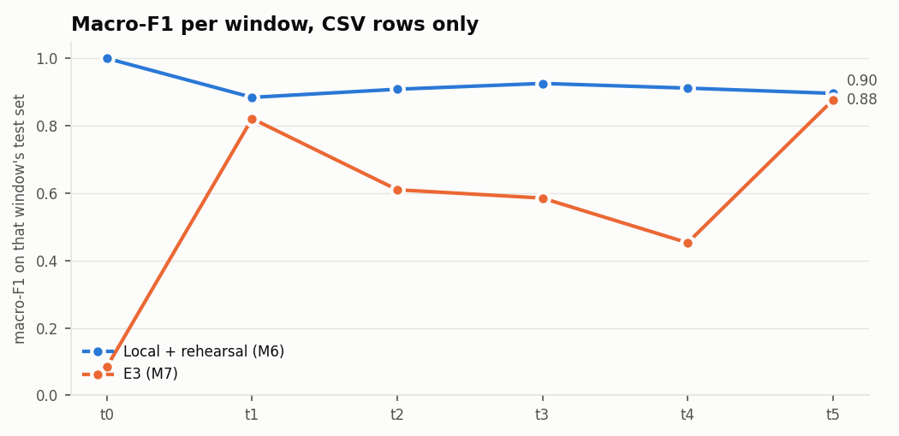

# M9: E4, drift-triggered updates, top-K features, adaptive gate (`full` pool)

Run `20261115-224222_m9_e4_full`. Generated by `scripts/m9_e4.py`. Seed 43. Scores use CSV-only rows (D7). Rows reach a client in 10 rounds per window, in random order, because the dataset has no timestamps. Between its update and the next g_t, a client uses its own calibrated output. Top-K limits new trees; older trees keep their splits, so inference still needs every feature.

**Passes missing from this report: ['e4', 'e4_label_free', 'e4_schedule', 'fixed']. They did not finish.**

## Results

| method | window avg | avg excl. t0 | final (t5) | SD over t1 to t5 | class forgetting |
|---|---:|---:|---:|---:|---:|
| Fixed schedule, top-10 | 0.6161 | 0.7214 | 0.8244 | 0.1006 | -0.0610 |
| Fixed schedule, top-10, client guard | 0.9131 | 0.8958 | 0.8816 | 0.0203 | 0.0269 |
| Fixed schedule, top-20 | 0.5800 | 0.6790 | 0.8439 | 0.1776 | -0.0534 |
| Fixed schedule, top-20, client guard | 0.9190 | 0.9029 | 0.8902 | 0.0186 | 0.0244 |
| Fixed schedule, top-30 | 0.4800 | 0.5590 | 0.8263 | 0.1657 | -0.0872 |
| Fixed schedule, top-30, client guard | 0.9208 | 0.9050 | 0.8956 | 0.0158 | 0.0219 |
| ADWIN trigger added to the fixed schedule, top-K | 0.5066 | 0.5909 | 0.8406 | 0.1977 | -0.1550 |
| ADWIN trigger added to the fixed schedule, top-K, client guard | 0.9208 | 0.9050 | 0.8970 | 0.0153 | 0.0218 |
| Local + rehearsal (M6) | 0.9209 | 0.9051 | 0.8960 | 0.0157 | 0.0223 |
| E3 (M7) | 0.5717 | 0.6690 | 0.8758 | 0.1755 | -0.0477 |
| E3 (M7), client guard | 0.9219 | 0.9063 | 0.9018 | 0.0151 | 0.0211 |

No `fixed` pass in this report, so nothing was checked against M7.

## Recovery inside each window

For E3, the old model and its g_t serve until the window ends. `mean over rounds` is macro-F1 averaged over the rounds of the window, with the window-end model as the last of them. `first trigger round` is the earliest over clients. Read the time to E3's earlier score: a method that already fell before the boundary reaches its own lower score sooner, which isn't a better recovery.

| method | window | own score before the boundary | old model on new rows | after window | mean over rounds | rounds to reach E3's earlier score (share of window) | rounds to reach its own (share of window) | first trigger round |
|---|---|---:|---:|---:|---:|---:|---:|---:|
| E3 (M7) | t1 | 0.085 | 0.016 | 0.821 | 0.089 | 1.0 | 1.0 | none |
| E3 (M7) | t2 | 0.821 | 0.584 | 0.610 | 0.586 | not in this window | not in this window | none |
| E3 (M7) | t3 | 0.610 | 0.370 | 0.585 | 0.390 | not in this window | not in this window | none |
| E3 (M7) | t4 | 0.585 | 0.481 | 0.453 | 0.478 | not in this window | not in this window | none |
| E3 (M7) | t5 | 0.453 | 0.462 | 0.876 | 0.499 | 0.0 | 0.0 | none |
| ADWIN trigger added to the fixed schedule, top-K | t1 | 0.085 | 0.016 | 0.349 | 0.754 | 0.1 | 0.1 | 1 |
| ADWIN trigger added to the fixed schedule, top-K | t2 | 0.349 | 0.259 | 0.439 | 0.540 | not in this window | 0.1 | 1 |
| ADWIN trigger added to the fixed schedule, top-K | t3 | 0.439 | 0.289 | 0.692 | 0.814 | 0.1 | 0.1 | 1 |
| ADWIN trigger added to the fixed schedule, top-K | t4 | 0.692 | 0.567 | 0.634 | 0.666 | 0.0 | 0.2 | 1 |
| ADWIN trigger added to the fixed schedule, top-K | t5 | 0.634 | 0.599 | 0.841 | 0.728 | 0.0 | 0.1 | 1 |

## Cost

| method | local updates | clients updated, by window | uplink float32 (MB) | uplink 8-bit + zlib (MB) | downlink (kB) | local minutes |
|---|---:|---|---:|---:|---:|---:|
| Fixed schedule, top-10 | 90 | 15 15 15 15 15 15 | 21.6 | 1.1 | 35.6 | 18.4 |
| Fixed schedule, top-20 | 90 | 15 15 15 15 15 15 | 21.6 | 0.9 | 35.6 | 19.0 |
| Fixed schedule, top-30 | 90 | 15 15 15 15 15 15 | 21.6 | 0.9 | 35.6 | 20.1 |
| ADWIN trigger added to the fixed schedule, top-K | 129 | 15 15 15 15 15 15 | 21.6 | 0.9 | 35.6 | 38.7 |

## K sweep, fixed schedule

| K | mean validation macro-F1 | window avg (test) | final t5 (test) | picked |
|---:|---:|---:|---:|---|
| 10 | 0.8955 | 0.6161 | 0.8244 |  |
| 20 | 0.9043 | 0.5800 | 0.8439 |  |
| 30 | 0.9079 | 0.4800 | 0.8263 |  |

## Adaptive gate: choosing the strength

| method | strength | mean errors caught, next window | fixed gate at the same cost | mean escalated, next window | picked on validation rows |
|---|---:|---:|---:|---:|---|

## Gate on test rows

`thresholds_only` is M7's gate. `fixed` adds the proposal's ADWIN flag and equals the adaptive gate at a score of 0. `psi_flag` is the D8 sensitivity run, not a headline. Target 10% (D10). Shown for E3's schedule and E4, at the picked strength; if that is 0, adaptive rows don't appear. All strengths and methods are in `gate_test.csv`. `fixed gate at the same cost` is the errors a fixed gate catches when loosened to the same escalation rate, on the same rows, so it shows whether the drift score adds anything over a looser threshold.

| method | model through | eval window | error rate | mode | strength | escalated | errors caught | fixed gate at the same cost | accuracy on the rest |
|---|---|---|---:|---|---:|---:|---:|---:|---:|

