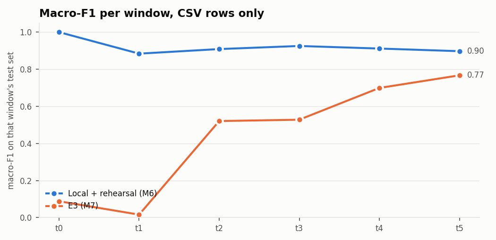

# M9: E4, drift-triggered updates, top-K features, adaptive gate (`full` pool)

Run `20261115-221758_m9_e4_full`. Generated by `scripts/m9_e4.py`. Seed 44. Scores use CSV-only rows (D7). Rows reach a client in 10 rounds per window, in random order, because the dataset has no timestamps. Between its update and the next g_t, a client uses its own calibrated output. Top-K limits new trees; older trees keep their splits, so inference still needs every feature.

**Passes missing from this report: ['e4', 'e4_label_free', 'e4_schedule', 'fixed']. They did not finish.**

## Results

| method | window avg | avg excl. t0 | final (t5) | SD over t1 to t5 | class forgetting |
|---|---:|---:|---:|---:|---:|
| Fixed schedule, top-10 | 0.6000 | 0.7027 | 0.8388 | 0.2267 | -0.0177 |
| Fixed schedule, top-10, client guard | 0.9115 | 0.8939 | 0.8812 | 0.0178 | 0.0244 |
| Fixed schedule, top-20 | 0.5020 | 0.5854 | 0.4978 | 0.1066 | 0.0641 |
| Fixed schedule, top-20, client guard | 0.9200 | 0.9041 | 0.8908 | 0.0175 | 0.0243 |
| Fixed schedule, top-30 | 0.4391 | 0.5091 | 0.7663 | 0.2311 | -0.1429 |
| Fixed schedule, top-30, client guard | 0.9210 | 0.9052 | 0.8969 | 0.0156 | 0.0220 |
| ADWIN trigger added to the fixed schedule, top-K | 0.4684 | 0.5442 | 0.8080 | 0.2580 | -0.0226 |
| ADWIN trigger added to the fixed schedule, top-K, client guard | 0.9208 | 0.9050 | 0.8952 | 0.0155 | 0.0226 |
| Local + rehearsal (M6) | 0.9210 | 0.9052 | 0.8971 | 0.0156 | 0.0215 |
| E3 (M7) | 0.4364 | 0.5060 | 0.7669 | 0.2941 | -0.0718 |
| E3 (M7), client guard | 0.9210 | 0.9052 | 0.8971 | 0.0156 | 0.0215 |

No `fixed` pass in this report, so nothing was checked against M7.

## Recovery inside each window

For E3, the old model and its g_t serve until the window ends. `mean over rounds` is macro-F1 averaged over the rounds of the window, with the window-end model as the last of them. `first trigger round` is the earliest over clients. Read the time to E3's earlier score: a method that already fell before the boundary reaches its own lower score sooner, which isn't a better recovery.

| method | window | own score before the boundary | old model on new rows | after window | mean over rounds | rounds to reach E3's earlier score (share of window) | rounds to reach its own (share of window) | first trigger round |
|---|---|---:|---:|---:|---:|---:|---:|---:|
| E3 (M7) | t1 | 0.088 | 0.018 | 0.016 | 0.018 | not in this window | not in this window | none |
| E3 (M7) | t2 | 0.016 | 0.012 | 0.520 | 0.058 | 0.0 | 0.0 | none |
| E3 (M7) | t3 | 0.520 | 0.318 | 0.528 | 0.337 | 1.0 | 1.0 | none |
| E3 (M7) | t4 | 0.528 | 0.432 | 0.699 | 0.456 | 1.0 | 1.0 | none |
| E3 (M7) | t5 | 0.699 | 0.665 | 0.767 | 0.674 | 1.0 | 1.0 | none |
| ADWIN trigger added to the fixed schedule, top-K | t1 | 0.089 | 0.019 | 0.157 | 0.738 | 0.1 | 0.1 | 1 |
| ADWIN trigger added to the fixed schedule, top-K | t2 | 0.157 | 0.116 | 0.450 | 0.425 | 0.0 | 0.1 | 1 |
| ADWIN trigger added to the fixed schedule, top-K | t3 | 0.450 | 0.293 | 0.568 | 0.753 | 0.1 | 0.1 | 1 |
| ADWIN trigger added to the fixed schedule, top-K | t4 | 0.568 | 0.465 | 0.738 | 0.564 | 0.1 | 0.3 | 1 |
| ADWIN trigger added to the fixed schedule, top-K | t5 | 0.738 | 0.713 | 0.808 | 0.782 | 0.0 | 0.1 | 1 |

## Cost

| method | local updates | clients updated, by window | uplink float32 (MB) | uplink 8-bit + zlib (MB) | downlink (kB) | local minutes |
|---|---:|---|---:|---:|---:|---:|
| Fixed schedule, top-10 | 90 | 15 15 15 15 15 15 | 21.6 | 1.1 | 35.6 | 16.0 |
| Fixed schedule, top-20 | 90 | 15 15 15 15 15 15 | 21.6 | 0.9 | 35.6 | 16.9 |
| Fixed schedule, top-30 | 90 | 15 15 15 15 15 15 | 21.6 | 0.9 | 35.6 | 17.2 |
| ADWIN trigger added to the fixed schedule, top-K | 130 | 15 15 15 15 15 15 | 21.6 | 0.9 | 35.6 | 34.4 |

## K sweep, fixed schedule

| K | mean validation macro-F1 | window avg (test) | final t5 (test) | picked |
|---:|---:|---:|---:|---|
| 10 | 0.8952 | 0.6000 | 0.8388 |  |
| 20 | 0.9052 | 0.5020 | 0.4978 |  |
| 30 | 0.9085 | 0.4391 | 0.7663 |  |

## Adaptive gate: choosing the strength

| method | strength | mean errors caught, next window | fixed gate at the same cost | mean escalated, next window | picked on validation rows |
|---|---:|---:|---:|---:|---|

## Gate on test rows

`thresholds_only` is M7's gate. `fixed` adds the proposal's ADWIN flag and equals the adaptive gate at a score of 0. `psi_flag` is the D8 sensitivity run, not a headline. Target 10% (D10). Shown for E3's schedule and E4, at the picked strength; if that is 0, adaptive rows don't appear. All strengths and methods are in `gate_test.csv`. `fixed gate at the same cost` is the errors a fixed gate catches when loosened to the same escalation rate, on the same rows, so it shows whether the drift score adds anything over a looser threshold.

| method | model through | eval window | error rate | mode | strength | escalated | errors caught | fixed gate at the same cost | accuracy on the rest |
|---|---|---|---:|---|---:|---:|---:|---:|---:|

