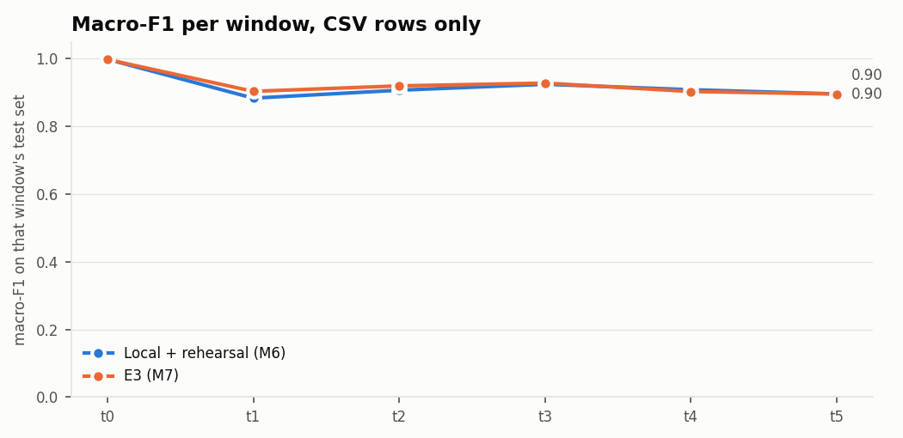

# M9: E4, drift-triggered updates, top-K features, adaptive gate (`full` pool)

Run `20261117-091221_m9_e4_full`. Generated by `scripts/m9_e4.py`. Seed 42. Scores use CSV-only rows (D7). Rows reach a client in 10 rounds per window, in random order, because the dataset has no timestamps. Between its update and the next g_t, a client uses its own calibrated output. Top-K limits new trees; older trees keep their splits, so inference still needs every feature.

**Passes missing from this report: ['e4', 'e4_label_free', 'e4_schedule', 'fixed']. They did not finish.**

## Results

| method | window avg | avg excl. t0 | final (t5) | SD over t1 to t5 | class forgetting |
|---|---:|---:|---:|---:|---:|
| Fixed schedule, top-10 | 0.9124 | 0.8955 | 0.8772 | 0.0170 | 0.0270 |
| Fixed schedule, top-10, client guard | 0.9164 | 0.9002 | 0.8827 | 0.0147 | 0.0278 |
| Fixed schedule, top-20 | 0.9210 | 0.9058 | 0.8882 | 0.0151 | 0.0264 |
| Fixed schedule, top-20, client guard | 0.9232 | 0.9082 | 0.8925 | 0.0133 | 0.0233 |
| Fixed schedule, top-30 | 0.9238 | 0.9091 | 0.8917 | 0.0146 | 0.0259 |
| Fixed schedule, top-30, client guard | 0.9260 | 0.9116 | 0.8972 | 0.0141 | 0.0183 |
| ADWIN trigger added to the fixed schedule, top-K | 0.9215 | 0.9064 | 0.8900 | 0.0164 | 0.0267 |
| ADWIN trigger added to the fixed schedule, top-K, client guard | 0.9246 | 0.9099 | 0.8971 | 0.0133 | 0.0258 |
| Local + rehearsal (M6) | 0.9192 | 0.9035 | 0.8955 | 0.0153 | 0.0203 |
| E3 (M7) | 0.9243 | 0.9097 | 0.8952 | 0.0134 | 0.0238 |
| E3 (M7), client guard | 0.9261 | 0.9117 | 0.8968 | 0.0136 | 0.0205 |

No `fixed` pass in this report, so nothing was checked against M7.

## Recovery inside each window

For E3, the old model and its g_t serve until the window ends. `mean over rounds` is macro-F1 averaged over the rounds of the window, with the window-end model as the last of them. `first trigger round` is the earliest over clients. Read the time to E3's earlier score: a method that already fell before the boundary reaches its own lower score sooner, which isn't a better recovery.

| method | window | own score before the boundary | old model on new rows | after window | mean over rounds | rounds to reach E3's earlier score (share of window) | rounds to reach its own (share of window) | first trigger round |
|---|---|---:|---:|---:|---:|---:|---:|---:|
| E3 (M7) | t1 | 0.997 | 0.457 | 0.903 | 0.498 | not in this window | not in this window | none |
| E3 (M7) | t2 | 0.903 | 0.651 | 0.919 | 0.675 | 1.0 | 1.0 | none |
| E3 (M7) | t3 | 0.919 | 0.571 | 0.928 | 0.604 | 1.0 | 1.0 | none |
| E3 (M7) | t4 | 0.928 | 0.756 | 0.903 | 0.769 | not in this window | not in this window | none |
| E3 (M7) | t5 | 0.903 | 0.847 | 0.895 | 0.851 | 1.0 | 1.0 | none |
| ADWIN trigger added to the fixed schedule, top-K | t1 | 0.997 | 0.457 | 0.896 | 0.842 | not in this window | not in this window | 1 |
| ADWIN trigger added to the fixed schedule, top-K | t2 | 0.896 | 0.644 | 0.920 | 0.852 | 1.0 | 1.0 | 1 |
| ADWIN trigger added to the fixed schedule, top-K | t3 | 0.920 | 0.575 | 0.928 | 0.876 | 0.4 | 0.4 | 1 |
| ADWIN trigger added to the fixed schedule, top-K | t4 | 0.928 | 0.756 | 0.898 | 0.820 | not in this window | not in this window | 1 |
| ADWIN trigger added to the fixed schedule, top-K | t5 | 0.898 | 0.843 | 0.890 | 0.873 | 1.0 | 1.0 | 1 |

## Cost

| method | local updates | clients updated, by window | uplink float32 (MB) | uplink 8-bit + zlib (MB) | downlink (kB) | local minutes |
|---|---:|---|---:|---:|---:|---:|
| Fixed schedule, top-10 | 90 | 15 15 15 15 15 15 | 338.6 | 17.9 | 35.6 | 16.2 |
| Fixed schedule, top-20 | 90 | 15 15 15 15 15 15 | 338.6 | 17.1 | 35.6 | 17.5 |
| Fixed schedule, top-30 | 90 | 15 15 15 15 15 15 | 338.6 | 16.9 | 35.6 | 17.8 |
| ADWIN trigger added to the fixed schedule, top-K | 129 | 15 15 15 15 15 15 | 338.6 | 16.9 | 35.6 | 35.8 |

## K sweep, fixed schedule

| K | mean validation macro-F1 | window avg (test) | final t5 (test) | picked |
|---:|---:|---:|---:|---|
| 10 | 0.8993 | 0.9124 | 0.8772 |  |
| 20 | 0.9055 | 0.9210 | 0.8882 |  |
| 30 | 0.9082 | 0.9238 | 0.8917 |  |

## Adaptive gate: choosing the strength

| method | strength | mean errors caught, next window | fixed gate at the same cost | mean escalated, next window | picked on validation rows |
|---|---:|---:|---:|---:|---|

## Gate on test rows

`thresholds_only` is M7's gate. `fixed` adds the proposal's ADWIN flag and equals the adaptive gate at a score of 0. `psi_flag` is the D8 sensitivity run, not a headline. Target 10% (D10). Shown for E3's schedule and E4, at the picked strength; if that is 0, adaptive rows don't appear. All strengths and methods are in `gate_test.csv`. `fixed gate at the same cost` is the errors a fixed gate catches when loosened to the same escalation rate, on the same rows, so it shows whether the drift score adds anything over a looser threshold.

| method | model through | eval window | error rate | mode | strength | escalated | errors caught | fixed gate at the same cost | accuracy on the rest |
|---|---|---|---:|---|---:|---:|---:|---:|---:|

