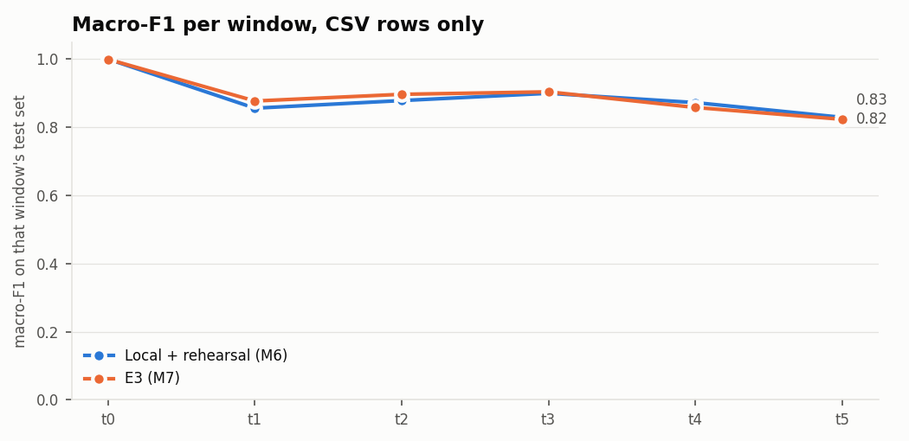

# M9: E4, drift-triggered updates, top-K features, adaptive gate (`full` pool)

Run `20261117-092436_m9_e4_full`. Generated by `scripts/m9_e4.py`. Seed 42. Scores use CSV-only rows (D7). Rows reach a client in 10 rounds per window, in random order, because the dataset has no timestamps. Between its update and the next g_t, a client uses its own calibrated output. Top-K limits new trees; older trees keep their splits, so inference still needs every feature.

**Passes missing from this report: ['e4', 'e4_label_free', 'e4_schedule', 'fixed']. They did not finish.**

## Results

| method | window avg | avg excl. t0 | final (t5) | SD over t1 to t5 | class forgetting |
|---|---:|---:|---:|---:|---:|
| Fixed schedule, top-10 | 0.8863 | 0.8637 | 0.8143 | 0.0339 | 0.0385 |
| Fixed schedule, top-10, client guard | 0.8906 | 0.8688 | 0.8216 | 0.0299 | 0.0428 |
| Fixed schedule, top-20 | 0.8924 | 0.8711 | 0.8220 | 0.0327 | 0.0391 |
| Fixed schedule, top-20, client guard | 0.8958 | 0.8751 | 0.8275 | 0.0293 | 0.0398 |
| Fixed schedule, top-30 | 0.8929 | 0.8717 | 0.8221 | 0.0328 | 0.0393 |
| Fixed schedule, top-30, client guard | 0.8968 | 0.8762 | 0.8304 | 0.0288 | 0.0374 |
| ADWIN trigger added to the fixed schedule, top-K | 0.8938 | 0.8728 | 0.8282 | 0.0327 | 0.0323 |
| ADWIN trigger added to the fixed schedule, top-K, client guard | 0.8967 | 0.8762 | 0.8319 | 0.0281 | 0.0364 |
| Local + rehearsal (M6) | 0.8889 | 0.8668 | 0.8289 | 0.0263 | 0.0328 |
| E3 (M7) | 0.8928 | 0.8715 | 0.8230 | 0.0325 | 0.0414 |
| E3 (M7), client guard | 0.8974 | 0.8769 | 0.8331 | 0.0277 | 0.0374 |

No `fixed` pass in this report, so nothing was checked against M7.

## Recovery inside each window

For E3, the old model and its g_t serve until the window ends. `mean over rounds` is macro-F1 averaged over the rounds of the window, with the window-end model as the last of them. `first trigger round` is the earliest over clients. Read the time to E3's earlier score: a method that already fell before the boundary reaches its own lower score sooner, which isn't a better recovery.

| method | window | own score before the boundary | old model on new rows | after window | mean over rounds | rounds to reach E3's earlier score (share of window) | rounds to reach its own (share of window) | first trigger round |
|---|---|---:|---:|---:|---:|---:|---:|---:|
| E3 (M7) | t1 | 0.999 | 0.463 | 0.877 | 0.501 | not in this window | not in this window | none |
| E3 (M7) | t2 | 0.877 | 0.612 | 0.896 | 0.638 | 1.0 | 1.0 | none |
| E3 (M7) | t3 | 0.896 | 0.603 | 0.904 | 0.631 | 1.0 | 1.0 | none |
| E3 (M7) | t4 | 0.904 | 0.741 | 0.858 | 0.752 | not in this window | not in this window | none |
| E3 (M7) | t5 | 0.858 | 0.797 | 0.823 | 0.799 | not in this window | not in this window | none |
| ADWIN trigger added to the fixed schedule, top-K | t1 | 0.999 | 0.463 | 0.876 | 0.824 | not in this window | not in this window | 1 |
| ADWIN trigger added to the fixed schedule, top-K | t2 | 0.876 | 0.596 | 0.903 | 0.824 | 1.0 | 1.0 | 1 |
| ADWIN trigger added to the fixed schedule, top-K | t3 | 0.903 | 0.638 | 0.904 | 0.869 | 0.1 | 0.1 | 1 |
| ADWIN trigger added to the fixed schedule, top-K | t4 | 0.904 | 0.742 | 0.853 | 0.837 | not in this window | not in this window | 1 |
| ADWIN trigger added to the fixed schedule, top-K | t5 | 0.853 | 0.790 | 0.828 | 0.810 | not in this window | not in this window | 1 |

## Cost

| method | local updates | clients updated, by window | uplink float32 (MB) | uplink 8-bit + zlib (MB) | downlink (kB) | local minutes |
|---|---:|---|---:|---:|---:|---:|
| Fixed schedule, top-10 | 90 | 15 15 15 15 15 15 | 338.6 | 17.4 | 35.6 | 17.7 |
| Fixed schedule, top-20 | 90 | 15 15 15 15 15 15 | 338.6 | 16.9 | 35.6 | 18.0 |
| Fixed schedule, top-30 | 90 | 15 15 15 15 15 15 | 338.6 | 16.7 | 35.6 | 18.6 |
| ADWIN trigger added to the fixed schedule, top-K | 132 | 15 15 15 15 15 15 | 338.6 | 16.7 | 35.6 | 36.2 |

## K sweep, fixed schedule

| K | mean validation macro-F1 | window avg (test) | final t5 (test) | picked |
|---:|---:|---:|---:|---|
| 10 | 0.8989 | 0.8863 | 0.8143 |  |
| 20 | 0.9082 | 0.8924 | 0.8220 |  |
| 30 | 0.9094 | 0.8929 | 0.8221 |  |

## Adaptive gate: choosing the strength

| method | strength | mean errors caught, next window | fixed gate at the same cost | mean escalated, next window | picked on validation rows |
|---|---:|---:|---:|---:|---|

## Gate on test rows

`thresholds_only` is M7's gate. `fixed` adds the proposal's ADWIN flag and equals the adaptive gate at a score of 0. `psi_flag` is the D8 sensitivity run, not a headline. Target 10% (D10). Shown for E3's schedule and E4, at the picked strength; if that is 0, adaptive rows don't appear. All strengths and methods are in `gate_test.csv`. `fixed gate at the same cost` is the errors a fixed gate catches when loosened to the same escalation rate, on the same rows, so it shows whether the drift score adds anything over a looser threshold.

| method | model through | eval window | error rate | mode | strength | escalated | errors caught | fixed gate at the same cost | accuracy on the rest |
|---|---|---|---:|---|---:|---:|---:|---:|---:|

