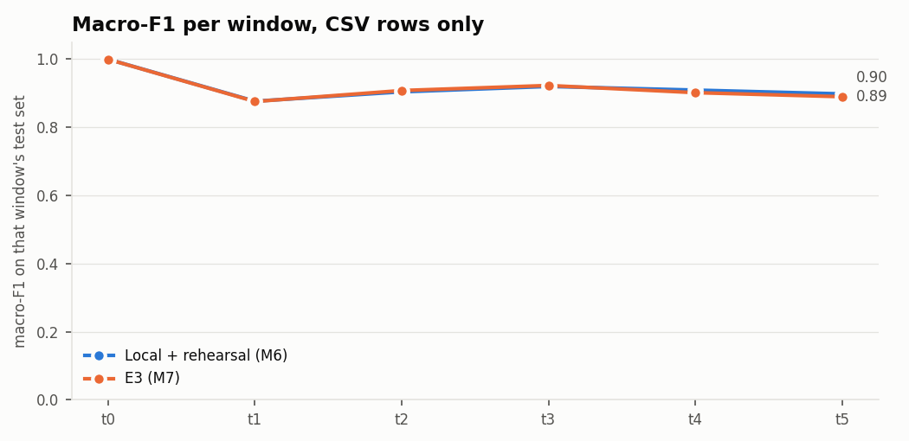

# M9: E4, drift-triggered updates, top-K features, adaptive gate (`full` pool)

Run `20261117-090814_m9_e4_full`. Generated by `scripts/m9_e4.py`. Seed 42. Scores use CSV-only rows (D7). Rows reach a client in 10 rounds per window, in random order, because the dataset has no timestamps. Between its update and the next g_t, a client uses its own calibrated output. Top-K limits new trees; older trees keep their splits, so inference still needs every feature.

**Passes missing from this report: ['e4', 'e4_label_free', 'e4_schedule', 'fixed']. They did not finish.**

## Results

| method | window avg | avg excl. t0 | final (t5) | SD over t1 to t5 | class forgetting |
|---|---:|---:|---:|---:|---:|
| Fixed schedule, top-10 | 0.8983 | 0.8781 | 0.8729 | 0.0163 | 0.0421 |
| Fixed schedule, top-10, client guard | 0.9022 | 0.8827 | 0.8779 | 0.0159 | 0.0509 |
| Fixed schedule, top-20 | 0.9154 | 0.8987 | 0.8871 | 0.0174 | 0.0368 |
| Fixed schedule, top-20, client guard | 0.9191 | 0.9030 | 0.8927 | 0.0157 | 0.0484 |
| Fixed schedule, top-30 | 0.9153 | 0.8985 | 0.8894 | 0.0166 | 0.0339 |
| Fixed schedule, top-30, client guard | 0.9198 | 0.9040 | 0.8970 | 0.0154 | 0.0455 |
| ADWIN trigger added to the fixed schedule, top-K | 0.9152 | 0.8985 | 0.8863 | 0.0176 | 0.0397 |
| ADWIN trigger added to the fixed schedule, top-K, client guard | 0.9185 | 0.9023 | 0.8941 | 0.0153 | 0.0446 |
| Local + rehearsal (M6) | 0.9175 | 0.9011 | 0.8977 | 0.0161 | 0.0429 |
| E3 (M7) | 0.9158 | 0.8991 | 0.8893 | 0.0179 | 0.0383 |
| E3 (M7), client guard | 0.9194 | 0.9034 | 0.8978 | 0.0163 | 0.0456 |

No `fixed` pass in this report, so nothing was checked against M7.

## Recovery inside each window

For E3, the old model and its g_t serve until the window ends. `mean over rounds` is macro-F1 averaged over the rounds of the window, with the window-end model as the last of them. `first trigger round` is the earliest over clients. Read the time to E3's earlier score: a method that already fell before the boundary reaches its own lower score sooner, which isn't a better recovery.

| method | window | own score before the boundary | old model on new rows | after window | mean over rounds | rounds to reach E3's earlier score (share of window) | rounds to reach its own (share of window) | first trigger round |
|---|---|---:|---:|---:|---:|---:|---:|---:|
| E3 (M7) | t1 | 0.999 | 0.461 | 0.875 | 0.499 | not in this window | not in this window | none |
| E3 (M7) | t2 | 0.875 | 0.621 | 0.907 | 0.647 | 1.0 | 1.0 | none |
| E3 (M7) | t3 | 0.907 | 0.596 | 0.922 | 0.626 | 1.0 | 1.0 | none |
| E3 (M7) | t4 | 0.922 | 0.751 | 0.901 | 0.765 | not in this window | not in this window | none |
| E3 (M7) | t5 | 0.901 | 0.825 | 0.889 | 0.831 | 1.0 | 1.0 | none |
| ADWIN trigger added to the fixed schedule, top-K | t1 | 0.999 | 0.461 | 0.876 | 0.834 | not in this window | not in this window | 1 |
| ADWIN trigger added to the fixed schedule, top-K | t2 | 0.876 | 0.614 | 0.908 | 0.842 | 0.1 | 0.1 | 1 |
| ADWIN trigger added to the fixed schedule, top-K | t3 | 0.908 | 0.619 | 0.921 | 0.884 | 0.1 | 0.1 | 1 |
| ADWIN trigger added to the fixed schedule, top-K | t4 | 0.921 | 0.750 | 0.901 | 0.824 | not in this window | 1.0 | 1 |
| ADWIN trigger added to the fixed schedule, top-K | t5 | 0.901 | 0.823 | 0.886 | 0.866 | 1.0 | 1.0 | 1 |

## Cost

| method | local updates | clients updated, by window | uplink float32 (MB) | uplink 8-bit + zlib (MB) | downlink (kB) | local minutes |
|---|---:|---|---:|---:|---:|---:|
| Fixed schedule, top-10 | 90 | 15 15 15 15 15 15 | 338.6 | 17.1 | 35.6 | 16.6 |
| Fixed schedule, top-20 | 90 | 15 15 15 15 15 15 | 338.6 | 16.9 | 35.6 | 17.1 |
| Fixed schedule, top-30 | 90 | 15 15 15 15 15 15 | 338.6 | 16.7 | 35.6 | 17.9 |
| ADWIN trigger added to the fixed schedule, top-K | 127 | 15 15 15 15 15 15 | 338.6 | 16.8 | 35.6 | 34.4 |

## K sweep, fixed schedule

| K | mean validation macro-F1 | window avg (test) | final t5 (test) | picked |
|---:|---:|---:|---:|---|
| 10 | 0.8738 | 0.8983 | 0.8729 |  |
| 20 | 0.8922 | 0.9154 | 0.8871 |  |
| 30 | 0.8943 | 0.9153 | 0.8894 |  |

## Adaptive gate: choosing the strength

| method | strength | mean errors caught, next window | fixed gate at the same cost | mean escalated, next window | picked on validation rows |
|---|---:|---:|---:|---:|---|

## Gate on test rows

`thresholds_only` is M7's gate. `fixed` adds the proposal's ADWIN flag and equals the adaptive gate at a score of 0. `psi_flag` is the D8 sensitivity run, not a headline. Target 10% (D10). Shown for E3's schedule and E4, at the picked strength; if that is 0, adaptive rows don't appear. All strengths and methods are in `gate_test.csv`. `fixed gate at the same cost` is the errors a fixed gate catches when loosened to the same escalation rate, on the same rows, so it shows whether the drift score adds anything over a looser threshold.

| method | model through | eval window | error rate | mode | strength | escalated | errors caught | fixed gate at the same cost | accuracy on the rest |
|---|---|---|---:|---|---:|---:|---:|---:|---:|

