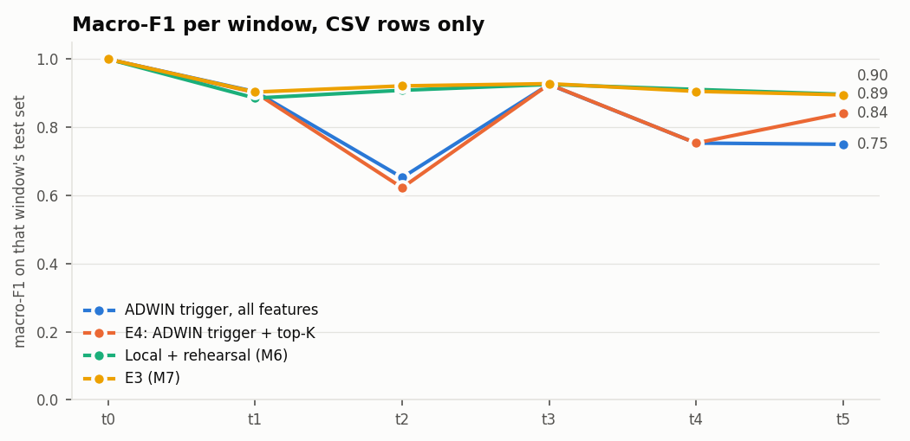

# M9: E4, drift-triggered updates, top-K features, adaptive gate (`full` pool)

Run `20261107-224851_m9_e4_full`. Generated by `scripts/m9_e4.py`. Seed 43. Scores use CSV-only rows (D7). Rows reach a client in 10 rounds per window, in random order, because the dataset has no timestamps. Between its update and the next g_t, a client uses its own calibrated output. Top-K limits new trees; older trees keep their splits, so inference still needs every feature.

## Results

| method | window avg | avg excl. t0 | final (t5) | SD over t1 to t5 | class forgetting |
|---|---:|---:|---:|---:|---:|
| Fixed schedule, all features (reproduces E3) | 0.9254 | 0.9106 | 0.8959 | 0.0131 | 0.0290 |
| Fixed schedule, all features (reproduces E3), client guard | 0.9289 | 0.9147 | 0.9011 | 0.0123 | 0.0259 |
| Fixed schedule, top-10 | 0.9160 | 0.8993 | 0.8819 | 0.0150 | 0.0280 |
| Fixed schedule, top-10, client guard | 0.9178 | 0.9014 | 0.8860 | 0.0136 | 0.0278 |
| Fixed schedule, top-20 | 0.9224 | 0.9071 | 0.8891 | 0.0153 | 0.0297 |
| Fixed schedule, top-20, client guard | 0.9253 | 0.9105 | 0.8947 | 0.0137 | 0.0255 |
| Fixed schedule, top-30 | 0.9251 | 0.9103 | 0.8947 | 0.0143 | 0.0286 |
| Fixed schedule, top-30, client guard | 0.9286 | 0.9145 | 0.9018 | 0.0127 | 0.0255 |
| ADWIN trigger, all features | 0.8307 | 0.7970 | 0.7497 | 0.1152 | 0.0243 |
| ADWIN trigger, all features, client guard | 0.8979 | 0.8776 | 0.8395 | 0.0445 | 0.0001 |
| Trigger on disagreement, all features | 0.7639 | 0.7169 | 0.7523 | 0.1686 | 0.0253 |
| Trigger on disagreement, all features, client guard | 0.7968 | 0.7562 | 0.8167 | 0.1752 | -0.0110 |
| E4: ADWIN trigger + top-K | 0.8405 | 0.8088 | 0.8407 | 0.1237 | -0.0582 |
| E4: ADWIN trigger + top-K, client guard | 0.9094 | 0.8913 | 0.8778 | 0.0254 | -0.0005 |
| ADWIN trigger added to the fixed schedule, top-K | 0.9236 | 0.9085 | 0.8893 | 0.0155 | 0.0326 |
| ADWIN trigger added to the fixed schedule, top-K, client guard | 0.9272 | 0.9127 | 0.8960 | 0.0140 | 0.0226 |
| Local + rehearsal (M6) | 0.9209 | 0.9052 | 0.8965 | 0.0151 | 0.0211 |
| E3 (M7) | 0.9251 | 0.9103 | 0.8949 | 0.0135 | 0.0291 |
| E3 (M7), client guard | 0.9283 | 0.9141 | 0.8981 | 0.0133 | 0.0234 |

Check against M7: `fixed` scores 0.92535 on window average and E3 in M7's report 0.92515 (difference +0.00021).

## Recovery inside each window

For E3, the old model and its g_t serve until the window ends. `mean over rounds` is macro-F1 averaged over the rounds of the window, with the window-end model as the last of them. `first trigger round` is the earliest over clients. Read the time to E3's earlier score: a method that already fell before the boundary reaches its own lower score sooner, which isn't a better recovery.

| method | window | own score before the boundary | old model on new rows | after window | mean over rounds | rounds to reach E3's earlier score (share of window) | rounds to reach its own (share of window) | first trigger round |
|---|---|---:|---:|---:|---:|---:|---:|---:|
| E3 (M7) | t1 | 0.999 | 0.462 | 0.903 | 0.502 | not in this window | not in this window | none |
| E3 (M7) | t2 | 0.903 | 0.640 | 0.921 | 0.666 | 1.0 | 1.0 | none |
| E3 (M7) | t3 | 0.921 | 0.603 | 0.928 | 0.632 | 1.0 | 1.0 | none |
| E3 (M7) | t4 | 0.928 | 0.754 | 0.905 | 0.768 | not in this window | not in this window | none |
| E3 (M7) | t5 | 0.905 | 0.853 | 0.895 | 0.856 | 1.0 | 1.0 | none |
| Fixed schedule, all features (reproduces E3) | t1 | 0.999 | 0.462 | 0.903 | 0.502 | not in this window | not in this window | none |
| Fixed schedule, all features (reproduces E3) | t2 | 0.903 | 0.640 | 0.921 | 0.666 | 1.0 | 1.0 | none |
| Fixed schedule, all features (reproduces E3) | t3 | 0.921 | 0.603 | 0.927 | 0.632 | 1.0 | 1.0 | none |
| Fixed schedule, all features (reproduces E3) | t4 | 0.927 | 0.754 | 0.905 | 0.768 | not in this window | not in this window | none |
| Fixed schedule, all features (reproduces E3) | t5 | 0.905 | 0.854 | 0.896 | 0.858 | 1.0 | 1.0 | none |
| ADWIN trigger, all features | t1 | 0.999 | 0.462 | 0.904 | 0.844 | not in this window | not in this window | 1 |
| ADWIN trigger, all features | t2 | 0.904 | 0.626 | 0.652 | 0.829 | not in this window | not in this window | 1 |
| ADWIN trigger, all features | t3 | 0.652 | 0.463 | 0.925 | 0.813 | 1.0 | 0.1 | 1 |
| ADWIN trigger, all features | t4 | 0.925 | 0.753 | 0.753 | 0.795 | not in this window | not in this window | 1 |
| ADWIN trigger, all features | t5 | 0.753 | 0.729 | 0.750 | 0.782 | not in this window | 0.1 | 1 |
| Trigger on disagreement, all features | t1 | 0.999 | 0.462 | 0.462 | 0.462 | not in this window | not in this window | none |
| Trigger on disagreement, all features | t2 | 0.462 | 0.324 | 0.686 | 0.719 | not in this window | 0.1 | 1 |
| Trigger on disagreement, all features | t3 | 0.686 | 0.461 | 0.929 | 0.877 | 0.1 | 0.1 | 1 |
| Trigger on disagreement, all features | t4 | 0.929 | 0.755 | 0.756 | 0.777 | not in this window | not in this window | 2 |
| Trigger on disagreement, all features | t5 | 0.756 | 0.728 | 0.752 | 0.789 | not in this window | 0.1 | 1 |
| E4: ADWIN trigger + top-K | t1 | 0.999 | 0.462 | 0.902 | 0.844 | not in this window | not in this window | 1 |
| E4: ADWIN trigger + top-K | t2 | 0.902 | 0.626 | 0.622 | 0.821 | not in this window | not in this window | 1 |
| E4: ADWIN trigger + top-K | t3 | 0.622 | 0.451 | 0.926 | 0.809 | 1.0 | 0.1 | 1 |
| E4: ADWIN trigger + top-K | t4 | 0.926 | 0.753 | 0.753 | 0.829 | not in this window | not in this window | 1 |
| E4: ADWIN trigger + top-K | t5 | 0.753 | 0.728 | 0.841 | 0.789 | not in this window | 0.1 | 1 |
| ADWIN trigger added to the fixed schedule, top-K | t1 | 0.999 | 0.462 | 0.902 | 0.844 | not in this window | not in this window | 1 |
| ADWIN trigger added to the fixed schedule, top-K | t2 | 0.902 | 0.626 | 0.919 | 0.848 | 1.0 | 1.0 | 1 |
| ADWIN trigger added to the fixed schedule, top-K | t3 | 0.919 | 0.616 | 0.928 | 0.883 | 0.2 | 0.2 | 1 |
| ADWIN trigger added to the fixed schedule, top-K | t4 | 0.928 | 0.755 | 0.903 | 0.808 | not in this window | not in this window | 1 |
| ADWIN trigger added to the fixed schedule, top-K | t5 | 0.903 | 0.855 | 0.889 | 0.879 | 1.0 | 1.0 | 1 |

## Cost

| method | local updates | clients updated, by window | uplink float32 (MB) | uplink 8-bit + zlib (MB) | downlink (kB) | local minutes |
|---|---:|---|---:|---:|---:|---:|
| Fixed schedule, all features (reproduces E3) | 90 | 15 15 15 15 15 15 | 338.6 | 16.5 | 35.6 | 18.4 |
| Fixed schedule, top-10 | 90 | 15 15 15 15 15 15 | 338.6 | 17.3 | 35.6 | 15.6 |
| Fixed schedule, top-20 | 90 | 15 15 15 15 15 15 | 338.6 | 16.8 | 35.6 | 16.2 |
| Fixed schedule, top-30 | 90 | 15 15 15 15 15 15 | 338.6 | 16.5 | 35.6 | 16.7 |
| ADWIN trigger, all features | 95 | 15 15 4 14 2 5 | 189.7 | 8.8 | 35.6 | 22.4 |
| Trigger on disagreement, all features | 77 | 15 0 10 15 1 5 | 194.7 | 6.4 | 35.6 | 18.0 |
| E4: ADWIN trigger + top-K | 97 | 15 15 4 14 2 6 | 194.1 | 9.0 | 35.6 | 24.7 |
| ADWIN trigger added to the fixed schedule, top-K | 128 | 15 15 15 15 15 15 | 338.6 | 16.7 | 35.6 | 32.7 |

## K sweep, fixed schedule

| K | mean validation macro-F1 | window avg (test) | final t5 (test) | picked |
|---:|---:|---:|---:|---|
| 10 | 0.8978 | 0.9160 | 0.8819 |  |
| 20 | 0.9072 | 0.9224 | 0.8891 |  |
| 30 | 0.9097 | 0.9251 | 0.8947 | yes |

## Adaptive gate: choosing the strength

| method | strength | mean errors caught, next window | fixed gate at the same cost | mean escalated, next window | picked on validation rows |
|---|---:|---:|---:|---:|---|
| Fixed schedule, all features (reproduces E3) | 0 | 0.255 | 0.255 | 0.069 |  |
| Fixed schedule, all features (reproduces E3) | 1 | 0.262 | 0.261 | 0.071 |  |
| Fixed schedule, all features (reproduces E3) | 2 | 0.268 | 0.267 | 0.073 |  |
| Fixed schedule, all features (reproduces E3) | 4 | 0.280 | 0.278 | 0.077 |  |
| Fixed schedule, all features (reproduces E3) | 8 | 0.303 | 0.302 | 0.086 | yes |
| Fixed schedule, all features (reproduces E3) | 16 | 0.347 | 0.368 | 0.112 |  |
| E4: ADWIN trigger + top-K | 0 | 0.218 | 0.218 | 0.064 |  |
| E4: ADWIN trigger + top-K | 1 | 0.225 | 0.224 | 0.066 |  |
| E4: ADWIN trigger + top-K | 2 | 0.233 | 0.230 | 0.068 |  |
| E4: ADWIN trigger + top-K | 4 | 0.247 | 0.244 | 0.073 |  |
| E4: ADWIN trigger + top-K | 8 | 0.272 | 0.278 | 0.086 | yes |
| E4: ADWIN trigger + top-K | 16 | 0.310 | 0.331 | 0.106 |  |

## Gate on test rows

`thresholds_only` is M7's gate. `fixed` adds the proposal's ADWIN flag and equals the adaptive gate at a score of 0. `psi_flag` is the D8 sensitivity run, not a headline. Target 10% (D10). Shown for E3's schedule and E4, at the picked strength; if that is 0, adaptive rows don't appear. All strengths and methods are in `gate_test.csv`. `fixed gate at the same cost` is the errors a fixed gate catches when loosened to the same escalation rate, on the same rows, so it shows whether the drift score adds anything over a looser threshold.

| method | model through | eval window | error rate | mode | strength | escalated | errors caught | fixed gate at the same cost | accuracy on the rest |
|---|---|---|---:|---|---:|---:|---:|---:|---:|
| Fixed schedule, all features (reproduces E3) | t0 | t0 | 0.000 | thresholds_only |  | 0.002 | 0.789 |  | 1.000 |
| Fixed schedule, all features (reproduces E3) | t0 | t0 | 0.000 | psi_flag |  | 0.002 | 0.789 |  | 1.000 |
| Fixed schedule, all features (reproduces E3) | t0 | t0 | 0.000 | fixed | 0 | 0.002 | 0.789 | 0.789 | 1.000 |
| Fixed schedule, all features (reproduces E3) | t0 | t0 | 0.000 | adaptive | 8 | 0.002 | 0.789 | 0.789 | 1.000 |
| Fixed schedule, all features (reproduces E3) | t0 | t1 | 0.741 | thresholds_only |  | 0.002 | 0.002 |  | 0.259 |
| Fixed schedule, all features (reproduces E3) | t0 | t1 | 0.741 | psi_flag |  | 0.871 | 0.912 |  | 0.498 |
| Fixed schedule, all features (reproduces E3) | t0 | t1 | 0.741 | fixed | 0 | 0.002 | 0.002 | 0.002 | 0.259 |
| Fixed schedule, all features (reproduces E3) | t0 | t1 | 0.741 | adaptive | 8 | 0.002 | 0.002 | 0.002 | 0.259 |
| Fixed schedule, all features (reproduces E3) | t1 | t1 | 0.105 | thresholds_only |  | 0.072 | 0.303 |  | 0.921 |
| Fixed schedule, all features (reproduces E3) | t1 | t1 | 0.105 | psi_flag |  | 0.343 | 0.484 |  | 0.918 |
| Fixed schedule, all features (reproduces E3) | t1 | t1 | 0.105 | fixed | 0 | 0.072 | 0.303 | 0.303 | 0.921 |
| Fixed schedule, all features (reproduces E3) | t1 | t1 | 0.105 | adaptive | 8 | 0.072 | 0.303 | 0.303 | 0.921 |
| Fixed schedule, all features (reproduces E3) | t1 | t2 | 0.119 | thresholds_only |  | 0.081 | 0.352 |  | 0.916 |
| Fixed schedule, all features (reproduces E3) | t1 | t2 | 0.119 | psi_flag |  | 0.348 | 0.510 |  | 0.911 |
| Fixed schedule, all features (reproduces E3) | t1 | t2 | 0.119 | fixed | 0 | 0.084 | 0.355 | 0.355 | 0.916 |
| Fixed schedule, all features (reproduces E3) | t1 | t2 | 0.119 | adaptive | 8 | 0.091 | 0.376 | 0.379 | 0.919 |
| Fixed schedule, all features (reproduces E3) | t2 | t2 | 0.103 | thresholds_only |  | 0.071 | 0.293 |  | 0.921 |
| Fixed schedule, all features (reproduces E3) | t2 | t2 | 0.103 | psi_flag |  | 0.071 | 0.293 |  | 0.921 |
| Fixed schedule, all features (reproduces E3) | t2 | t2 | 0.103 | fixed | 0 | 0.071 | 0.293 | 0.293 | 0.921 |
| Fixed schedule, all features (reproduces E3) | t2 | t2 | 0.103 | adaptive | 8 | 0.077 | 0.315 | 0.315 | 0.923 |
| Fixed schedule, all features (reproduces E3) | t2 | t3 | 0.161 | thresholds_only |  | 0.106 | 0.428 |  | 0.897 |
| Fixed schedule, all features (reproduces E3) | t2 | t3 | 0.161 | psi_flag |  | 0.126 | 0.451 |  | 0.899 |
| Fixed schedule, all features (reproduces E3) | t2 | t3 | 0.161 | fixed | 0 | 0.114 | 0.433 | 0.433 | 0.897 |
| Fixed schedule, all features (reproduces E3) | t2 | t3 | 0.161 | adaptive | 8 | 0.156 | 0.528 | 0.525 | 0.910 |
| Fixed schedule, all features (reproduces E3) | t3 | t3 | 0.110 | thresholds_only |  | 0.071 | 0.277 |  | 0.914 |
| Fixed schedule, all features (reproduces E3) | t3 | t3 | 0.110 | psi_flag |  | 0.102 | 0.300 |  | 0.914 |
| Fixed schedule, all features (reproduces E3) | t3 | t3 | 0.110 | fixed | 0 | 0.071 | 0.277 | 0.277 | 0.914 |
| Fixed schedule, all features (reproduces E3) | t3 | t3 | 0.110 | adaptive | 8 | 0.110 | 0.381 | 0.401 | 0.923 |
| Fixed schedule, all features (reproduces E3) | t3 | t4 | 0.115 | thresholds_only |  | 0.072 | 0.275 |  | 0.910 |
| Fixed schedule, all features (reproduces E3) | t3 | t4 | 0.115 | psi_flag |  | 0.102 | 0.295 |  | 0.910 |
| Fixed schedule, all features (reproduces E3) | t3 | t4 | 0.115 | fixed | 0 | 0.073 | 0.276 | 0.276 | 0.910 |
| Fixed schedule, all features (reproduces E3) | t3 | t4 | 0.115 | adaptive | 8 | 0.112 | 0.376 | 0.393 | 0.919 |
| Fixed schedule, all features (reproduces E3) | t4 | t4 | 0.111 | thresholds_only |  | 0.072 | 0.282 |  | 0.915 |
| Fixed schedule, all features (reproduces E3) | t4 | t4 | 0.111 | psi_flag |  | 0.072 | 0.282 |  | 0.915 |
| Fixed schedule, all features (reproduces E3) | t4 | t4 | 0.111 | fixed | 0 | 0.072 | 0.282 | 0.282 | 0.915 |
| Fixed schedule, all features (reproduces E3) | t4 | t4 | 0.111 | adaptive | 8 | 0.072 | 0.284 | 0.285 | 0.915 |
| Fixed schedule, all features (reproduces E3) | t4 | t5 | 0.142 | thresholds_only |  | 0.065 | 0.194 |  | 0.877 |
| Fixed schedule, all features (reproduces E3) | t4 | t5 | 0.142 | psi_flag |  | 0.173 | 0.309 |  | 0.881 |
| Fixed schedule, all features (reproduces E3) | t4 | t5 | 0.142 | fixed | 0 | 0.067 | 0.198 | 0.198 | 0.878 |
| Fixed schedule, all features (reproduces E3) | t4 | t5 | 0.142 | adaptive | 8 | 0.076 | 0.218 | 0.222 | 0.880 |
| Fixed schedule, all features (reproduces E3) | t5 | t5 | 0.103 | thresholds_only |  | 0.065 | 0.281 |  | 0.921 |
| Fixed schedule, all features (reproduces E3) | t5 | t5 | 0.103 | psi_flag |  | 0.172 | 0.359 |  | 0.920 |
| Fixed schedule, all features (reproduces E3) | t5 | t5 | 0.103 | fixed | 0 | 0.065 | 0.281 | 0.281 | 0.921 |
| Fixed schedule, all features (reproduces E3) | t5 | t5 | 0.103 | adaptive | 8 | 0.077 | 0.325 | 0.331 | 0.925 |
| E4: ADWIN trigger + top-K | t0 | t0 | 0.000 | thresholds_only |  | 0.002 | 0.818 |  | 1.000 |
| E4: ADWIN trigger + top-K | t0 | t0 | 0.000 | psi_flag |  | 0.002 | 0.818 |  | 1.000 |
| E4: ADWIN trigger + top-K | t0 | t0 | 0.000 | fixed | 0 | 0.002 | 0.818 | 0.818 | 1.000 |
| E4: ADWIN trigger + top-K | t0 | t0 | 0.000 | adaptive | 8 | 0.002 | 0.818 | 0.818 | 1.000 |
| E4: ADWIN trigger + top-K | t0 | t1 | 0.741 | thresholds_only |  | 0.002 | 0.002 |  | 0.259 |
| E4: ADWIN trigger + top-K | t0 | t1 | 0.741 | psi_flag |  | 0.871 | 0.912 |  | 0.498 |
| E4: ADWIN trigger + top-K | t0 | t1 | 0.741 | fixed | 0 | 0.002 | 0.002 | 0.002 | 0.259 |
| E4: ADWIN trigger + top-K | t0 | t1 | 0.741 | adaptive | 8 | 0.002 | 0.002 | 0.002 | 0.259 |
| E4: ADWIN trigger + top-K | t1 | t1 | 0.106 | thresholds_only |  | 0.069 | 0.245 |  | 0.914 |
| E4: ADWIN trigger + top-K | t1 | t1 | 0.106 | psi_flag |  | 0.340 | 0.412 |  | 0.905 |
| E4: ADWIN trigger + top-K | t1 | t1 | 0.106 | fixed | 0 | 0.069 | 0.245 | 0.245 | 0.914 |
| E4: ADWIN trigger + top-K | t1 | t1 | 0.106 | adaptive | 8 | 0.069 | 0.245 | 0.245 | 0.914 |
| E4: ADWIN trigger + top-K | t1 | t2 | 0.120 | thresholds_only |  | 0.079 | 0.303 |  | 0.909 |
| E4: ADWIN trigger + top-K | t1 | t2 | 0.120 | psi_flag |  | 0.346 | 0.449 |  | 0.899 |
| E4: ADWIN trigger + top-K | t1 | t2 | 0.120 | fixed | 0 | 0.083 | 0.307 | 0.307 | 0.909 |
| E4: ADWIN trigger + top-K | t1 | t2 | 0.120 | adaptive | 8 | 0.095 | 0.342 | 0.347 | 0.913 |
| E4: ADWIN trigger + top-K | t2 | t2 | 0.119 | thresholds_only |  | 0.066 | 0.257 |  | 0.905 |
| E4: ADWIN trigger + top-K | t2 | t2 | 0.119 | psi_flag |  | 0.066 | 0.257 |  | 0.905 |
| E4: ADWIN trigger + top-K | t2 | t2 | 0.119 | fixed | 0 | 0.066 | 0.257 | 0.257 | 0.905 |
| E4: ADWIN trigger + top-K | t2 | t2 | 0.119 | adaptive | 8 | 0.091 | 0.326 | 0.331 | 0.912 |
| E4: ADWIN trigger + top-K | t2 | t3 | 0.175 | thresholds_only |  | 0.086 | 0.302 |  | 0.866 |
| E4: ADWIN trigger + top-K | t2 | t3 | 0.175 | psi_flag |  | 0.110 | 0.348 |  | 0.872 |
| E4: ADWIN trigger + top-K | t2 | t3 | 0.175 | fixed | 0 | 0.094 | 0.309 | 0.309 | 0.866 |
| E4: ADWIN trigger + top-K | t2 | t3 | 0.175 | adaptive | 8 | 0.145 | 0.439 | 0.424 | 0.885 |
| E4: ADWIN trigger + top-K | t3 | t3 | 0.106 | thresholds_only |  | 0.067 | 0.279 |  | 0.918 |
| E4: ADWIN trigger + top-K | t3 | t3 | 0.106 | psi_flag |  | 0.098 | 0.299 |  | 0.918 |
| E4: ADWIN trigger + top-K | t3 | t3 | 0.106 | fixed | 0 | 0.067 | 0.279 | 0.279 | 0.918 |
| E4: ADWIN trigger + top-K | t3 | t3 | 0.106 | adaptive | 8 | 0.092 | 0.366 | 0.364 | 0.926 |
| E4: ADWIN trigger + top-K | t3 | t4 | 0.111 | thresholds_only |  | 0.067 | 0.264 |  | 0.913 |
| E4: ADWIN trigger + top-K | t3 | t4 | 0.111 | psi_flag |  | 0.098 | 0.282 |  | 0.912 |
| E4: ADWIN trigger + top-K | t3 | t4 | 0.111 | fixed | 0 | 0.068 | 0.265 | 0.265 | 0.913 |
| E4: ADWIN trigger + top-K | t3 | t4 | 0.111 | adaptive | 8 | 0.093 | 0.349 | 0.348 | 0.921 |
| E4: ADWIN trigger + top-K | t4 | t4 | 0.110 | thresholds_only |  | 0.062 | 0.252 |  | 0.913 |
| E4: ADWIN trigger + top-K | t4 | t4 | 0.110 | psi_flag |  | 0.062 | 0.252 |  | 0.913 |
| E4: ADWIN trigger + top-K | t4 | t4 | 0.110 | fixed | 0 | 0.062 | 0.252 | 0.252 | 0.913 |
| E4: ADWIN trigger + top-K | t4 | t4 | 0.110 | adaptive | 8 | 0.063 | 0.255 | 0.255 | 0.913 |
| E4: ADWIN trigger + top-K | t4 | t5 | 0.141 | thresholds_only |  | 0.064 | 0.191 |  | 0.878 |
| E4: ADWIN trigger + top-K | t4 | t5 | 0.141 | psi_flag |  | 0.173 | 0.300 |  | 0.881 |
| E4: ADWIN trigger + top-K | t4 | t5 | 0.141 | fixed | 0 | 0.067 | 0.194 | 0.194 | 0.878 |
| E4: ADWIN trigger + top-K | t4 | t5 | 0.141 | adaptive | 8 | 0.075 | 0.215 | 0.216 | 0.881 |
| E4: ADWIN trigger + top-K | t5 | t5 | 0.107 | thresholds_only |  | 0.062 | 0.265 |  | 0.917 |
| E4: ADWIN trigger + top-K | t5 | t5 | 0.107 | psi_flag |  | 0.169 | 0.341 |  | 0.915 |
| E4: ADWIN trigger + top-K | t5 | t5 | 0.107 | fixed | 0 | 0.062 | 0.265 | 0.265 | 0.917 |
| E4: ADWIN trigger + top-K | t5 | t5 | 0.107 | adaptive | 8 | 0.073 | 0.299 | 0.306 | 0.919 |

