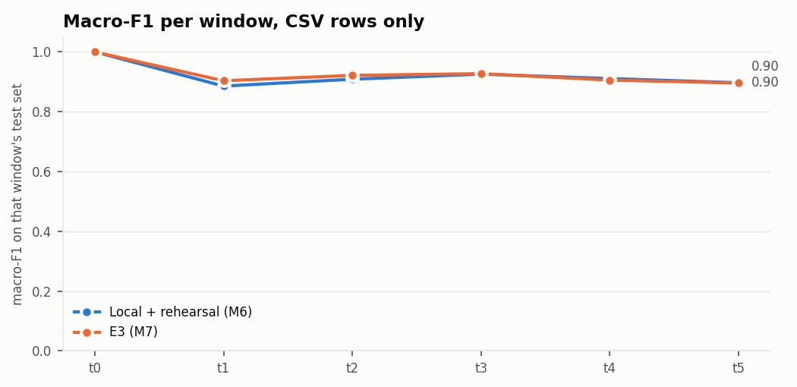

# M9: E4, drift-triggered updates, top-K features, adaptive gate (`full` pool)

Run `20261115-144918_m9_e4_full`. Generated by `scripts/m9_e4.py`. Seed 43. Scores use CSV-only rows (D7). Rows reach a client in 10 rounds per window, in random order, because the dataset has no timestamps. Between its update and the next g_t, a client uses its own calibrated output. Top-K limits new trees; older trees keep their splits, so inference still needs every feature.

## Results

| method | window avg | avg excl. t0 | final (t5) | SD over t1 to t5 | class forgetting |
|---|---:|---:|---:|---:|---:|
| E4 (e4_added), all features | 0.9247 | 0.9098 | 0.8928 | 0.0141 | 0.0295 |
| E4 (e4_added), all features, client guard | 0.9287 | 0.9146 | 0.8966 | 0.0138 | 0.0244 |
| E4 (e4_added), no rehearsal | 0.9240 | 0.9090 | 0.8909 | 0.0154 | 0.0311 |
| E4 (e4_added), no rehearsal, client guard | 0.9280 | 0.9137 | 0.8986 | 0.0137 | 0.0241 |
| Local + rehearsal (M6) | 0.9208 | 0.9051 | 0.8963 | 0.0151 | 0.0210 |
| E3 (M7) | 0.9252 | 0.9103 | 0.8955 | 0.0131 | 0.0292 |
| E3 (M7), client guard | 0.9284 | 0.9142 | 0.9012 | 0.0115 | 0.0236 |

No `fixed` pass in this report, so nothing was checked against M7.

## Recovery inside each window

For E3, the old model and its g_t serve until the window ends. `mean over rounds` is macro-F1 averaged over the rounds of the window, with the window-end model as the last of them. `first trigger round` is the earliest over clients. Read the time to E3's earlier score: a method that already fell before the boundary reaches its own lower score sooner, which isn't a better recovery.

| method | window | own score before the boundary | old model on new rows | after window | mean over rounds | rounds to reach E3's earlier score (share of window) | rounds to reach its own (share of window) | first trigger round |
|---|---|---:|---:|---:|---:|---:|---:|---:|
| E3 (M7) | t1 | 0.999 | 0.462 | 0.903 | 0.502 | not in this window | not in this window | none |
| E3 (M7) | t2 | 0.903 | 0.640 | 0.921 | 0.666 | 1.0 | 1.0 | none |
| E3 (M7) | t3 | 0.921 | 0.603 | 0.927 | 0.632 | 1.0 | 1.0 | none |
| E3 (M7) | t4 | 0.927 | 0.754 | 0.905 | 0.767 | not in this window | not in this window | none |
| E3 (M7) | t5 | 0.905 | 0.854 | 0.896 | 0.858 | 1.0 | 1.0 | none |

## Cost

| method | local updates | clients updated, by window | uplink float32 (MB) | uplink 8-bit + zlib (MB) | downlink (kB) | local minutes |
|---|---:|---|---:|---:|---:|---:|
| E4 (e4_added), all features | 129 | 15 15 15 15 15 15 | 338.6 | 16.7 | 35.6 | 32.8 |
| E4 (e4_added), no rehearsal | 131 | 15 15 15 15 15 15 | 338.6 | 16.6 | 35.6 | 33.4 |

## K sweep, fixed schedule

| K | mean validation macro-F1 | window avg (test) | final t5 (test) | picked |
|---:|---:|---:|---:|---|

## Adaptive gate: choosing the strength

| method | strength | mean errors caught, next window | fixed gate at the same cost | mean escalated, next window | picked on validation rows |
|---|---:|---:|---:|---:|---|

## Gate on test rows

`thresholds_only` is M7's gate. `fixed` adds the proposal's ADWIN flag and equals the adaptive gate at a score of 0. `psi_flag` is the D8 sensitivity run, not a headline. Target 10% (D10). Shown for E3's schedule and E4, at the picked strength; if that is 0, adaptive rows don't appear. All strengths and methods are in `gate_test.csv`. `fixed gate at the same cost` is the errors a fixed gate catches when loosened to the same escalation rate, on the same rows, so it shows whether the drift score adds anything over a looser threshold.

| method | model through | eval window | error rate | mode | strength | escalated | errors caught | fixed gate at the same cost | accuracy on the rest |
|---|---|---|---:|---|---:|---:|---:|---:|---:|

