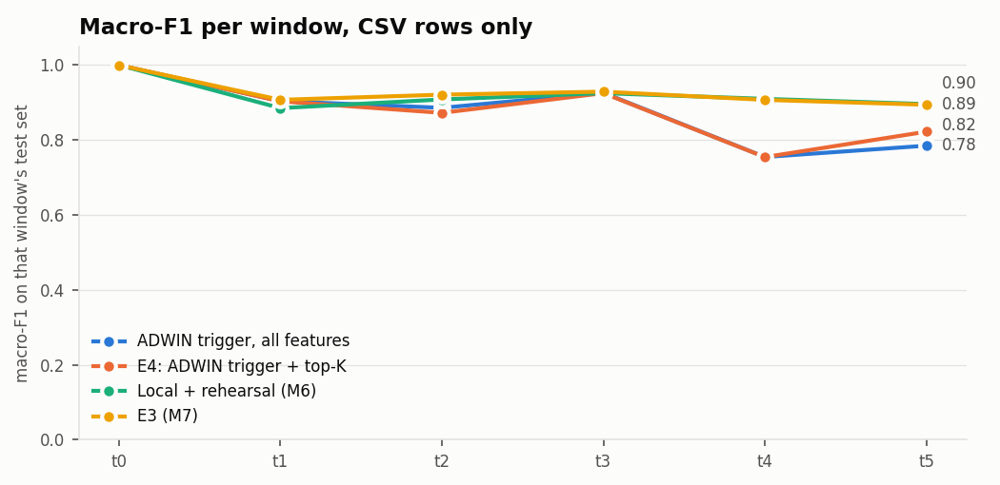

# M9: E4, drift-triggered updates, top-K features, adaptive gate (`full` pool)

Run `20261115-150325_m9_e4_full`. Generated by `scripts/m9_e4.py`. Seed 44. Scores use CSV-only rows (D7). Rows reach a client in 10 rounds per window, in random order, because the dataset has no timestamps. Between its update and the next g_t, a client uses its own calibrated output. Top-K limits new trees; older trees keep their splits, so inference still needs every feature.

## Results

| method | window avg | avg excl. t0 | final (t5) | SD over t1 to t5 | class forgetting |
|---|---:|---:|---:|---:|---:|
| Fixed schedule, all features (reproduces E3) | 0.9257 | 0.9110 | 0.8932 | 0.0140 | 0.0304 |
| Fixed schedule, all features (reproduces E3), client guard | 0.9282 | 0.9139 | 0.8999 | 0.0120 | 0.0253 |
| Fixed schedule, top-10 | 0.9140 | 0.8969 | 0.8757 | 0.0174 | 0.0300 |
| Fixed schedule, top-10, client guard | 0.9162 | 0.8995 | 0.8804 | 0.0144 | 0.0283 |
| Fixed schedule, top-20 | 0.9227 | 0.9075 | 0.8889 | 0.0149 | 0.0264 |
| Fixed schedule, top-20, client guard | 0.9255 | 0.9107 | 0.8940 | 0.0126 | 0.0240 |
| Fixed schedule, top-30 | 0.9251 | 0.9103 | 0.8953 | 0.0132 | 0.0275 |
| Fixed schedule, top-30, client guard | 0.9279 | 0.9136 | 0.8994 | 0.0120 | 0.0233 |
| ADWIN trigger, all features | 0.8754 | 0.8506 | 0.7844 | 0.0763 | -0.0075 |
| ADWIN trigger, all features, client guard | 0.9014 | 0.8817 | 0.8500 | 0.0502 | -0.0236 |
| Trigger on disagreement, all features | 0.7643 | 0.7173 | 0.7525 | 0.1690 | 0.0245 |
| Trigger on disagreement, all features, client guard | 0.8118 | 0.7743 | 0.8610 | 0.1831 | -0.0134 |
| E4: ADWIN trigger + top-K | 0.8791 | 0.8550 | 0.8217 | 0.0684 | -0.0456 |
| E4: ADWIN trigger + top-K, client guard | 0.9016 | 0.8820 | 0.8563 | 0.0483 | -0.0292 |
| ADWIN trigger added to the fixed schedule, top-K | 0.9244 | 0.9094 | 0.8938 | 0.0143 | 0.0296 |
| ADWIN trigger added to the fixed schedule, top-K, client guard | 0.9271 | 0.9126 | 0.9011 | 0.0114 | 0.0259 |
| Local + rehearsal (M6) | 0.9202 | 0.9043 | 0.8954 | 0.0151 | 0.0225 |
| E3 (M7) | 0.9259 | 0.9112 | 0.8937 | 0.0136 | 0.0326 |
| E3 (M7), client guard | 0.9280 | 0.9137 | 0.8999 | 0.0120 | 0.0249 |

Check against M7: `fixed` scores 0.92566 on window average and E3 in M7's report 0.92587 (difference -0.00020).

## Recovery inside each window

For E3, the old model and its g_t serve until the window ends. `mean over rounds` is macro-F1 averaged over the rounds of the window, with the window-end model as the last of them. `first trigger round` is the earliest over clients. Read the time to E3's earlier score: a method that already fell before the boundary reaches its own lower score sooner, which isn't a better recovery.

| method | window | own score before the boundary | old model on new rows | after window | mean over rounds | rounds to reach E3's earlier score (share of window) | rounds to reach its own (share of window) | first trigger round |
|---|---|---:|---:|---:|---:|---:|---:|---:|
| E3 (M7) | t1 | 0.999 | 0.461 | 0.907 | 0.502 | not in this window | not in this window | none |
| E3 (M7) | t2 | 0.907 | 0.630 | 0.921 | 0.656 | 1.0 | 1.0 | none |
| E3 (M7) | t3 | 0.921 | 0.604 | 0.929 | 0.633 | 1.0 | 1.0 | none |
| E3 (M7) | t4 | 0.929 | 0.755 | 0.907 | 0.769 | not in this window | not in this window | none |
| E3 (M7) | t5 | 0.907 | 0.854 | 0.894 | 0.858 | 1.0 | 1.0 | none |
| Fixed schedule, all features (reproduces E3) | t1 | 0.999 | 0.461 | 0.907 | 0.502 | not in this window | not in this window | none |
| Fixed schedule, all features (reproduces E3) | t2 | 0.907 | 0.630 | 0.921 | 0.656 | 1.0 | 1.0 | none |
| Fixed schedule, all features (reproduces E3) | t3 | 0.921 | 0.604 | 0.928 | 0.634 | 1.0 | 1.0 | none |
| Fixed schedule, all features (reproduces E3) | t4 | 0.928 | 0.755 | 0.905 | 0.769 | not in this window | not in this window | none |
| Fixed schedule, all features (reproduces E3) | t5 | 0.905 | 0.852 | 0.893 | 0.856 | 1.0 | 1.0 | none |
| ADWIN trigger, all features | t1 | 0.999 | 0.461 | 0.903 | 0.846 | not in this window | not in this window | 1 |
| ADWIN trigger, all features | t2 | 0.903 | 0.632 | 0.885 | 0.871 | 0.3 | 0.1 | 1 |
| ADWIN trigger, all features | t3 | 0.885 | 0.588 | 0.926 | 0.863 | 1.0 | 0.1 | 1 |
| ADWIN trigger, all features | t4 | 0.926 | 0.753 | 0.754 | 0.789 | not in this window | not in this window | 2 |
| ADWIN trigger, all features | t5 | 0.754 | 0.727 | 0.784 | 0.792 | not in this window | 0.1 | 1 |
| Trigger on disagreement, all features | t1 | 0.999 | 0.461 | 0.461 | 0.461 | not in this window | not in this window | none |
| Trigger on disagreement, all features | t2 | 0.461 | 0.317 | 0.686 | 0.716 | not in this window | 0.1 | 1 |
| Trigger on disagreement, all features | t3 | 0.686 | 0.466 | 0.929 | 0.880 | 0.1 | 0.1 | 1 |
| Trigger on disagreement, all features | t4 | 0.929 | 0.755 | 0.757 | 0.815 | not in this window | not in this window | 1 |
| Trigger on disagreement, all features | t5 | 0.757 | 0.732 | 0.753 | 0.785 | not in this window | 0.1 | 1 |
| E4: ADWIN trigger + top-K | t1 | 0.999 | 0.462 | 0.903 | 0.846 | not in this window | not in this window | 1 |
| E4: ADWIN trigger + top-K | t2 | 0.903 | 0.629 | 0.872 | 0.868 | 0.4 | 0.4 | 1 |
| E4: ADWIN trigger + top-K | t3 | 0.872 | 0.581 | 0.925 | 0.859 | 1.0 | 0.1 | 1 |
| E4: ADWIN trigger + top-K | t4 | 0.925 | 0.753 | 0.754 | 0.790 | not in this window | not in this window | 2 |
| E4: ADWIN trigger + top-K | t5 | 0.754 | 0.727 | 0.822 | 0.795 | not in this window | 0.1 | 1 |
| ADWIN trigger added to the fixed schedule, top-K | t1 | 0.999 | 0.462 | 0.903 | 0.846 | not in this window | not in this window | 1 |
| ADWIN trigger added to the fixed schedule, top-K | t2 | 0.903 | 0.629 | 0.919 | 0.872 | 0.4 | 0.4 | 1 |
| ADWIN trigger added to the fixed schedule, top-K | t3 | 0.919 | 0.634 | 0.929 | 0.882 | 0.2 | 0.2 | 1 |
| ADWIN trigger added to the fixed schedule, top-K | t4 | 0.929 | 0.755 | 0.902 | 0.849 | not in this window | not in this window | 1 |
| ADWIN trigger added to the fixed schedule, top-K | t5 | 0.902 | 0.852 | 0.894 | 0.878 | 1.0 | 1.0 | 1 |

## Cost

| method | local updates | clients updated, by window | uplink float32 (MB) | uplink 8-bit + zlib (MB) | downlink (kB) | local minutes |
|---|---:|---|---:|---:|---:|---:|
| Fixed schedule, all features (reproduces E3) | 90 | 15 15 15 15 15 15 | 338.6 | 16.6 | 35.6 | 21.5 |
| Fixed schedule, top-10 | 90 | 15 15 15 15 15 15 | 338.6 | 17.4 | 35.6 | 17.5 |
| Fixed schedule, top-20 | 90 | 15 15 15 15 15 15 | 338.6 | 16.8 | 35.6 | 17.8 |
| Fixed schedule, top-30 | 90 | 15 15 15 15 15 15 | 338.6 | 16.5 | 35.6 | 18.7 |
| ADWIN trigger, all features | 97 | 15 15 6 13 1 6 | 193.8 | 9.0 | 35.6 | 26.0 |
| Trigger on disagreement, all features | 75 | 15 0 10 15 1 4 | 190.3 | 6.2 | 35.6 | 19.7 |
| E4: ADWIN trigger + top-K | 99 | 15 15 6 13 1 7 | 198.1 | 9.3 | 35.6 | 26.7 |
| ADWIN trigger added to the fixed schedule, top-K | 131 | 15 15 15 15 15 15 | 338.6 | 16.6 | 35.6 | 35.6 |

## K sweep, fixed schedule

| K | mean validation macro-F1 | window avg (test) | final t5 (test) | picked |
|---:|---:|---:|---:|---|
| 10 | 0.8999 | 0.9140 | 0.8757 |  |
| 20 | 0.9068 | 0.9227 | 0.8889 |  |
| 30 | 0.9096 | 0.9251 | 0.8953 | yes |

## Adaptive gate: choosing the strength

| method | strength | mean errors caught, next window | fixed gate at the same cost | mean escalated, next window | picked on validation rows |
|---|---:|---:|---:|---:|---|
| Fixed schedule, all features (reproduces E3) | 0 | 0.262 | 0.262 | 0.071 |  |
| Fixed schedule, all features (reproduces E3) | 1 | 0.268 | 0.269 | 0.073 |  |
| Fixed schedule, all features (reproduces E3) | 2 | 0.276 | 0.276 | 0.076 |  |
| Fixed schedule, all features (reproduces E3) | 4 | 0.290 | 0.291 | 0.081 |  |
| Fixed schedule, all features (reproduces E3) | 8 | 0.315 | 0.322 | 0.091 | yes |
| Fixed schedule, all features (reproduces E3) | 16 | 0.364 | 0.421 | 0.131 |  |
| E4: ADWIN trigger + top-K | 0 | 0.245 | 0.245 | 0.067 |  |
| E4: ADWIN trigger + top-K | 1 | 0.251 | 0.251 | 0.069 |  |
| E4: ADWIN trigger + top-K | 2 | 0.257 | 0.256 | 0.071 |  |
| E4: ADWIN trigger + top-K | 4 | 0.269 | 0.269 | 0.075 |  |
| E4: ADWIN trigger + top-K | 8 | 0.295 | 0.298 | 0.085 | yes |
| E4: ADWIN trigger + top-K | 16 | 0.340 | 0.369 | 0.114 |  |

## Gate on test rows

`thresholds_only` is M7's gate. `fixed` adds the proposal's ADWIN flag and equals the adaptive gate at a score of 0. `psi_flag` is the D8 sensitivity run, not a headline. Target 10% (D10). Shown for E3's schedule and E4, at the picked strength; if that is 0, adaptive rows don't appear. All strengths and methods are in `gate_test.csv`. `fixed gate at the same cost` is the errors a fixed gate catches when loosened to the same escalation rate, on the same rows, so it shows whether the drift score adds anything over a looser threshold.

| method | model through | eval window | error rate | mode | strength | escalated | errors caught | fixed gate at the same cost | accuracy on the rest |
|---|---|---|---:|---|---:|---:|---:|---:|---:|
| Fixed schedule, all features (reproduces E3) | t0 | t0 | 0.000 | thresholds_only |  | 0.003 | 0.909 |  | 1.000 |
| Fixed schedule, all features (reproduces E3) | t0 | t0 | 0.000 | psi_flag |  | 0.003 | 0.909 |  | 1.000 |
| Fixed schedule, all features (reproduces E3) | t0 | t0 | 0.000 | fixed | 0 | 0.003 | 0.909 | 0.909 | 1.000 |
| Fixed schedule, all features (reproduces E3) | t0 | t0 | 0.000 | adaptive | 8 | 0.003 | 0.909 | 0.909 | 1.000 |
| Fixed schedule, all features (reproduces E3) | t0 | t1 | 0.741 | thresholds_only |  | 0.002 | 0.002 |  | 0.259 |
| Fixed schedule, all features (reproduces E3) | t0 | t1 | 0.741 | psi_flag |  | 0.871 | 0.912 |  | 0.498 |
| Fixed schedule, all features (reproduces E3) | t0 | t1 | 0.741 | fixed | 0 | 0.002 | 0.002 | 0.002 | 0.259 |
| Fixed schedule, all features (reproduces E3) | t0 | t1 | 0.741 | adaptive | 8 | 0.002 | 0.002 | 0.002 | 0.259 |
| Fixed schedule, all features (reproduces E3) | t1 | t1 | 0.100 | thresholds_only |  | 0.072 | 0.300 |  | 0.924 |
| Fixed schedule, all features (reproduces E3) | t1 | t1 | 0.100 | psi_flag |  | 0.343 | 0.483 |  | 0.921 |
| Fixed schedule, all features (reproduces E3) | t1 | t1 | 0.100 | fixed | 0 | 0.072 | 0.300 | 0.300 | 0.924 |
| Fixed schedule, all features (reproduces E3) | t1 | t1 | 0.100 | adaptive | 8 | 0.072 | 0.300 | 0.300 | 0.924 |
| Fixed schedule, all features (reproduces E3) | t1 | t2 | 0.114 | thresholds_only |  | 0.081 | 0.350 |  | 0.919 |
| Fixed schedule, all features (reproduces E3) | t1 | t2 | 0.114 | psi_flag |  | 0.348 | 0.509 |  | 0.914 |
| Fixed schedule, all features (reproduces E3) | t1 | t2 | 0.114 | fixed | 0 | 0.084 | 0.353 | 0.353 | 0.919 |
| Fixed schedule, all features (reproduces E3) | t1 | t2 | 0.114 | adaptive | 8 | 0.089 | 0.367 | 0.368 | 0.921 |
| Fixed schedule, all features (reproduces E3) | t2 | t2 | 0.100 | thresholds_only |  | 0.067 | 0.190 |  | 0.913 |
| Fixed schedule, all features (reproduces E3) | t2 | t2 | 0.100 | psi_flag |  | 0.067 | 0.190 |  | 0.913 |
| Fixed schedule, all features (reproduces E3) | t2 | t2 | 0.100 | fixed | 0 | 0.067 | 0.190 | 0.190 | 0.913 |
| Fixed schedule, all features (reproduces E3) | t2 | t2 | 0.100 | adaptive | 8 | 0.074 | 0.212 | 0.219 | 0.915 |
| Fixed schedule, all features (reproduces E3) | t2 | t3 | 0.157 | thresholds_only |  | 0.117 | 0.457 |  | 0.903 |
| Fixed schedule, all features (reproduces E3) | t2 | t3 | 0.157 | psi_flag |  | 0.137 | 0.487 |  | 0.906 |
| Fixed schedule, all features (reproduces E3) | t2 | t3 | 0.157 | fixed | 0 | 0.124 | 0.462 | 0.462 | 0.903 |
| Fixed schedule, all features (reproduces E3) | t2 | t3 | 0.157 | adaptive | 8 | 0.180 | 0.581 | 0.600 | 0.920 |
| Fixed schedule, all features (reproduces E3) | t3 | t3 | 0.109 | thresholds_only |  | 0.065 | 0.258 |  | 0.914 |
| Fixed schedule, all features (reproduces E3) | t3 | t3 | 0.109 | psi_flag |  | 0.095 | 0.280 |  | 0.914 |
| Fixed schedule, all features (reproduces E3) | t3 | t3 | 0.109 | fixed | 0 | 0.065 | 0.258 | 0.258 | 0.914 |
| Fixed schedule, all features (reproduces E3) | t3 | t3 | 0.109 | adaptive | 8 | 0.114 | 0.399 | 0.425 | 0.926 |
| Fixed schedule, all features (reproduces E3) | t3 | t4 | 0.113 | thresholds_only |  | 0.066 | 0.257 |  | 0.910 |
| Fixed schedule, all features (reproduces E3) | t3 | t4 | 0.113 | psi_flag |  | 0.097 | 0.277 |  | 0.910 |
| Fixed schedule, all features (reproduces E3) | t3 | t4 | 0.113 | fixed | 0 | 0.067 | 0.257 | 0.257 | 0.910 |
| Fixed schedule, all features (reproduces E3) | t3 | t4 | 0.113 | adaptive | 8 | 0.116 | 0.395 | 0.416 | 0.923 |
| Fixed schedule, all features (reproduces E3) | t4 | t4 | 0.108 | thresholds_only |  | 0.070 | 0.283 |  | 0.917 |
| Fixed schedule, all features (reproduces E3) | t4 | t4 | 0.108 | psi_flag |  | 0.070 | 0.283 |  | 0.917 |
| Fixed schedule, all features (reproduces E3) | t4 | t4 | 0.108 | fixed | 0 | 0.070 | 0.283 | 0.283 | 0.917 |
| Fixed schedule, all features (reproduces E3) | t4 | t4 | 0.108 | adaptive | 8 | 0.070 | 0.283 | 0.283 | 0.917 |
| Fixed schedule, all features (reproduces E3) | t4 | t5 | 0.140 | thresholds_only |  | 0.068 | 0.212 |  | 0.882 |
| Fixed schedule, all features (reproduces E3) | t4 | t5 | 0.140 | psi_flag |  | 0.177 | 0.316 |  | 0.884 |
| Fixed schedule, all features (reproduces E3) | t4 | t5 | 0.140 | fixed | 0 | 0.071 | 0.216 | 0.216 | 0.882 |
| Fixed schedule, all features (reproduces E3) | t4 | t5 | 0.140 | adaptive | 8 | 0.078 | 0.233 | 0.239 | 0.884 |
| Fixed schedule, all features (reproduces E3) | t5 | t5 | 0.104 | thresholds_only |  | 0.063 | 0.258 |  | 0.918 |
| Fixed schedule, all features (reproduces E3) | t5 | t5 | 0.104 | psi_flag |  | 0.170 | 0.335 |  | 0.917 |
| Fixed schedule, all features (reproduces E3) | t5 | t5 | 0.104 | fixed | 0 | 0.063 | 0.258 | 0.258 | 0.918 |
| Fixed schedule, all features (reproduces E3) | t5 | t5 | 0.104 | adaptive | 8 | 0.078 | 0.306 | 0.318 | 0.922 |
| E4: ADWIN trigger + top-K | t0 | t0 | 0.000 | thresholds_only |  | 0.002 | 0.895 |  | 1.000 |
| E4: ADWIN trigger + top-K | t0 | t0 | 0.000 | psi_flag |  | 0.002 | 0.895 |  | 1.000 |
| E4: ADWIN trigger + top-K | t0 | t0 | 0.000 | fixed | 0 | 0.002 | 0.895 | 0.895 | 1.000 |
| E4: ADWIN trigger + top-K | t0 | t0 | 0.000 | adaptive | 8 | 0.002 | 0.895 | 0.895 | 1.000 |
| E4: ADWIN trigger + top-K | t0 | t1 | 0.741 | thresholds_only |  | 0.002 | 0.002 |  | 0.259 |
| E4: ADWIN trigger + top-K | t0 | t1 | 0.741 | psi_flag |  | 0.871 | 0.912 |  | 0.498 |
| E4: ADWIN trigger + top-K | t0 | t1 | 0.741 | fixed | 0 | 0.002 | 0.002 | 0.002 | 0.259 |
| E4: ADWIN trigger + top-K | t0 | t1 | 0.741 | adaptive | 8 | 0.002 | 0.002 | 0.002 | 0.259 |
| E4: ADWIN trigger + top-K | t1 | t1 | 0.105 | thresholds_only |  | 0.068 | 0.287 |  | 0.920 |
| E4: ADWIN trigger + top-K | t1 | t1 | 0.105 | psi_flag |  | 0.341 | 0.463 |  | 0.915 |
| E4: ADWIN trigger + top-K | t1 | t1 | 0.105 | fixed | 0 | 0.068 | 0.287 | 0.287 | 0.920 |
| E4: ADWIN trigger + top-K | t1 | t1 | 0.105 | adaptive | 8 | 0.068 | 0.287 | 0.287 | 0.920 |
| E4: ADWIN trigger + top-K | t1 | t2 | 0.119 | thresholds_only |  | 0.074 | 0.312 |  | 0.912 |
| E4: ADWIN trigger + top-K | t1 | t2 | 0.119 | psi_flag |  | 0.343 | 0.467 |  | 0.903 |
| E4: ADWIN trigger + top-K | t1 | t2 | 0.119 | fixed | 0 | 0.077 | 0.316 | 0.316 | 0.912 |
| E4: ADWIN trigger + top-K | t1 | t2 | 0.119 | adaptive | 8 | 0.083 | 0.336 | 0.335 | 0.914 |
| E4: ADWIN trigger + top-K | t2 | t2 | 0.105 | thresholds_only |  | 0.068 | 0.266 |  | 0.917 |
| E4: ADWIN trigger + top-K | t2 | t2 | 0.105 | psi_flag |  | 0.068 | 0.266 |  | 0.917 |
| E4: ADWIN trigger + top-K | t2 | t2 | 0.105 | fixed | 0 | 0.068 | 0.266 | 0.266 | 0.917 |
| E4: ADWIN trigger + top-K | t2 | t2 | 0.105 | adaptive | 8 | 0.075 | 0.286 | 0.294 | 0.919 |
| E4: ADWIN trigger + top-K | t2 | t3 | 0.162 | thresholds_only |  | 0.106 | 0.421 |  | 0.895 |
| E4: ADWIN trigger + top-K | t2 | t3 | 0.162 | psi_flag |  | 0.125 | 0.441 |  | 0.897 |
| E4: ADWIN trigger + top-K | t2 | t3 | 0.162 | fixed | 0 | 0.113 | 0.427 | 0.427 | 0.895 |
| E4: ADWIN trigger + top-K | t2 | t3 | 0.162 | adaptive | 8 | 0.167 | 0.530 | 0.550 | 0.909 |
| E4: ADWIN trigger + top-K | t3 | t3 | 0.107 | thresholds_only |  | 0.069 | 0.283 |  | 0.918 |
| E4: ADWIN trigger + top-K | t3 | t3 | 0.107 | psi_flag |  | 0.100 | 0.302 |  | 0.917 |
| E4: ADWIN trigger + top-K | t3 | t3 | 0.107 | fixed | 0 | 0.069 | 0.283 | 0.283 | 0.918 |
| E4: ADWIN trigger + top-K | t3 | t3 | 0.107 | adaptive | 8 | 0.132 | 0.412 | 0.483 | 0.927 |
| E4: ADWIN trigger + top-K | t3 | t4 | 0.111 | thresholds_only |  | 0.070 | 0.275 |  | 0.913 |
| E4: ADWIN trigger + top-K | t3 | t4 | 0.111 | psi_flag |  | 0.100 | 0.292 |  | 0.912 |
| E4: ADWIN trigger + top-K | t3 | t4 | 0.111 | fixed | 0 | 0.071 | 0.276 | 0.276 | 0.913 |
| E4: ADWIN trigger + top-K | t3 | t4 | 0.111 | adaptive | 8 | 0.133 | 0.401 | 0.472 | 0.923 |
| E4: ADWIN trigger + top-K | t4 | t4 | 0.109 | thresholds_only |  | 0.061 | 0.244 |  | 0.913 |
| E4: ADWIN trigger + top-K | t4 | t4 | 0.109 | psi_flag |  | 0.061 | 0.244 |  | 0.913 |
| E4: ADWIN trigger + top-K | t4 | t4 | 0.109 | fixed | 0 | 0.061 | 0.244 | 0.244 | 0.913 |
| E4: ADWIN trigger + top-K | t4 | t4 | 0.109 | adaptive | 8 | 0.061 | 0.246 | 0.246 | 0.913 |
| E4: ADWIN trigger + top-K | t4 | t5 | 0.141 | thresholds_only |  | 0.062 | 0.183 |  | 0.878 |
| E4: ADWIN trigger + top-K | t4 | t5 | 0.141 | psi_flag |  | 0.171 | 0.294 |  | 0.880 |
| E4: ADWIN trigger + top-K | t4 | t5 | 0.141 | fixed | 0 | 0.064 | 0.186 | 0.186 | 0.878 |
| E4: ADWIN trigger + top-K | t4 | t5 | 0.141 | adaptive | 8 | 0.074 | 0.211 | 0.209 | 0.880 |
| E4: ADWIN trigger + top-K | t5 | t5 | 0.105 | thresholds_only |  | 0.065 | 0.270 |  | 0.918 |
| E4: ADWIN trigger + top-K | t5 | t5 | 0.105 | psi_flag |  | 0.171 | 0.343 |  | 0.917 |
| E4: ADWIN trigger + top-K | t5 | t5 | 0.105 | fixed | 0 | 0.065 | 0.270 | 0.270 | 0.918 |
| E4: ADWIN trigger + top-K | t5 | t5 | 0.105 | adaptive | 8 | 0.079 | 0.314 | 0.322 | 0.922 |

