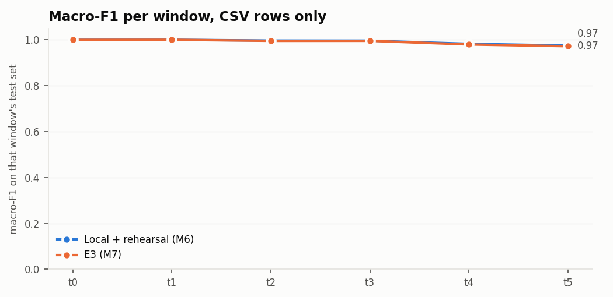

# M9: E4, drift-triggered updates, top-K features, adaptive gate (`full` pool)

Run `20261117-090713_m9_e4_full`. Generated by `scripts/m9_e4.py`. Seed 42. Scores use CSV-only rows (D7). Rows reach a client in 10 rounds per window, in random order, because the dataset has no timestamps. Between its update and the next g_t, a client uses its own calibrated output. Top-K limits new trees; older trees keep their splits, so inference still needs every feature.

**Passes missing from this report: ['e4', 'e4_label_free', 'e4_schedule', 'fixed']. They did not finish.**

## Results

| method | window avg | avg excl. t0 | final (t5) | SD over t1 to t5 | class forgetting |
|---|---:|---:|---:|---:|---:|
| Fixed schedule, top-10 | 0.9884 | 0.9861 | 0.9672 | 0.0141 | 0.0012 |
| Fixed schedule, top-10, client guard | 0.9893 | 0.9873 | 0.9678 | 0.0138 | 0.0023 |
| Fixed schedule, top-20 | 0.9895 | 0.9874 | 0.9687 | 0.0133 | -0.0003 |
| Fixed schedule, top-20, client guard | 0.9906 | 0.9889 | 0.9722 | 0.0119 | 0.0016 |
| Fixed schedule, top-30 | 0.9899 | 0.9880 | 0.9707 | 0.0125 | 0.0015 |
| Fixed schedule, top-30, client guard | 0.9911 | 0.9894 | 0.9742 | 0.0113 | 0.0010 |
| ADWIN trigger added to the fixed schedule, top-K | 0.9894 | 0.9874 | 0.9697 | 0.0131 | 0.0028 |
| ADWIN trigger added to the fixed schedule, top-K, client guard | 0.9904 | 0.9886 | 0.9723 | 0.0119 | 0.0007 |
| Local + rehearsal (M6) | 0.9914 | 0.9898 | 0.9747 | 0.0108 | 0.0027 |
| E3 (M7) | 0.9901 | 0.9882 | 0.9716 | 0.0121 | 0.0005 |
| E3 (M7), client guard | 0.9914 | 0.9897 | 0.9746 | 0.0108 | 0.0028 |

No `fixed` pass in this report, so nothing was checked against M7.

## Recovery inside each window

For E3, the old model and its g_t serve until the window ends. `mean over rounds` is macro-F1 averaged over the rounds of the window, with the window-end model as the last of them. `first trigger round` is the earliest over clients. Read the time to E3's earlier score: a method that already fell before the boundary reaches its own lower score sooner, which isn't a better recovery.

| method | window | own score before the boundary | old model on new rows | after window | mean over rounds | rounds to reach E3's earlier score (share of window) | rounds to reach its own (share of window) | first trigger round |
|---|---|---:|---:|---:|---:|---:|---:|---:|
| E3 (M7) | t1 | 0.999 | 0.462 | 1.000 | 0.511 | 1.0 | 1.0 | none |
| E3 (M7) | t2 | 1.000 | 0.711 | 0.995 | 0.737 | 1.0 | 1.0 | none |
| E3 (M7) | t3 | 0.995 | 0.662 | 0.995 | 0.693 | 1.0 | 1.0 | none |
| E3 (M7) | t4 | 0.995 | 0.809 | 0.979 | 0.825 | 1.0 | 1.0 | none |
| E3 (M7) | t5 | 0.979 | 0.943 | 0.972 | 0.946 | 1.0 | 1.0 | none |
| ADWIN trigger added to the fixed schedule, top-K | t1 | 1.000 | 0.462 | 1.000 | 0.951 | 0.1 | 0.1 | 1 |
| ADWIN trigger added to the fixed schedule, top-K | t2 | 1.000 | 0.699 | 0.995 | 0.962 | 0.1 | 0.1 | 1 |
| ADWIN trigger added to the fixed schedule, top-K | t3 | 0.995 | 0.696 | 0.995 | 0.966 | 0.1 | 0.1 | 1 |
| ADWIN trigger added to the fixed schedule, top-K | t4 | 0.995 | 0.809 | 0.977 | 0.946 | 1.0 | 1.0 | 1 |
| ADWIN trigger added to the fixed schedule, top-K | t5 | 0.977 | 0.944 | 0.970 | 0.954 | 1.0 | 1.0 | 1 |

## Cost

| method | local updates | clients updated, by window | uplink float32 (MB) | uplink 8-bit + zlib (MB) | downlink (kB) | local minutes |
|---|---:|---|---:|---:|---:|---:|
| Fixed schedule, top-10 | 90 | 15 15 15 15 15 15 | 338.6 | 2.0 | 35.6 | 17.1 |
| Fixed schedule, top-20 | 90 | 15 15 15 15 15 15 | 338.6 | 2.0 | 35.6 | 18.3 |
| Fixed schedule, top-30 | 90 | 15 15 15 15 15 15 | 338.6 | 2.0 | 35.6 | 18.3 |
| ADWIN trigger added to the fixed schedule, top-K | 138 | 15 15 15 15 15 15 | 338.6 | 1.7 | 35.6 | 43.5 |

## K sweep, fixed schedule

| K | mean validation macro-F1 | window avg (test) | final t5 (test) | picked |
|---:|---:|---:|---:|---|
| 10 | 0.9855 | 0.9884 | 0.9672 |  |
| 20 | 0.9835 | 0.9895 | 0.9687 |  |
| 30 | 0.9857 | 0.9899 | 0.9707 |  |

## Adaptive gate: choosing the strength

| method | strength | mean errors caught, next window | fixed gate at the same cost | mean escalated, next window | picked on validation rows |
|---|---:|---:|---:|---:|---|

## Gate on test rows

`thresholds_only` is M7's gate. `fixed` adds the proposal's ADWIN flag and equals the adaptive gate at a score of 0. `psi_flag` is the D8 sensitivity run, not a headline. Target 10% (D10). Shown for E3's schedule and E4, at the picked strength; if that is 0, adaptive rows don't appear. All strengths and methods are in `gate_test.csv`. `fixed gate at the same cost` is the errors a fixed gate catches when loosened to the same escalation rate, on the same rows, so it shows whether the drift score adds anything over a looser threshold.

| method | model through | eval window | error rate | mode | strength | escalated | errors caught | fixed gate at the same cost | accuracy on the rest |
|---|---|---|---:|---|---:|---:|---:|---:|---:|

